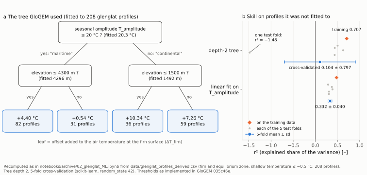
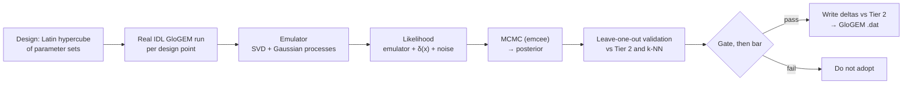
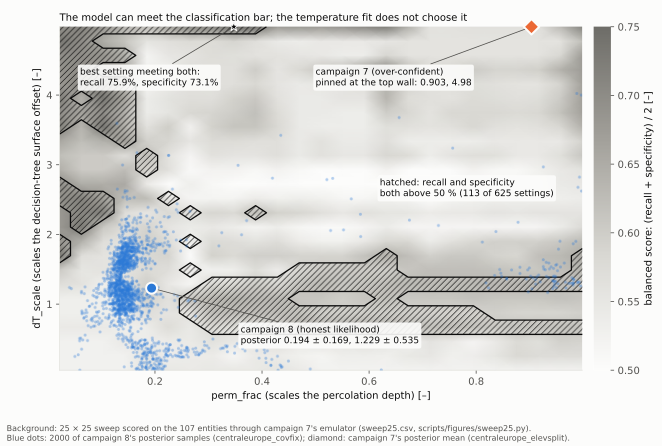

# 1. Starting point: glenglat, the first module and the first calibrations

> **In short.** This chapter covers June to early September 2026: the glenglat borehole data, the
> firn/ice temperature module as first coupled to GloGEMflow, and the calibration ladder built on
> it (Tier 1 and Tier 2 regressions, a k-NN correction, then a Kennedy–O'Hagan Bayesian
> calibration). Eight calibration campaigns in a row failed to deliver the target, and nearly every
> failure turned out to be plumbing, not glaciology. **Main lesson: a calibration can converge
> cleanly and still be wrong. Check that each parameter reaches the physics, that the training
> data are what you think they are, and that you score in the same space you fit in.**

## What we believed

- A few global parameters of the thermal module could be fitted to glenglat, and a transfer model
  could carry them to every glacier.
- The missing firn warming could be added empirically: a Cuffey & Paterson exponential profile,
  `T(z) = T_maat + ΔT_firn · exp(−z/z0)`, with `ΔT_firn` taken from a decision tree fitted to
  glenglat.
- Three parameters would be enough:

  | parameter | what it scaled |
  |---|---|
  | `perm_frac` | meltwater percolation depth, as a fraction of the Herron–Langway firn–ice transition depth |
  | `dT_scale` | the decision-tree firn-warming offset added to the surface temperature |
  | `z0` | e-folding depth of the initial exponential profile |

- `perm_frac` could not be identified from annual-mean borehole data, so it could be fixed at 1.0
  (GloGEM `d5628b1`, icetemp `a8e8deb`, both 2026-06-29). This conclusion came from the Python
  analytical surrogate (a closed-form stand-in for the model), not from GloGEM itself. It turned
  out to be wrong (see *What was wrong*).
- The target was point-temperature RMSE (root-mean-square error). We expected a well-built
  Bayesian calibration to beat simple regressions on it.

## What we measured

### The data: glenglat

glenglat is the global englacial temperature database (Jacquemart et al.), included in the repo as
a git submodule.

| scope | size |
|---|---|
| global calibration, June 2026 | 33 glaciers, 2423 measurements; readings above 0 °C (11.2 % of the raw data) removed as non-physical |
| CentralEurope, after the elevation split (Aug 2026) | 25 physical glaciers → 116 entities (one per glacier and 10 m band); 111 with a thermal label; 107 the emulator can score; 695 usable depth rows |
| CentralEurope labels | 56 `equilibrium=true`, 36 estimated, 24 unassessed; 89 with firn (accumulation-zone) observations, 27 with ice (ablation-zone); 37 with data below 30 m |
| per-borehole uncertainty | given for 551 of 835 boreholes |

Two caveats apply to every number in this book. First, boreholes are drilled where the thermal
structure is interesting, so the sample over-represents cold and polythermal glaciers compared with
the Alps as a whole. Second, of the 111 labelled entities, 82 are cold and 29 warm (27 polythermal,
2 temperate). A method can score well just by calling everything cold.

### The module by the end of June 2026

`firnice_temperature_model.pro` is older than this project. It came with the original GloGEM files
(`95c7b76`, 2025-01-21), and a permeability option and SIA advection were added in March–April
2025. In June 2026 it was coupled to GloGEMflow velocities (`a9cb358`, `4b80a07`, `5b1aa21`).

By the end of June 2026, for each 10 m elevation band and every month, it:

- conducts heat through a layered column (10 × 1 m, then 5 m, then 20 m layers; 259 m deep until
  `dad18bf` extended it to 519 m on 2026-08-31);
- refreezes melt and rain (`fit_water = mel + plg`) layer by layer against each layer's cold
  content, in firn bands down to `perm_limit` = Herron–Langway depth × `perm_frac`. Glacier ice is
  treated as impermeable;
- sets the surface to air temperature plus `dT_scale` × the decision-tree offset (× 0.4 on ice
  bands), capped at 0 °C;
- adds advection, a geothermal flux at the base, and a cap at the pressure-melting point (PMP).

Changes in the first two weeks:

| date | GloGEM commit | change |
|---|---|---|
| 2026-06-19 | `035c46e` | exponential initial profiles; `ΔT_firn` from a 4-leaf decision tree (CART) fitted to 208 glenglat profiles: split on seasonal amplitude `T_amplitude` at 20 °C (maritime/continental), then elevation (4300 m / 1500 m); leaves +4.40, +0.54, +7.26, +10.34 °C |
| 2026-06-22 | `46b2e0c` | lapse-rate floor of 6.5 K/km for the thermal `T_maat`: ERA5's ~4 K/km, fitted over terrain below ~2400 m, gave a +4–5 °C warm bias at 3500–4500 m |
| 2026-06-24 | `3ad1706` | optional implicit solver; profile output at the borehole elevations |
| 2026-06-26 | `780520a` | per-band Herron–Langway percolation depth; per-band calibration scalars and the calibration-file readers; optional thermal spin-up |
| 2026-06-29 | `d5628b1` | offset × 0.4 (`ICE_FRAC`) on ice bands; `perm_frac` dropped from the transfer model |

The decision tree was weak out of sample. The depth-2 tree used in GloGEM explained 71 % of the
variance on its training data (r² 0.707), but only r² = 0.104 ± 0.797 under 5-fold
cross-validation (fit on four fifths, test on the fifth left out). A one-variable linear fit on
`T_amplitude` scored 0.332 ± 0.040. The large ± means the tree's skill depended on which boreholes
happened to be in the test fold.



### First validation against boreholes

The first comparison matched each CentralEurope borehole reading to the modelled profile at the
same year, month and nearest band (archive notebook 04; the runs are not individually dated):

| run | bias (°C) | RMSE (°C) | R² |
|---|---|---|---|
| A — analytical initial profile | −2.91 | 4.36 | 0.167 |
| B — thermal spin-up, fixed 30 m percolation | −3.20 | 4.71 | 0.081 |
| C — thermal spin-up, Herron–Langway depth | −3.15 | 4.74 | 0.014 |
| D — 2-parameter calibration | −1.75 | 3.40 | 0.493 |
| E — D + advection | −1.63 | 3.40 | 0.494 |
| F — no refreezing | +2.01 | 4.11 | 0.258 |
| G — 3-parameter calibration + spatial k-NN correction | +3.82 | 5.42 | −0.282 |

The uncalibrated runs were about 3 °C too cold, and the thermal spin-up made that slightly worse.
Calibration roughly halved the bias. Switching refreezing off, or adding the k-NN correction, swung
the bias warm, and the k-NN made the fit worse than simply predicting the mean (negative R²).

### The calibration ladder

"Tier" is this project's own name for a coverage ladder, not standard terminology:

```
 TIER 1  fit each borehole glacier on its own          only glaciers with boreholes
    │    (grid search against an analytical surrogate,  (~25 Alpine)
    │     capped at 80 m depth)
    ▼
 TIER 2  predict the parameters from climate            every glacier (~4000 Alpine)
    │    param = f(T_maat, T_amplitude, elevation)
    ▼
 TIER 3  Bayesian correction on top of Tier 2           same boreholes, plus honest
         emulator + spatial discrepancy + noise          uncertainty; written out as
                                                         DELTAS relative to Tier 2
```

Tier 1 and 2 (archive notebook 05, global, 70/30 split by region) cut the validation RMSE from
5.26 °C with default parameters to 2.44 °C with the transfer model. The k-NN step then copied a
neighbour's residual at full strength, up to 650 km away, and made things worse (run G above).
It was replaced by Tier 3 on 2026-07-08 (icetemp `a9494d0`, GloGEM `26a526a`) and kept only as a
comparison baseline.

### Tier 3: the Kennedy–O'Hagan calibration

The idea in one line: **measured = model(parameters) + a smooth spatial bias + noise.** The spatial
bias δ(x) is a Gaussian process (a smooth surface fitted to the residuals that also reports its own
uncertainty). The real IDL model is too slow to call thousands of times, so an **emulator** stands
in for it: a fast statistical copy trained on real runs (SVD of the output profiles + Gaussian
processes, `surmise` PCGPwM). A random-walk sampler (MCMC, `emcee`) then maps which parameter values
fit the data; the result is the **posterior**.



*Leave-one-out (LOO)*: hold one glacier out, calibrate on the rest, predict the held-out one, and
repeat for every glacier. It is the honest test of how the method does on a glacier it has not
seen.

Before 2026-07-15 (icetemp `643eff0`) real training runs never completed: batch mode looped over
every RGI region, and the runs competed with other GloGEM jobs for CPU.

### Campaigns 1–4 (CentralEurope, July – mid-August 2026)

Each campaign changed one thing. All fixed `perm_frac` = 1.0 and calibrated `dT_scale` and `z0`.
LOO RMSE was scored through the analytical surrogate at the time.

| # | run tag (`data/bayescal/`) | what changed | sampler | KO LOO RMSE (Tier 2 / k-NN) | verdict |
|---|---|---|---|---|---|
| 1 | `centraleurope_bayescal` | 18 glaciers, 100-point design | R-hat ≈ 1.2; `dT_scale` pinned near its 0.2 floor | not recorded | reject |
| 2 | `…_25glaciers` | 25 glaciers, same design: is it data sparsity? | R-hat barely moved; still pinned | 2.649 (2.113 / 3.091) | reject |
| 3 | `…_25glaciers_thetaexp` | 145 points: is it emulator coverage? | R-hat 1.0, but at `dT_scale` ≈ 3.93, where there was no training run | 4.561 | reject |
| 4 | `…_25glaciers_thetaexp_v2` | 245 points, dense over `dT_scale`, trust-gate fix | R-hat ≈ 1.0, `dT_scale` ≈ 1.68, the first interior result | 4.687 | reject on RMSE; best classification |

*R-hat* compares independent sampler chains; about 1.0 means they agree. The run directories were
last modified between 2026-07-21 (campaign 1) and 2026-08-18 (campaign 4). Exact start dates were
not recorded.

What the four campaigns seemed to show: three independent fixes (more data, a wider design, a
fixed trust gate with a dense design) did not get the Bayesian method past the simple baselines.
We read that as a physics gap. That reading turned out to be premature.

### A second target: thermal classification

The deliverable is not point temperatures. It is to find **where** glaciers are polythermal, for
hazard assessment, and a cold/polythermal/temperate label is a more forgiving target. So
`thermal_structure.py` classifies each profile, with **the same rule for model and observations**
(an earlier draft judged the model more generously, and was corrected on Janosch's instruction):

- a reading is temperate if it lies within tolerance of the depth-dependent PMP, about
  −0.067 °C at 100 m, using GloGEM's own formula;
- the tolerance is the borehole's own glenglat uncertainty, or 0.2 °C where none is given;
- two confidence flags travel with each label: *robustness* (does the label flip anywhere between
  0.05 and 0.5 °C tolerance? only 4 of 24 glaciers did) and *elevation spread* (were boreholes more
  than 100 m apart in elevation pooled into one label? 9 of 24).

An adoption rule was agreed, **gate then bar**:

- **Gate** (is the fit trustworthy?): R-hat ≤ 1.05, and at least 5 real training runs within 0.5
  standardised units of the posterior mean.
- **Bar** (is it better?): beat both baselines on accuracy **and** polythermal recall (the share
  of truly polythermal glaciers it finds).

Checked against history: campaigns 2 and 3 fail the gate. Campaign 3 would have passed the bar on
its own, which is the case that shows the gate cannot be skipped. Campaign 4 passed both, with
accuracy 66.7 % vs Tier 2 45.8 % / k-NN 41.7 %, and polythermal recall 44.4 % vs 22.2 % / 0 %.
These are the values after a tolerance-lookup bug was fixed (below).

## What was wrong

Most of this surfaced on 2026-08-18/19, while writing a technical description of the model for a
conference talk. Each item was checked in the code and, where possible, measured.

| # | defect | consequence |
|---|---|---|
| 1 | **`z0` never reached the physics.** It is read only when building the initial profile, and the calibration overrides are applied *after* that step. | every campaign was a one-parameter calibration dressed as two; `z0`'s posterior just returned the prior |
| 2 | **`perm_frac` was fixed because of a surrogate artefact.** In the Python surrogate `perm_frac` and `dT_scale` enter only as a product, so they cannot be separated. In GloGEM they are different mechanisms (percolation depth vs surface offset). | a real parameter was thrown away |
| 3 | **KO was fitted in one space and scored in another.** The fit used the emulator of the real model; LOO scoring ran every method through the surrogate. | the two differ by 2.702 °C on average, more than Tier 2's whole LOO RMSE (2.113 °C) |
| 4 | **Three physics bugs were active in every campaign.** B1: the guard `ABS(MAX(w))` switched off upward (emergence) advection in every ablation zone. B2: the horizontal velocity profile was `(1 − j/tt)^4` in layer-index space instead of the Nye profile. B4: the basal condition was not a flux condition, giving ~0.004 K/m instead of G/k ≈ 0.029 K/m. | wrong forward model; fixed 2026-08-18 and committed inside `dad18bf` (2026-08-31) |
| 5 | **Training data were duplicated.** GloGEM writes every run to the same file names. A design point skipped as "already done" re-read whatever run was last on disk. | 99 of 145 outputs duplicated in campaign 3 (68.3 %), 144 of 245 in campaign 4 (58.8 %) |
| 6 | **The trust gate misbehaved** (the gate refuses parameter values too far from any training run). When it found no clear error jump, its fallback trusted out to the farthest distance ever tested: 6.12× the typical design spacing in campaign 3, far too loose. After that was fixed, the radius, still read off an error-vs-distance curve, landed at 1.00× the spacing in campaigns 4 and 5: too tight. The allowed region shattered into islands (9 in campaign 5) that trapped the sampler. | campaign 3's false optimum; a fake two-peaked posterior in campaign 5; campaign 4's clean result was partly luck (its optimum happened to sit inside an island). Now: radius = 2 × the median spacing between design points |
| 7 | **The tolerance lookup never matched.** Borehole IDs were integers in one table and strings in the other. | every glacier silently got the 0.2 °C default |

Defect 5 explains much of defect 6. With most outputs identical, the error-vs-distance curve had
nothing to fit, so it came out flat. It also retracts an early claim that the physics fixes added
+2.6 °C of warming, which had been measured against a skipped design point. The lesson we kept:
never use a stored output as a baseline without checking that the run actually happened.

## What we changed and why

### Campaigns 5–8 (2026-08-18 to 2026-09-01)

| # | run tag | what changed | result |
|---|---|---|---|
| 5 | `centraleurope_physicsfix_pf_dt` | B1/B2/B4 fixed; calibrate (`perm_frac`, `dT_scale`), `z0` fixed at 15 m; score through the real-model emulator; clean data (0 of 150 duplicated) | **first KO win on temperature**: LOO RMSE 1.666 vs Tier 2 2.257, k-NN 2.912 (22 glaciers). But both parameters pinned at the bottom of the design, and polythermal recall 22.2 %, only tying Tier 2 |
| — | diagnosis, 2026-08-19 | why recall stayed low | **the emulator could not see the temperate ice**: 257 of 527 depth observations (48.8 %), mostly deep (median 64 m vs 18 m kept), had no model row. 5 of 10 polythermal glaciers looked 100 % cold to the calibration. Causes: the column stops at the band thickness, and all of a glacier's boreholes were pooled at one elevation (Grenzgletscher's 2015–4485 m boreholes all placed at 4450 m) |
| 6 | `centraleurope_physicsfix_widened` | design extended below the floors | abandoned: its training runs no longer matched the entity definitions after the split |
| 7 | `centraleurope_elevsplit` | one entity per glacier and 10 m band: 24 → 111 entities; emulable depth rows 270 → 695 | posterior flipped to the **top** wall (`perm_frac` 0.903, `dT_scale` 4.98); KO RMSE 2.033 but recall 16 %; gate failed |
| 8 | `centraleurope_covfix` (code in icetemp `8c316a0`, 2026-08-31) | honest likelihood (see below) | all four gates pass; posterior interior (`perm_frac` 0.194 ± 0.169, `dT_scale` 1.229 ± 0.535); KO RMSE 1.992, best of three; recall 6.9 % vs Tier 2 55.2 % |
| 8b | rescored, icetemp `5bf3522` (2026-09-01) | fixes to the validation path (below) | KO recall 24.1 %, balanced 56.9 % vs Tier 2 60.5 %; KO RMSE 2.565 vs 3.895 / 3.253. **Verdict unchanged** |

**The honest likelihood (campaign 8).** The likelihood (how probable the data are for given
parameter values) was 13× over-confident. A calibration check that should read about 1 (the
misfit divided by the misfit the likelihood expects, *Mahalanobis/n*) read 13.0 at campaign 7's
posterior. Three problems:

- the spatial Gaussian process's own fitted noise (4.77 °C²) had been thrown away in favour of
  glenglat's thermistor precision (median 0.10 °C²), while the real scatter within one borehole
  is about 2 °C;
- the emulator's uncertainty was used as independent per-row errors. In fact it has only 6 free
  directions, and treating them as independent understated the whole-profile warm/cold shift, the
  direction `dT_scale` moves, by more than 200×;
- campaign 7's sampler had settled 223 log-units below the best point a plain grid search found,
  while still reporting R-hat 1.00. Clean convergence numbers certified nothing.

The fix was a fixed model-error term (3.5 °C², correlated over 15 m of depth), the full emulator
covariance, and elevation in the spatial Gaussian process. The check fell to 1.34, and the
posterior widened 186×.

**Accuracy was the wrong yardstick.** Calling every entity cold scores 73.9 % accuracy for free.
The bar became: **recall and specificity both above 50 %** (warm glaciers found, cold glaciers
correctly left alone), then beat both baselines on the **balanced score**, their mean. Two gates
were added: Mahalanobis/n within [0.5, 2.0], and the MCMC mode within 5 log-units of an
independent grid search.

**The validation fixes of 2026-09-01 (`5bf3522`).** KO's leave-one-out step translated its
residual into parameters by inverting the *surrogate*. That pushed 48.6 % of folds onto the lowest
allowed `dT_scale` (the coldest setting), which alone could explain "KO predicts cold everywhere".
The folds were also leaky: other bands of the held-out glacier stayed in training. And the truth
labels were capped at 80 m, which hid the deep tongue rows the elevation split had recovered. After
the fixes only 4.5 % of folds were pinned. Ground truth is now uncapped, because capping it would
have relabelled Tête Rousse, observed to 70 m, as cold.



## What is still open

At the end of this phase the Bayesian method was the best **temperature** predictor and still
failed the **classification** bar. Open at that point:

- **Capability vs selection.** In-sample, 113 of 625 parameter settings put both recall and
  specificity above 50 % (best 75.9 % / 73.1 %). Only 3.3 % of campaign 8's posterior did. The
  temperature likelihood is dominated by the 82 cold entities and favours a cold answer.
- **Tier 2's pass is not proven either.** The 29 warm entities come from only 15 glaciers.
  Resampling whole glaciers (the honest way, since bands of one glacier are not independent) gives
  Tier 2's campaign-8 recall an interval of 0.31–0.84, indistinguishable from a coin flip. KO's
  failure is clear: 0.00–0.31.
- **The sign of the physics gap is disputed.** One measurement found cold entities ~4 °C too warm;
  every other framing said "too few warm glaciers found". They were measured at different
  parameter values and were never reconciled.
- **The emulator is stale.** It was trained on the 259 m grid, before `dad18bf`. Any application
  run needs retraining at a pinned commit.
- **Depth coverage.** The model's column was too shallow for many boreholes. The elevation split
  fixed the pooling part, not the thickness part. This comes back in chapter 3.
- **The parameters themselves.** A per-glacier test on 2026-09-08 asked whether one shared set of
  (`perm_frac`, `dT_scale`) exists at all. It led to the redesign in chapter 2.
- Not yet done: the gate thresholds (0.5, 5 points, 1.05) are a reasoned starting point from three
  campaigns, not fitted values; the "shallow-only, possibly seasonal" confidence flag was never
  implemented.

## Sources

- Memory notes: `project_bayesian_icetemp_calibration.md` (campaign history, trust gate, data
  duplication, classification, campaigns 5–8); `ref_depth_likelihood_review_2026-08-20.md`;
  `ref_depth_likelihood_review2_2026-08-20.md`; `ref_scoping_plan_2026-08-31.md`;
  `feedback_advection_always_on.md`
- Fact sheet: `glogemflow_icetemp/TALK_FACTSHEET.md` (talk of 2026-08-24; note that its "6.9 %
  vs 55.2 %" headline was superseded by `5bf3522`)
- Notebooks (archived): `notebooks/archive/02_glenglat_ML.ipynb` (CART, cross-validation),
  `04_firnicetemp_validation.ipynb` (runs A–G), `05_firnicetemp_calibration.ipynb` (Tier 1/2)
- Campaign configs: `config/bayescal_centraleurope*.yaml`; runs in `data/bayescal/`
- GloGEM commits: `95c7b76`, `a9cb358`, `4b80a07`, `5b1aa21`, `035c46e`, `46b2e0c`, `3ad1706`,
  `780520a`, `d5628b1`, `26a526a`, `461cf33`, `dad18bf`
- icetemp commits: `02999e7`, `880a0a3`, `a8e8deb`, `a9494d0`, `a374a60`, `643eff0`, `8c316a0`,
  `5bf3522`

## Glossary

| term | meaning |
|---|---|
| B1, B2, B4 | the physics bugs found in the July–August campaigns (listed in the text) |
| CART | classification and regression tree: the decision tree that set the initial firn warming ΔT_firn from seasonal amplitude and elevation |
| emulator | a fast statistical copy of the model, trained on real runs |
| ERA5 | the ECMWF reanalysis (the climate input) |
| glenglat | the global englacial temperature database (Jacquemart et al.), the borehole data |
| IDL | the programming language of GloGEM |
| k-NN, NN | k nearest neighbours: a correction taken from the most similar calibrated glaciers |
| KO | Kennedy–O'Hagan: Bayesian calibration with a model-discrepancy term |
| LOO | leave-one-out: hold one glacier out, calibrate on the rest, predict it |
| MCMC | Markov chain Monte Carlo: the random-walk sampler that maps the parameter posterior |
| perm_frac | the old permeability fraction: the share of the firn column meltwater could reach (replaced in chapter 2) |
| PMP | pressure-melting point: the highest temperature ice can have at its depth |
| RGI, RGI6, RGI7 | Randolph Glacier Inventory (glacier outlines and IDs), versions 6 and 7 |
| RMSE | root-mean-square error between model and measurement |
| SIA | shallow-ice approximation (the flow model used for advection velocities) |
| SVD | singular value decomposition: compresses the output profiles for the emulator |
| T_amplitude | seasonal air-temperature amplitude (maritime against continental climate) |
| T_maat | mean annual air temperature at the band |
| Tier 1, Tier 2, Tier 3 | the calibration ladder: per-glacier fits (1), regressions of the parameters on glacier properties (2), the Kennedy–O'Hagan Bayesian calibration (3) |
