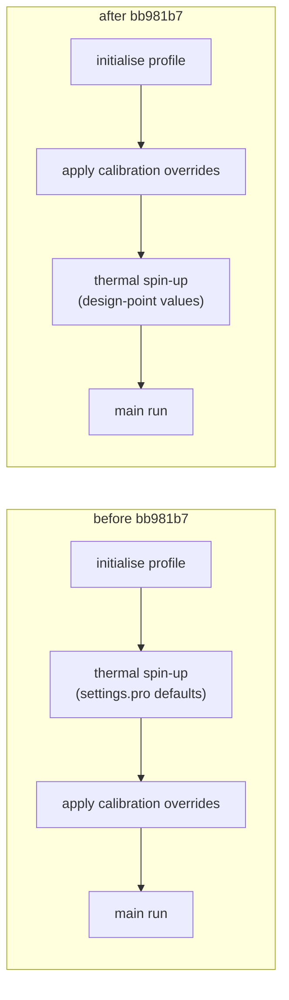

# 2. Parameter redesign: from `perm_frac` / `dT_scale` to `f_ref`, `f_ins`, `f_adv`

> **In short.** In September 2026 the two calibrated parameters were replaced. `perm_frac` barely
> moved the model, and `dT_scale` scaled an empirical offset that was doing the job of a physical
> process the model had lost: the snowpack gave no insulation because density cancelled out of the
> heat equation. The new parameters act on physical processes instead: how much meltwater refreezes
> (`f_ref`), how well snow and firn conduct (`f_ins`), and how fast ice moves (`f_adv`). **Main
> lesson: a weak or over-strong parameter is often a symptom of the implementation, not the
> physics. Read the code path before tuning the number.**

## What we believed

- **`perm_frac` should matter a lot.** Janosch introduced it expecting a large effect: it sets how
  deep meltwater percolates, and latent heat from refreezing is the main warming process in firn.
  On 2026-08-18, a first test on the real model seemed to confirm it (rank correlation +0.618
  with the output). That test was later found to have run on largely duplicated training data
  (chapter 1).
- **`dT_scale` × the CART offset was a legitimate empirical correction.** The decision tree was
  fitted to glenglat warming offsets. It was needed because the initial column was otherwise
  isothermal at the mean annual air temperature.
- **The snowpack insulates the column.** GloGEM tracks snow and builds a density profile, so the
  insulation looked physically represented.
- **A parameter that is declared in `settings.pro` and read from the calibration file acts on the
  model.**

## What we measured

### 1. There is no single shared parameter set (2026-09-08)

A colleague's question, and one that should have come first: before any Bayesian machinery, fit a
few well-observed glaciers one by one and see whether their best parameters agree. Done against the
emulator, all depths, 41 × 41 grid (icetemp `ca37122`, `56d0e08`):

| glacier | n obs | best `perm_frac` | best `dT_scale` | own-best RMSE (°C) | cost of one shared set (°C) |
|---|---|---|---|---|---|
| Grenzgletscher | 275 | 0.022 | 0.175 | 3.19 | +0.03 |
| Glacier des Bossons | 64 | 0.925 | 0.175 | 1.26 | +0.36 |
| Lysgletscher | 46 | 0.657 | 0.052 | 1.66 | +0.06 |
| Hintereisferner | 42 | 0.022 | 2.146 | 0.89 | +2.29 |
| Taconnaz | 40 | 0.071 | 1.530 | 2.78 | +0.87 |
| Gornergletscher | 25 | 0.412 | 4.610 | 0.87 | +0.26 |

(6 of the 11 glaciers shown.) Across all 11, the best values spread over 92 % of the explored range
for **both** parameters. Each glacier fits well on its own (median 0.89 °C), but forcing one shared
set costs a median +0.67 °C. The spread also appears **within** one glacier: Grenzgletscher's 21
bands want `perm_frac` anywhere from 0.022 to 0.998.

Could climate predict the spread? `dT_scale` correlated with elevation (rank correlation −0.65,
p = 0.031). But leaving one glacier out at a time and predicting it from the others was *worse*
than just using the median of the others (skill −31.6 %; −23.0 % with a slightly different
covariate definition, itself a sign the result is not robust). The correlation also lost
significance when Gornergletscher alone was removed (p = 0.115). With 11 glaciers,
transferability could not be shown. The reading: **the parameters were absorbing missing
physics, not describing real glacier-to-glacier differences.**

<!-- FIGURE: per-glacier optima in (perm_frac, dT_scale) space, one marker per glacier sized by n obs, design box outlined; source: notebooks/archive/06_parameter_identifiability.ipynb (figs/parameter_agreement.png) -->

### 2. `perm_frac` barely moves the model (2026-09-10)

Measured on the real model: about **0.1–0.2 °C per standard deviation** of `perm_frac`, against
0.75–1.4 °C for `dT_scale`. The code shows three reasons, none of them physical:

1. **It does nothing on bare-ice bands.** `perm_limit`, the only thing `perm_frac` scales, is used
   in one loop, inside `if firn eq 1`. The ice branch sets the water to zero ("ice is assumed
   impermeable").
2. **The loop runs out of water before it runs out of depth.** Meltwater is used up layer by layer
   against each layer's cold content. Once it is gone, deeper layers are untouched, so a cap on
   depth rarely binds.
3. **It is quantised by the layer grid.** `perm_limit` is an integer layer index. With a
   percolation depth of ~30 m, going from 0.5 to 0.6 moves the limit from 15 to 18 m, inside one
   5 m layer: an identical result.

An earlier test on the corrected physics (2026-08-18) had already hinted at this. Raising
`perm_frac` from 0.2 to 1.0 changed the mean by only +0.22 °C: from exactly 0.000 °C on cold,
high glaciers with no melt (Mont Blanc, Grenzgletscher, Bossons) up to +0.92 °C on melt-affected
ones, with most of the effect gone above ~0.5.

### 3. The snow gave no insulation (2026-09-10)

Found while answering Janosch's question *"is insulation accounted for?"*. Conductivity *k* and
heat capacity *C* were built as the **same** linear mix of ice and air. The air terms are
negligible, so both reduce to (ρ/ρ_ice) × the ice value, and density cancels in the diffusivity
*k/C* that the heat equation actually uses:

```
 old:   k(ρ) ≈ (ρ/1000)·k_ice        C(ρ) ≈ (ρ/1000)·C_ice
        κ = k/C ≈ k_ice/C_ice        → density cancels

        ρ = 250 (snow):  k = 0.583   C = 473 473    k/C = 1.2319e-6
        ρ = 900 (ice):   k = 2.097   C = 1 701 130  k/C = 1.2328e-6   (0.07 % apart)
```

Heat capacity really is close to linear in density; conductivity is not. At 250 kg m⁻³ the old
form gave 0.583 W m⁻¹ K⁻¹ against 0.149 (Calonne 2011) and 0.088 (Sturm 1997), with Yen (1981)
about 9 % above Calonne: roughly 4× too conductive. Real snow diffuses heat at roughly 0.28× the
rate of ice; GloGEM gave 1.00×.

### 4. The CART offset was doing insulation's job, badly

If the physics cannot insulate, something else must warm the firn. That was the CART offset: every
month, every band, `T_surf = min(0, T_air + dT_scale · dT_firn_band)` (× 0.4 on ice bands). It is
a **permanent boundary condition**, so a spin-up cannot wash it out. Evidence, mostly from
2026-08-20:

- **It dominated the firn temperature.** On RGI7 01225 (the Gorner complex; its flowline is the
  Grenzgletscher branch), with coupled flow, spin-up and strain heating on, a converged spin-up
  gave, at 4495 m and 1 m depth, −11.22 °C with the offset off, −5.00 °C at the default, and
  −0.00 °C at `dT_scale` = 3. With the offset removed, Colle Gnifetti came out at −11.2 °C against
  ~−12 °C measured.
- **It jumped at arbitrary thresholds.** The continental branch has no high-altitude leaf, so
  2000 m and 4600 m got the same +7.26 K. RGI7 01225's seasonal amplitude of 20.49 °C put it just
  past the 20 °C split. That denied it the +0.54 K leaf for cold high firn: a 0.5 °C shift in one
  predictor changed the offset 13-fold. (Chapter 3 shows the Alpine amplitude barely varies at all.)
- **Its model-side check was wrong.** The validation output compared it with
  `(L_f/c_i) · f_rf`, which used a refreezing *fraction* where a mass ratio belongs and predicted
  +46.8 K at 4400–4600 m. A mass-based energy balance gives +0.03 to +0.06 K across the firn
  bands. That, and the offset-off run above, both say the offset up there should be ~0.05 K, not
  7.26 K.
- **It saturated.** Raising `dT_scale` from 4.98 to 25 changed the model by at most 0.004 °C:
  the `min(0, …)` cap pins the surface at 0 °C. At a high-warming setting near campaign 7's
  posterior (`dT_scale` 4.84), 75.5 % of modelled points sat within 0.05 °C of the melting point,
  against 8.2 % of observations. A point stuck at the melting point carries no information about
  the parameter, so the fit could drift to extreme warming almost for free.

This is why `dT_scale` was by far the strongest parameter (0.75–1.4 °C per sd). It was fitted
directly to temperatures to make up for insulation the physics did not provide.

### 5. The spin-up never saw the design point (found 2026-08-31, blocking by 2026-09-18)

`glogem.pro` built the initial profile, **then ran the thermal spin-up** (it was `@`-included at
the end of `initialise_firnicetemp_spinup.pro`), and **only then** applied the calibration
overrides. So the spin-up always ran with `settings.pro` defaults. The spin-up runs the full
temperature model, so with it switched on every design point would have produced the **same**
deep state and differed only in the 30-year main run.

The 2026-08-31 review listed this as one reason not to use the spin-up in calibration. It became
blocking once the CART offset was dropped (below), because then the spin-up is where the deep
profile comes from.

## What was wrong

The weaknesses and strengths were **implementation, not physics**:

| symptom | real cause |
|---|---|
| `perm_frac` weak | caps depth in a water-limited loop; dead on ice; quantised |
| `dT_scale` strong | scales an empirical offset standing in for missing insulation |
| snowpack inert | linear mixing for *k* makes density cancel in *k/C* |
| `z0` inert (chapter 1) | read before the overrides are applied |
| spin-up identical across design points | run before the overrides are applied |

Two of these belong to one class that kept recurring: **a parameter is set but never reaches the
code path being calibrated.** The run exits cleanly and writes plausible output. When the new
parameters were first added, the same thing happened again: `insul_scale` and `refreeze_frac`
existed in `settings.pro` but had no references in the calibration-file reader. In the commit's
words, they "were pinned at their defaults while the calibration believed it was varying them"
(fixed in GloGEM `154dc6c`).

## What we changed and why

| date (commit) | change | why |
|---|---|---|
| 2026-09-08 (GloGEM `2b24e54`, icetemp `b0ba1ef`) | `z0` → **`f_adv`** (`advection_scale`): per-band multiplier on the depth-averaged velocity, applied every substep before both advection terms. Placeholder climate-regression transfer model retired | `z0` could never act. `f_adv` reaches the transient model. Janosch: "retire this for now… we want to simplify things" |
| 2026-09-15 (GloGEM `1aef7f6`) | **`f_ins`** (`insul_scale`): real snow/firn conductivity | restore physical insulation (below) |
| 2026-09-18 (GloGEM `d072e0f`) | snow layers assigned by **depth**, not layer count | the old code used a snow depth in metres as a layer count (below) |
| 2026-09-18 (GloGEM `fdd1ecb`) | **`f_ref`** (`refreeze_frac`): fraction of melt + rain that enters the column | act on the water budget, the binding constraint (below) |
| 2026-09-22 (GloGEM `154dc6c`, icetemp `7ba8596`) | calibration slots become (`f_ref`, `f_ins`, `f_adv`) end to end; the reader refuses files with old column names | the columns had been reused three times; an old `z0` of 200 m would have been read as an advection multiplier of 200 |
| 2026-09-22 (GloGEM `bb981b7`) | **CART offset removed**; spin-up moved after the overrides | see below |
| 2026-09-22 (icetemp `e870750`, `cb22f02`) | spin-up a per-run setting; IDL halts detected; pre-flight notebook | see below |

Dates are commit dates. The decisions came earlier: the insulation and refreezing parameters on
2026-09-10, the wiring and the spin-up move in the working tree on 2026-09-18.

### `f_ins`: real snow conductivity (`1aef7f6`)

Two published relations, each inside its valid range (following GEMB, Gardner et al. 2023):

```
 ρ <  900 kg m⁻³ :  k = f_ins · Calonne(ρ),  Calonne(ρ) = 0.024 − 1.23e-4·ρ + 2.5e-6·ρ²
                    capped at k_ice(T)
 ρ >= 900 kg m⁻³ :  k = Yen(T) = 9.828 · exp(−5.7e-3 · T)     (T in K; NOT scaled)
```

- **Only snow/firn is scaled.** Insulation is the *contrast* between snow and ice. Scaling both
  would only change how fast everything diffuses. An early draft made exactly this mistake.
- **The cap matters.** Without it, `f_ins` above ~1.12 lets dense firn conduct better than ice.
- **The prior comes from the literature, not a guess.** At 250 kg m⁻³ the published relations
  sit at 0.59 (Sturm), 1.00 (Calonne) and 1.09 (Yen) of Calonne's value.
- **Result:** snow now diffuses heat at 0.16–0.36× the rate of ice for `f_ins` 0.6–1.4, against
  1.00× before.
- **Side effect:** ice conductivity became temperature-dependent (2.07 W m⁻¹ K⁻¹ at 0 °C). The
  old hard-coded 2.33 is the value at about −21 °C.
- An early draft misquoted Yen's snow relation (running 24 % high). Janosch caught it from the
  paper: the published form is `2.22362·(ρ/1000)^1.885`, valid only for 80–600 kg m⁻³.

### Snow layers by depth (`d072e0f`)

The old code divided snow water equivalent by snow density, which gives a **depth in metres**, and
then used it as a **number of layers**. That only works where layers are 1 m thick. Over 923,040
band-months on 22 glaciers:

| defect | how often | effect |
|---|---|---|
| `fix()` truncation | 77.7 % of band-months | −0.44 m, 11.8 % of the snowpack lost |
| dead zone (under 0.3 m w.e. → zero layers) | 11.1 % of ice bands | 0.55 m of real snow invisible, and **no latent heat** that month (the ice-band refreezing loop runs over snow layers only) |
| depth used as an index below 10 m | 10.65 % | up to +32 m over-assigned |

After the fix, 29 of 110 calibration profiles changed (mean +0.134 °C, maximum 5.11 °C). Some got
warmer and some colder, which is the expected signature. The firn-dominated glaciers were
correctly untouched.

### `f_ref`: scale the water, not the depth (`fdd1ecb`)

```
 perm_frac (old): caps the DEPTH             f_ref (new): scales the WATER
   melt + rain enters in full                  (melt + rain) × f_ref enters
   refreezes layer by layer, runs out          refreezes layer by layer, runs out
   e.g. at 8 m                                 earlier or later depending on f_ref
   depth cap at e.g. 15 m: never reached       → less water, less latent heat,
   → the parameter changes nothing               on firn AND on ice bands
```

`fit_water = (mel + plg) · f_ref`, applied before the firn/ice branch, so it also works on
bare-ice bands, with no quantisation. `perm_frac` survives as a fixed setting for the percolation
depth; it is no longer calibrated.

### Energy and mass stay separate (Janosch's decision, 2026-09-10)

The thermal module's refreezing changes **only the temperature profile**. The mass balance keeps
its own refreezing (`refreezing_parametrised` / `_full`):

```
                        melt + rain
                ┌────────────┴────────────┐
                ▼                         ▼
       MASS BALANCE                  THERMAL MODULE
       refr (8 m column or           fit_water = (mel + plg) · f_ref
       air-temperature proxy)        → latent heat → temperature only
       → balmo = Σ(psg − mel + refr)·area / ar_gl
       (existing MB calibration untouched)
```

**Why.** `refr` enters the mass balance directly, not just runoff. Exporting the thermal module's
refreezing would move the mass balance 1:1 and invalidate the existing, expensive global
calibration. This follows Janosch's earlier call (2026-08-19) that the two refreezing columns can
stay separate.

**The honest cost.** Refreezing is now treated inconsistently between the mass and energy
budgets. A paper must say so. If the two are ever unified, the thermal module should own
refreezing: it has real layer temperatures, the PMP and a proper solver, while `refreezing_full`
is an 8 m duplicate with a known conduction bug, and `refreezing_parametrised` uses an
air-temperature proxy. An August review had proposed the opposite direction, feeding the mass
balance's `refr` into the thermal module; that was rejected for these reasons.

### The CART offset goes, the spin-up moves (`bb981b7`)

"Drop it entirely" (Janosch). The surface is now `min(0, T_air)`, and the initial column is
isothermal at the band's mean annual air temperature. `dT_firn_band` is still computed, but only as
a reference column in the validation output. Insulation now comes from the conductivity, which
responds to the snowpack the model already tracks and so strengthens by itself in winter.

This made the thermal spin-up **mandatory** for calibration: without a prescribed warm offset, the
deep temperature comes from climate alone unless the spin-up runs. So the spin-up `@`-include moved
into `glogem.pro`, after all three override blocks:



### Guards against silent failures (`e870750`, `cb22f02`)

- IDL exits with status 0 even after `% Execution halted`, so dead runs had been marked done and
  skipped. They are now detected. The spin-up became a per-run setting.
- `notebooks/01_parameter_preflight.ipynb` perturbs each parameter alone and checks that the
  profile changes, before any sweep is launched. It exists because of five silent failures the
  project had already hit: unwired parameters, the spin-up running before the override, reused
  `.dat` columns, `settings.pro` overriding the config, and the flow model never starting.

### The new parameter set

| | name | acts on | range | prior |
|---|---|---|---|---|
| `f_ref` | `refreeze_frac` | share of melt + rain that enters the column and refreezes | 0 – 1 | uniform: no directional belief |
| `f_ins` | `insul_scale` | Calonne snow/firn conductivity (low = insulates more) | 0.3 – 2.0 | truncated Gaussian, mean 1.0, sd 0.35 (±2 sd spans Sturm–Yen) |
| `f_adv` | `advection_scale` | depth-averaged ice velocity | 0.3 – 1.7 | truncated Gaussian, mean 1.0, sd 0.25 |

A first check on Grenzgletscher (2026-09-08) confirmed that `f_adv` reaches the output: at 1.5
the column was ~0.4–0.5 °C colder over 80 m than at 1.0, consistent with more cold ice arriving
from upglacier.

<!-- FIGURE: conductivity vs density — old linear mix, Calonne ×0.6/1.0/1.4, Sturm, Yen, with the k_ice cap; and the resulting snow/ice diffusivity ratio; source: settings.pro constants and the tables in GloGEM commit 1aef7f6 -->

## What is still open

- **Can the three be told apart?** Chapter 3: largely not, at first.
- **`writeback.py` still treats slot 3 as `z0`.** Its fallback translation still inverts the
  analytical surrogate, which models the retired CART offset and has no advection term. This must
  be fixed before the next full Bayesian campaign.
- **The spin-up does not run the main run's physics.** Phase 1 has no seasonal snow (so `f_ins`
  acts only through firn density) and no advection (so `f_adv` acts only in Phase 2 and the main
  run). Chapter 5.
- **Advection train/apply mismatch.** Training runs use `enable_advection='y'`. The application
  configs (`config_centraleurope_glenglat_bayes.pro`, `_knn.pro`) and the `settings.pro` default
  still read `'n'` as of 2026-09-24, although Janosch decided on 2026-08-31 that advection is
  always on.
- **Standalone SIA velocity** ignores the band shape factor and overestimates driving stress 2–3×.
  It is the only velocity available in the calibration period.
- **Deferred physics, by decision:** per-glacier parameters (Janosch, 2026-08-19: "`perm_frac`
  certainly needs to vary by glacier"), ice permeability / cryo-hydrologic warming (ice is still
  impermeable), and strain heating (off, and ~900× too small as coded; chapter 4).

## Sources

- Memory notes: `project_icetemp_parameter_redesign.md`, `project_why_perm_frac_is_weak.md`,
  `project_snow_insulation_is_inert.md`, `project_spinup_ran_before_calibration.md`,
  `project_bayesian_icetemp_calibration.md` (per-glacier test; saturation and PMP clamping;
  refreezing columns; `z0` → `advection_scale`), `ref_scoping_plan_2026-08-31.md`,
  `feedback_advection_always_on.md`
- Handoff note: `GloGEM/flow_analysis/firn_offset_handoff.md` (CART offset experiments, 2026-08-20)
- Notebooks: `notebooks/archive/06_parameter_identifiability.ipynb` (per-glacier test),
  `notebooks/01_parameter_preflight.ipynb`
- GloGEM commits: `2b24e54`, `efb382a`, `1aef7f6`, `fdd1ecb`, `d072e0f`, `154dc6c`, `bb981b7`
- icetemp commits: `ca37122`, `56d0e08`, `b0ba1ef`, `7ba8596`, `e870750`, `cb22f02`
