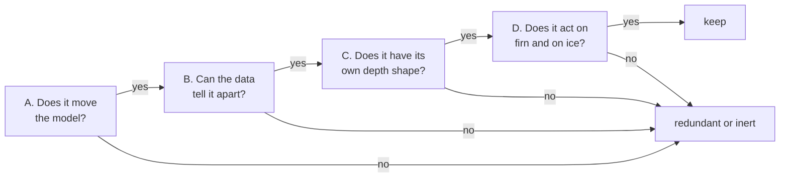
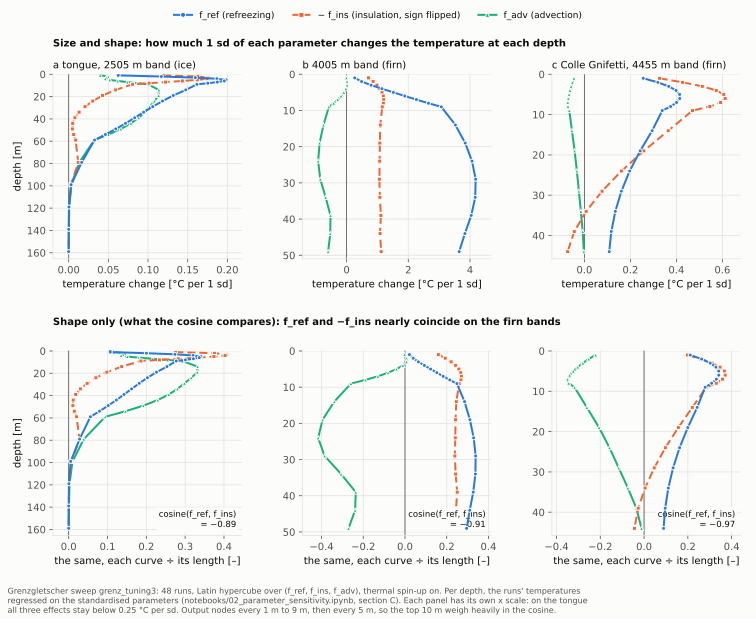
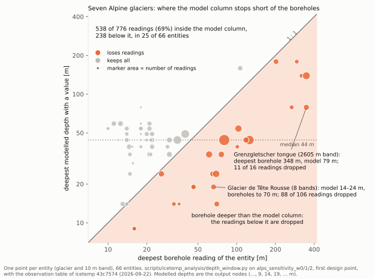

# 3. Why the parameters look alike

> **In short.** The three new parameters stand for three different processes, but the model output
> could not tell two of them apart. Raising `f_ref` and lowering `f_ins` changed the fitted
> temperatures in the same way, on Grenzgletscher and then across seven Alpine glaciers. We looked
> for better parameters: ten candidates were evaluated against the code, and every one scored
> 1–3 out of 10. The fault was not the parameters but the depth window: the model resolved a median
> of 44 m against boreholes reaching 348 m, and silently dropped 238 of 776 observations. **Main
> lesson: identifiability is a property of the parameters *and* the data window. Widen the window
> before blaming the parameters.**

## What we believed

- **Three processes, three identifiable parameters.** `f_ref` adds latent heat, `f_ins` changes
  how well snow conducts relative to ice, and `f_adv` changes how fast colder ice arrives from
  upglacier. Physically distinct processes should leave distinct fingerprints in a borehole
  profile.
- **Seasonal amplitude is a regime axis.** `T_amplitude` separated maritime from continental
  glaciers in the retired CART, and it is one of the three predictors in the Tier 2 transfer
  model.
- **If a parameter proves redundant, a better one can replace it.**

## What we measured

### The four-question test

`notebooks/02_parameter_sensitivity.ipynb` asks four questions, in order. A parameter keeps its
place only if it passes all four:



The measures, in plain words:

- **Strength (A):** °C change in the column-mean temperature per 1 standard deviation of the
  parameter. Below 0.05 °C/sd counts as inert.
- **Confounding (B):** how strongly the data trade one parameter against another (a correlation,
  *rho*, derived from how each parameter moves the model at the observed depths). |rho| > 0.8
  means many different combinations fit equally well.
- **Depth shape (C):** the cosine between two parameters' "temperature change vs depth" curves.
  It ignores size and compares only shape. |cos| > 0.95 means the same shape: one parameter can
  undo the other.
- **Regime (D):** strength on firn entities and on ice entities separately. `perm_frac` failed
  this one (chapter 2).

### Grenzgletscher: 48-point sweep (run 2026-09-18, analysed 2026-09-22)

A 48-point Latin hypercube (a space-filling spread of parameter sets) over (`f_ref`, `f_ins`,
`f_adv`), real IDL runs with the thermal spin-up on, 24 elevation-band entities, 284 matched
observations (run tag `grenz_tuning3`).

| | `f_ref` | `f_ins` | `f_adv` |
|---|---|---|---|
| strength, median over 24 entities (°C per sd) | 1.250 | 1.034 | **0.131** |

| pair | confounded (\|rho\| > 0.8) | median rho | depth-shape cosine |
|---|---|---|---|
| `f_ref` – `f_ins` | **22 of 24 entities** | **+0.98** | **−0.98** |
| `f_ref` – `f_adv` | 15 of 24 | +0.82 | −0.92 |
| `f_ins` – `f_adv` | 13 of 24 | +0.52 | +0.85 |

How to read the first row. Raising `f_ref` warms the column; raising `f_ins` (snow conducts better,
insulates less) cools it, with **the same depth pattern** (cosine −0.98). So raising both together
changes almost nothing, which is why the data correlate their estimates at +0.98. `f_ref` and
`f_ins` are each strong, but together they act as **one knob: net warming or cooling**. `f_adv`
is about ten times weaker.

The same thing showed up in the fit itself. Each parameter's rank correlation with RMSE across
the 48 runs was weak (+0.35, −0.31, +0.21), even though each parameter moves the model strongly:
RMSE depends on the combination, not on any single value. A Bayesian fit against this would return
a long, thin ridge of equally good combinations, and the individual values along it would mean
nothing.

The fit was still better than before. Notebook 03's best run reached an RMSE of 2.75 °C (bias
+0.01 °C) against 3.19 °C for the old `perm_frac`/`dT_scale` pair on this glacier. Two caveats: the
saved notebook output scores only 7 of the 48 design points, and the old number came from runs
without the spin-up.



### Seven Alpine glaciers: 32-point sweep (launched 2026-09-22)

Was this a Grenzgletscher artefact? Grenzgletscher is cold, high and accumulation-dominated, and
`f_ref` needs meltwater to act. So a second sweep spanned seven glaciers from firn-only to
ice-only, with mean annual air temperature from −2.3 to −12.4 °C: Glacier de Tête Rousse, Glacier
des Bossons, Gornergletscher, Grenzgletscher, Hintereisferner, Hohsaasgletscher and Vadret dal
Corvatsch. It had 66 entities and 776 observations (`alps_sensitivity_w0/1/2`; 29 of 32 design
points in the saved notebook output).

| test | `f_ref` | `f_ins` | `f_adv` |
|---|---|---|---|
| A — strength, median \|effect\| (°C per sd) | 0.609 | 0.689 | 0.160 |
| D — on firn entities (51) | 1.226 | 0.955 | 0.172 |
| D — on ice entities (15) | 0.327 | **0.049** | 0.245 |

| pair | B — confounded | B — median rho | C — median depth-shape cosine |
|---|---|---|---|
| `f_ref` – `f_ins` | **51 of 66** | **+0.97** | **−0.97** |
| `f_ref` – `f_adv` | 47 of 66 | −0.00 (sign varies by entity) | +0.97 |
| `f_ins` – `f_adv` | 51 of 66 | +0.34 | −0.91 |

**The degeneracy is not a Grenzgletscher artefact.** It holds across the ensemble. The ensemble
also shows `f_ins` is nearly inert on ice entities (0.049 °C/sd), and that `f_adv`'s depth shape
duplicates `f_ref`'s (cosine +0.97), although the data trade the two off in different directions
on different entities. The notebook's verdict table is still unfilled; by its own thresholds, no
parameter passes all four questions.

### The seasonal amplitude has no range in the Alps (2026-09-22)

Across all 24 base glaciers of the CentralEurope calibration set (111 entities, 1083 observations):

| covariate | range |
|---|---|
| `T_amplitude` (seasonal amplitude) | **17.6 to 21.3 °C** |
| `T_maat` (mean annual air temperature) | −2.3 to −16.0 °C |

The retired CART split "maritime" from "continental" at 20.0 °C, in the middle of a variable with
only ~3.7 °C of total spread. It was partitioning glaciers on noise: glaciers a few hundred metres
apart could land in different leaves. This is a second, independent reason for dropping the CART,
besides its jumps. The same caution applies to the Tier 2 transfer model, which uses
`T_amplitude` as a predictor. The earlier `dT_scale`–`T_amplitude` correlation from the
per-glacier test (rho +0.61, p = 0.048, 11 glaciers, 2026-09-08) should not be read as a regime
signal.

### Ten candidate replacements (2026-09-22)

If two parameters are one knob, can a better second parameter be found? First, an inventory of
every input to the thermal module. Then ten candidates, each analysed against the code and then
handed to a separate reviewer whose job was to **refute** the claim that it was distinct:

| candidate | why it looked separable |
|---|---|
| geothermal flux | acts only at the bed, the one term independent of the surface |
| `perm_frac` | moves *where* latent heat goes, not how much: a shape knob |
| Yen ice conductivity | the exact complement of `f_ins`, which scales only snow and firn |
| heat capacity | absent from the steady state; sets only how deep the seasonal wave reaches |
| water retention | does not exist in the model; would shift refreezing into winter |
| PMP slope | a depth-dependent ceiling, not a source; pure-ice value used, ~32 % uncertain |
| melt-surface fraction | acts only in melt months, only at the surface node |
| firn density | feeds both *k* and *C*, but `f_ins` may already be its proxy |
| lapse rate | shifts the surface temperature systematically with elevation |
| strain heating | concentrated near the bed, but only after fixing a 900× unit error |

**Every candidate ended at 1–3 out of 10.** Geothermal flux, the strongest prior and the only true
bottom-up term, was first scored 7 and corrected to 3. `perm_frac` went from 2 to 1.

## What was wrong

### The fitted depth window was too narrow

The refutations kept hitting the same wall. Measured on the real output of the seven-glacier
sweep:

| | |
|---|---|
| modelled resolved depth | median **44 m** (a quarter of entities ≤ 29 m; only 8 of 66 reach 79 m) |
| deepest borehole | **348 m** (Grenzgletscher tongue, 2605 m band; the model resolves 79 m there) |
| observations inside the modelled column | **538 of 776 (69 %)** |
| observations below it, silently dropped | **238 (31 %)** |
| entities where the borehole outruns the model | **25 of 66** |
| Glacier de Tête Rousse, the frozen-front hazard case | model resolves 19 m of a 70 m column; **88 of 106 observations dropped** |



*Checked on 2026-10-16, when the figure was drawn: the table describes the borehole table of
22 September (icetemp `43c7574`); two entries were corrected then (66 entities, not 65; 79 m resolved
at the deepest borehole, not 41 m). Since the outline reassignment of 13 October (`cf140d0`), the same
check gives 59 entities and 465 of 716 readings inside the model column (Tête Rousse: 138 of 178
dropped).*

On top of that, the bottom node of every column was never written to the output file, so all
basal signal was invisible to the calibration. And 30 of 65 entities were already warmer than
−0.3 °C at their deepest resolved node. At the melting point a bottom-up parameter has exactly
zero effect.

### Why a narrow window makes parameters look alike

To tell two parameters apart, their curves of "temperature change vs depth" must have
**different shapes where there are data**:

```
 depth        f_ref (refreezing)    f_ins (insulation)    geothermal flux
 ──────────   ───────────────────   ───────────────────   ─────────────────
    0 m       0                     0                     0      ← surface = air temperature,
                                                                   no parameter can move it
 14–44 m      rising, flattening    rising, flattening    rising, flattening
              ══════ the fitted window: the same ramp, just scaled ══════
 44–348 m     fades out             fades out             keeps growing to the bed
              ── no model rows here: 238 of 776 observations dropped ──
```

Inside 14–44 m every smooth response is a gentle ramp, and a ramp scaled by a constant is still
the same ramp. Geothermal flux shows it best. Across the fitted rows its effect grows only from
10 to 16 units (1.6×), so **62 % of it is a plain constant offset**, and a constant offset is also
what `f_ins` produces there. Over the rows actually fitted, cos(geothermal, `f_ins`) = 0.98 and
cos(geothermal, `f_ref`) = 0.95. Including the top 10 m makes the parameters look *more* distinct
than they are, because the shared zero at the surface is a constraint, not information.

It is like telling two hills apart through a slot that shows only a patch halfway up each. Both
look like "a slope of about 30°". The summit and the base would tell them apart, and those are
exactly the parts the window cuts off.

There is also an exact cancellation at the bed. For the 38 of 65 entities whose bed lies above
49 m, the bottom layer on firn bands still has firn density, so its conductivity is the scaled
Calonne value. The basal temperature step is then `G · f_geo · dz_bed / (k_Calonne · f_ins)`, and
over most of the `f_ins` range only the **ratio** `f_geo / f_ins` enters. That is the same failure
that made `f_ref` and `f_ins` redundant.

### Some "parameters" were bugs in disguise

Several candidates would have calibrated away numerical errors rather than physics:

- the explicit solver's `/2.` factor, which halves the diffusivity exactly where `f_ins` acts;
- strain heating, about 900× too small (it divides by density twice);
- the conduction stencil, wrong at the 1→5 m and 5→20 m block edges, near the firn–ice
  transition;
- a ~8 % unit mismatch in the cold content (metres of ice compared against metres of water
  equivalent).

A parameter that silently compensates a numerical error gives a model that fits for the wrong
reason. `f_ins` sat right on top of the `/2.` factor, so it may have been absorbing it all along.

## What we changed and why

**Decision (approved 2026-09-22): no new parameters until the depth window is fixed.** The problem
was never "we picked bad parameters". No parameter set can be separated inside a 14–44 m window,
so changing parameters first would only repeat the exercise. The plan fixes the window, then
re-measures:

| # | fix | where it is told |
|---|---|---|
| 1 | write the bed node to the output | chapter 4 (GloGEM `47d0c30`) |
| 2a / 2b | implicit solver; correct stencil on the stretched grid | chapter 4 (`daca009`, `dac9fa4`) |
| 2c | smooth geometric layer grid | chapter 4, not started |
| 3 | run the column to the observed borehole depth | chapter 4 (`6d05a87`) |
| 4 | fix strain heating, then size it against glacier size | chapter 4, not started |
| 5 | re-run the 32-point ensemble and notebook 02; re-measure separability | now part of the spin-up plan (chapter 5) |

Fix 3 lets the borehole, not the ice-thickness product, set the column depth. That is defensible,
because the borehole is direct evidence and the product is a band mean. But it creates a real
inconsistency with the flow and mass-balance modules, which a paper must state.

## What is still open

- **Does the degeneracy survive the fixes?** The ensemble has to be re-run after the depth window
  (chapter 4) and the new spin-up (chapter 5). The honest expectation from the spin-up plan:
  `f_adv` should gain most, since advection is currently switched off during the spin-up.
  `f_ref` and `f_ins` may still look alike, because both mainly shift the annual mean just below
  the seasonal layer.
- **Re-test geothermal flux.** Part of its low score came from the broken stencil smearing its
  effect up the column. With the correct stencil that smearing is gone.
- **`f_ins` on ice.** Nearly inert on ice entities (0.049 °C/sd). Check whether that is physics
  (thin seasonal snow on ice) or another implementation limit.
- **If two knobs remain one,** a choice will be needed: fix one of them, or accept that only their
  combination is calibrated. Per-glacier parameters, which Janosch has argued for, are a separate
  open question. Nothing is decided yet.
- **Covariates for any transfer model** should be checked for range within the region first. In
  the Alps, use `T_maat` or elevation, never `T_amplitude`.

## Sources

- Memory notes: `project_fref_fins_degeneracy.md`, `project_alps_t_amplitude_has_no_range.md`,
  `project_icetemp_depth_window_plan.md`, `project_icetemp_parameter_redesign.md`
- Plans: the approved depth-window plan of 2026-09-22 (its text survives in the session log of
  2026-09-22; its status table is at the end of
  [plans/2026-09-24_thermal_spinup_plan.md](plans/2026-09-24_thermal_spinup_plan.md))
- Session log 2026-09-22: parameter inventory, the ten candidates, the refutation verdicts
- Notebooks: `notebooks/02_parameter_sensitivity.ipynb` (tests A–D; saved output = seven-glacier
  ensemble), `notebooks/03_grenz_three_parameters.ipynb` (Grenzgletscher fit)
- Scripts: `scripts/icetemp_analysis/ensemble_sweep.py`, `depth_window.py` (the 538 / 776 count),
  `ens_summary.py`, `score_sweep.py`
- Runs: `data/bayescal/grenz_tuning3`, `alps_sensitivity_w0`, `_w1`, `_w2`
- icetemp commits: `cb22f02` (notebooks), `43c7574` (sensitivity drivers); GloGEM `bb981b7`
  (the T_amplitude argument for dropping the CART)

## Glossary

| term | meaning |
|---|---|
| CART | classification and regression tree: the decision tree that set the initial firn warming ΔT_firn from seasonal amplitude and elevation |
| depth window | the depths at which model and boreholes are compared |
| f_geo | a scaling of the geothermal heat flux at the bed |
| f_ref, f_ins, f_adv | the thermal model's three parameters since chapter 2: f_ref the share of melt and rain that enters the column and refreezes (code `refreeze_frac`); f_ins the scaling of the snow and firn conductivity, low = more insulation (code `insul_scale`); f_adv the scaling of the horizontal advection |
| IDL | the programming language of GloGEM |
| perm_frac | the old permeability fraction: the share of the firn column meltwater could reach (replaced in chapter 2) |
| PMP | pressure-melting point: the highest temperature ice can have at its depth |
| RMSE | root-mean-square error between model and measurement |
| T_amplitude | seasonal air-temperature amplitude (maritime against continental climate) |
| T_maat | mean annual air temperature at the band |
