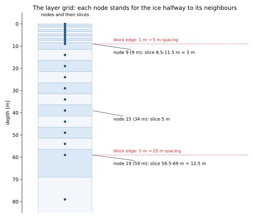
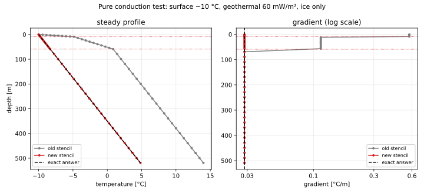
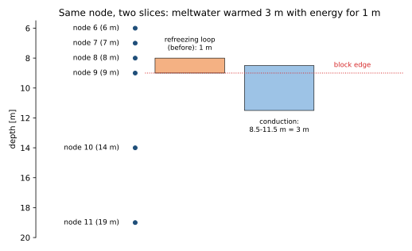

# 4. The depth window: making the model see the boreholes

> **In short.** By September 2026 the three calibration parameters could not be told apart
> (chapter 3). Before swapping parameters we asked a simpler question: *how much of the borehole
> data can the model see at all?* The answer was about two thirds. The column stopped too
> shallow, the bottom node was masked, and the conduction scheme was wrong at the depths where
> firn turns into ice. **Main lesson: check that the model can reach the data before blaming the
> parameters.**

## What we believed

The temperature column ran from the surface to the band's ice thickness, on a stretched grid of
10 × 1 m, 10 × 5 m and 23 × 20 m layers (nodes at 0–9 m, 14–59 m, 79–519 m). We assumed that:

- the column covered the observations;
- the explicit solver, with its `/2.` factor, was an accurate time stepper;
- the conduction formula was correct on the stretched grid.

## What we measured

Matching every glenglat observation in the calibration set against the modelled column:

| | |
|---|---|
| median modelled column depth | **44 m** |
| deepest borehole | **348 m** |
| observations silently dropped (below the column or masked) | **238 of 776 (31 %)** |
| Glacier de Tête Rousse (RGI 00777), the hazard case | **88 of 106 dropped** |

Three separate causes showed up:

1. **The bed node was masked in the output.** The profile writer masked from `tt-2`, one node too
   high, so the deepest modelled temperature was never compared with data.
2. **The column stopped at the inventory thickness.** `thick[]` is a width-averaged band value.
   It badly underestimates small glaciers: Tête Rousse is 19 m thick in the model but has a 70 m
   borehole.
3. **The conduction scheme was wrong where the layer spacing changes.**

### The conduction scheme, explained

Each node stands for a slice of ice reaching halfway to its neighbours:

Heat flow between two nodes is *conductivity × temperature difference ÷ distance*. The old
formula used one distance, the layer's own thickness, for **both** neighbours. That is only
right where the spacing is uniform. At the two block edges (9 m and 59 m) the distance to the
next node is 5× and 4× larger than the formula assumed.

The clean test is a case with an exact answer: pure ice, a fixed surface temperature and the
geothermal flux at the bed. At steady state the profile must be a straight line with slope
*G/k*. Solving both schemes to steady state on the real grid:

The old scheme made the profile a straight line in **layer number** instead of depth. The
gradient was **20× too steep** in the 1 m block and **4× too steep** in the 5 m block. At the
bottom of a 519 m column it put the bed at **+14.0 °C instead of +4.8 °C**. (This test has no
melting-point cap. It isolates the numerical error; it is not a real glacier.)

In real runs this was partly hidden: near the surface the seasonal wave is genuinely steep, and
200 spin-up cycles were too few to build the deep geothermal gradient. A test that looked only at
real profiles could not catch it (notebook 04, section 3 vs 3b).

## What was wrong, and what we changed

| # | fix | commit | effect |
|---|---|---|---|
| 1 | write the bed node to the output (mask from `tt-1`) | GloGEM `47d0c30` | resolved nodes per profile 20 → 21 (Grenz), 10 → 11 (Tête Rousse) |
| 2a | implicit (backward-Euler) solver as default | GloGEM `daca009` | unconditionally stable; changes results by up to 4.2 °C |
| 2b | finite-volume conduction on the non-uniform grid | GloGEM `dac9fa4` | matches the exact steady state; old scheme was 20× / 4× too steep |
| A | output and diagnostic depths (2, 14, 54 m) chosen by depth, not layer index | GloGEM `b64cf35` | survives any future grid change |
| 3 | run the column to the deepest observation where the borehole is deeper than `thick[]` | GloGEM `6d05a87`, icetemp `eef907c` | all 482 observations of Tête Rousse and Grenz/Gorner inside the column |

**Why the explicit solver needed its `/2.`.** An explicit scheme is only stable if the time step
is shorter than about *dz² / 2κ*. For 1 m ice layers that is 5.2 days, but the model steps
10 days. The `/2.` halved the diffusivity, and so the physics, to stay stable. The implicit
solver is stable at any step, so the factor could go (fix 2a before 2b).

**Why fix 3 uses the borehole, not a better thickness.** The borehole is direct evidence that
there is ice at least that deep. Fix 3 only ever deepens the column, to the first node at or below
the deepest reading, never to the nearest node, which could round upwards. A shallow borehole on
thick ice changes nothing.

### A side effect found later: the refreezing slice

Fix 2b gave every node its correct slice of ice for conduction, but the refreezing loop kept the
old one. When meltwater reaches a node, the loop computes how much water it takes to warm that
node's ice to 0 °C, using the layer thickness. At the 9 m node that is **1 m**; for conduction
the same node is **3 m** of ice:

So water that could only warm 1 m of ice warmed 3 m: **3× too much refreezing warming** at 9 m,
and **2.5×** at 59 m (12.5 m against 5 m). Before fix 2b both parts used the thin slice, so they
were consistent, if both wrong. Fix 2b broke that consistency. Above 9 m nothing changed, because
there all slices are 1 m either way. The refreezing loop now uses the same slice as conduction
(`firnice_temperature_model.pro`, GloGEM `f9024f3`).

**Effect** (Tête Rousse + Grenz/Gorner, same parameters, 200 spin-up cycles, runs `latfix` vs
`fix3b`):

| bands | change |
|---|---|
| no meltwater below 9 m (e.g. above 4335 m, Grenz tongue) | none (max 0.000 °C) |
| Monte Rosa firn, 3895–4305 m | **colder**: 30-year mean down to −0.44 °C, largest at 14–49 m; single months up to 3.8 °C |
| Tête Rousse | 30-year mean ≤ 0.007 °C; single months up to 0.7 °C |

Every change is towards colder, as expected when less refreezing heat is released. The large
single-month values come from the timing of when a layer reaches 0 °C, not from a shift of the
mean. This is also a reminder that refreezing (`f_ref`) is sensitive to exactly how the model
divides the column into slices.

## What is still open

- **Geometric grid** (fix 2c): replace the three blocks with layers that grow smoothly (0.5 m at
  the surface, each 12 % thicker than the one above). That removes the block edges entirely.
- **Strain heating** (fix 4) is about 900× too small because of a unit error. Fix it, then check
  whether it matters for glaciers of this size.
- **Re-measure whether the parameters can now be told apart** (fix 5), after the spin-up work in
  chapter 5, which changes the deep temperatures more than any of these fixes.

## Sources

- Plan: the depth-window plan was superseded in place by the spin-up plan; its status table is at the end of [plans/2026-09-24_thermal_spinup_plan.md](plans/2026-09-24_thermal_spinup_plan.md)
- Notebook: `notebooks/04_depth_window_fixes.ipynb` (section 3b: the exact steady-state test)
- Script: `scripts/icetemp_analysis/depth_window.py` (the dropped-observation count)
- Runs: `data/bayescal/ab_explicit_w0`, `ab_implicit_w0`, `ab_stencil_w0`, `stepA_w0`, `fix3_w0`,
  `fix3b_w0`, `latfix_w0`
- Figures: `development_history/figures/make_ch04.py`

## Glossary

| term | meaning |
|---|---|
| depth window | the depths at which model and boreholes are compared |
| f_ref, f_ins, f_adv | the thermal model's three parameters since chapter 2: f_ref the share of melt and rain that enters the column and refreezes (code `refreeze_frac`); f_ins the scaling of the snow and firn conductivity, low = more insulation (code `insul_scale`); f_adv the scaling of the horizontal advection |
| RGI, RGI6, RGI7 | Randolph Glacier Inventory (glacier outlines and IDs), versions 6 and 7 |
