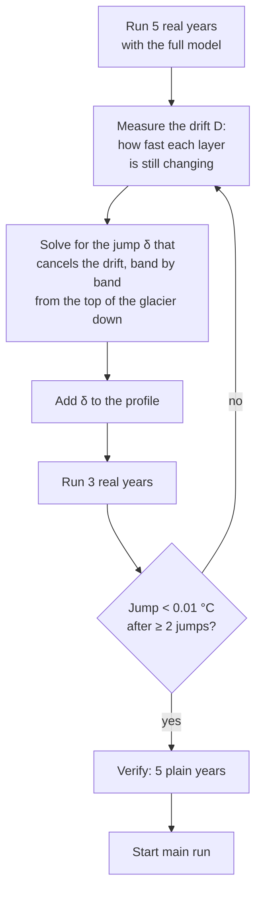

# 5. The thermal spin-up

> **In short.** The boreholes mostly sample ice tens of metres deep, and that ice is almost
> entirely spin-up state: 30 years of main run barely reach it. So the spin-up largely decides
> what the calibration sees. In September 2026 we found that it used one year of climate
> instead of thirty, was too slow to reach equilibrium on thick glaciers, and ran different
> physics from the main run. **Main lesson: the spin-up is part of the model, not a
> preliminary — it must run the same physics, and it must actually reach equilibrium.**
>
> *This chapter is written as the work lands. Status: problems measured and plan approved
> (2026-09-24); Phase 0 in progress.*

## What we believed

The thermal spin-up (`spinup_firnicetemp_thermal.pro`) cycled a 1961–1990 mean climate until
the deep layers stopped changing (≥ 200 cycles, tolerance 0.05 °C), then ran the reference
period year by year up to the start of the main run. We assumed that:

- it used the 1961–1990 climate the setting names;
- 200 cycles reached equilibrium;
- apart from simplifications that do not matter for the deep ice, it ran the main run's physics.

## What we measured

### It used one year of climate, not thirty

Calibration runs load only 1990–2020. The spin-up asked for 1961–1990, found just 1990 and
averaged that single year. 1990 is the third-warmest year of the thirty, **0.8 °C** warmer than
the 1961–1990 mean. The check for a missing period never fired, because it only tests that each
calendar month occurs at least once — and 12 months of 1990 pass.

### It was far too slow on thick glaciers

A column settles towards equilibrium over a time that grows with the **square of its
thickness**, roughly *τ ≈ 4H² / (π²κ)*:

| glacier (RGI7) | settling time τ |
|---|---|
| Glacier de Tête Rousse (00777) | ≤ 15 yr |
| Grenz/Gorner (01225) | up to 391 yr |

Each cycle only closes a fraction of the remaining gap, so thick columns need thousands of
cycles. Against a 3000-cycle brute-force reference (same physics), the error left by each
stopping rule was:

| stopping rule | cycles (00777 / 01225 / 01230) | remaining error °C (00777 / 01225 / 01230) |
|---|---|---|
| 200 cycles minimum, change < 0.05 °C (default) | 200 / 200 / 200 | 0.001 / **0.452** / **0.534** |
| change per cycle < 0.05 °C | 30 / 112 / 100 | 0.018 / 0.683 / 0.981 |
| change per cycle < 0.01 °C | 30 / 254 / 138 | 0.018 / 0.357 / 0.777 |
| projected remaining drift < 0.05 °C | 57 / 500 (cap) / 500 (cap) | 0.010 / 0.126 / 0.091 |

A small change per cycle does not mean the column is close to equilibrium: a thick column
changes slowly *because* it settles slowly. The projected-drift rule is accurate but hits the
500-cycle cap and doubles the runtime (765 s against 366 s for three glaciers). None of these
rules scales to ~4000 Alpine glaciers, let alone globally.

### It ran different physics from the main run

| | spin-up | main run |
|---|---|---|
| ice flow (advection) | off | on |
| snow, rain | none | real snowpack and rain |
| melt | simplified degree-day formula on monthly means | full melt model |
| climate | 1990 only (see above) | 1991–2020 |
| thermal surface lapse rate | at least 6.5 °C/km | reanalysis |
| season | January → December | starts in October |

This matters for calibration: a parameter that does nothing in the spin-up can only reach the
deep ice through the 30-year main run. With advection off, `f_adv` could not shape the deep
state at all.

### Advection matters at equilibrium, but only for large glaciers

Estimated steady-state effect of advection, and how much of it 30 years of main run reach on
the thickest band:

| glacier (RGI7) | vertical | along-glacier | reached in 30 yr |
|---|---|---|---|
| Tête Rousse (00777) | 0.05 °C | 0.01 °C | 86 % |
| Grenz/Gorner (01225) | 0.64 °C | ~2.6 °C (median) | 7 % |
| Monte Rosa east face (01230)¹ | 0.23 °C | ~1.1 °C | 22 % |

¹ Listed as "Grenzgletscher" in glenglat; the RGI7 outline is the Monte Rosa east face.

On Grenz/Gorner the along-glacier effect alone is larger than any calibration parameter's.

<!-- FIGURE: spin-up convergence of the deep layers, brute force vs stopping rules; source: truthref_w0 / truthref2_w0 design_0000.log -->

## What we changed and why

*(Filled in as each phase lands; see the plan for the full reasoning.)*

The approach, in one diagram:

Decisions taken (2026-09-24):

| topic | decision | why |
|---|---|---|
| climate | mean 1961–1990, spin-up ends Sep 1990, main run from Oct 1990 | as the flow-model spin-up does |
| thermal lapse rate | reanalysis below the climate grid point (~2400 m), at least 6.5 °C/km above | ERA5's rate is fitted on terrain up to the grid point; extrapolated 2 km up it makes summits too warm |
| vertical ice motion | the band's annual surface mass balance | kinematic condition at the surface |
| ice arriving from upglacier | mapped by relative depth, with vertical motion in the same coordinate | ice flows roughly parallel to the bed; a thinner band above has no ice at the same absolute depth |
| convergence depth | 15 m | the depth of zero annual amplitude on Alpine glaciers |

## What is still open

Everything in the plan's Phases 1–3: the drift correction, making the spin-up physics match
the main run, then rerunning the sensitivity ensemble.

## Sources

- Plan: [plans/2026-09-24_thermal_spinup_plan.md](plans/2026-09-24_thermal_spinup_plan.md)
- Runs: `data/bayescal/truthref_w0` (3000 cycles, before the refreezing fix), `truthref2_w0`
  (after it), `tol001_w0`, `projdrift_w0`, `longspin_w0`
- Code: `GloGEM/procedures/initialise/spinup_firnicetemp_thermal.pro`,
  `procedures/processing/downscale_gcmdata_monthly.pro`, `procedures/flow/spinup_flowmodel.pro`
