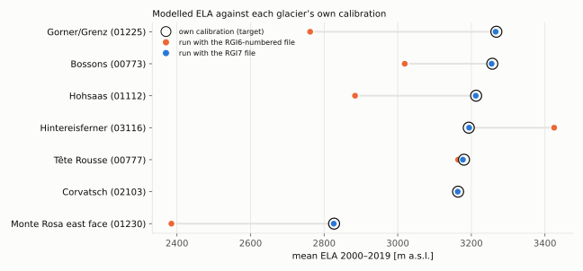
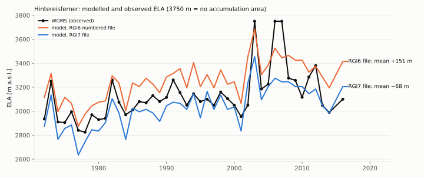

# 6. Firn extent and the mass-balance calibration

> **In short.** Hintereisferner came out about 5 °C too cold, Tête Rousse too warm, and the Grenz
> tongue cooled where the boreholes warmed. We first asked whether meltwater should be allowed to
> warm glacier *ice*. The evidence said no: the problem was **where the model puts its firn**. While
> measuring the firn line against observed ELAs, we found why it was so far off on some glaciers:
> **every ice-temperature training run since August had read the mass-balance parameters of other
> glaciers**, from a calibration file numbered by RGI6 instead of RGI7. **Main lesson: check that
> an input belongs to the glacier it is applied to — by its area, not just its ID.**
>
> *Status (2026-09-29): calibration source fixed and guarded (icetemp `65de865`). With the right
> parameters every glacier reproduces its own calibrated ELA, and the Hintereisferner ELA follows
> the WGMS series. The high firn is now 2–3 °C too warm with the old thermal parameters; a new
> sensitivity ensemble (`alps_r7`) is running to see how the parameters behave under the correct
> mass balance.*

## What we believed

After chapter 5 the thermal spin-up was right, and the model was compared with every borehole at
its own measurement month over October 1971 – September 2025. Three glaciers stood out:

| glacier (RGI7) | model − boreholes | what it looked like |
|---|---|---|
| Hintereisferner (03116) | about −5 °C | temperate boreholes of the 1970s modelled as cold ice |
| Tête Rousse (00777) | about +1.9 °C | the whole glacier temperate in the model, measured −2 °C |
| Grenz tongue (01225) | +2.6 °C in 1979–80, then cooling | the boreholes warmed from 1980 to 2010 |

In Phase 2 of the spin-up work we had switched meltwater heat off on ice bands (`97dfbf2`). The
first question was therefore whether water should be allowed into ice after all.

## What we measured

### Water in ice is not what the boreholes ask for

A literature review, a read of the code and a look at every ablation-zone borehole agreed:

- In the ablation zones the measured profiles always have **cold ice above temperate ice**, never
  the reverse: a cold skin of 15–25 m on small glaciers, a 100–200 m cold core on the Gorner
  tongue. That is the textbook picture of temperate ice formed in the firn area, carried down and
  cooled from the surface each winter (Blatter & Hutter 1991; Pettersson et al. 2003).
- Over all ice sites the model is already **too warm** (+0.5 to +1.1 °C at every depth).
- Every way of letting water into ice warms the ice near the surface and would erase the measured
  cold skins. The most defensible one, refreezing in crevasses (Gilbert et al. 2020), is kept as a
  **backup** for a specific signature that we do not see: a correct cold skin with warm ice missing
  below it, in crevassed bands.

The errors pointed to the firn instead. The model decides per band whether it is firn (meltwater
percolates and warms it) or ice (no water), from its own mass balance. On Hintereisferner its firn
line sat near 3185 m where the real one was about 2950–3000 m; on Tête Rousse every band was firn.

### Three things that were silently wrong in the calibration code

- **The calibration could not run.** Parts of the Python calibration still assumed the retired
  parameter `z0`: the third parameter was held at 15, which the emulator read as an advection
  scale of 15 (allowed 0.3–1.7), far outside every training run, so every proposal was rejected.
  The write-back file carried the same mix-up into IDL (a z0 value in metres in the column IDL
  reads as the advection correction).
- **81 readings never reached the fit.** A reading was matched only to a model node within half the
  node spacing. The nodes sit at 9 and 14 m and at 59/64/69 m, so almost every reading near 10 m —
  the classic firn temperature depth — and those at 61–69 m were skipped.
- **Boreholes without a zone label counted as firn.** glenglat leaves the accumulation/ablation
  label blank for 303 of its 835 boreholes, all six on Hintereisferner among them.

### The firn line against observed ELAs

A new log (`firnice_firnline_<id>.dat`, GloGEM `1b3b0ab`) gives each glacier's modelled ELA, AAR and
firn line for every year. Hintereisferner has an observed ELA series since 1953 (WGMS). The model
followed it well from year to year (correlation 0.81, the right trend) but was about 150 m too
high in every decade. Across the seven test glaciers, the modelled 2000–2019 ELAs also disagreed
with the ELAs the mass-balance calibration itself reports for the same glaciers — by up to 500 m,
in both directions:

## What was wrong

The training runs take the mass-balance parameters (degree-day factor, precipitation factor,
temperature offset) from a calibration file. Since August the campaign settings pointed at a file
from an older **RGI6** setup, while the glaciers themselves come from **RGI7**. Both inventories
number their glaciers 00001, 00002, … — but not in the same order. So the IDs were all found, and
each glacier silently received **another glacier's parameters**:

| RGI7 glacier | gets the parameters of RGI6 "same number" | own RGI7 calibration |
|---|---|---|
| Gorner/Grenz 01225 (56.6 km²) | a 0.012 km² glacier: DDF 3.0, c_prec 1.95, T_off 0.43 | DDF 4.5, c_prec 1.3, T_off 0.67 |
| Hintereisferner 03116 (8.0 km²) | a 0.45 km² glacier: DDF 4.5, T_off 0.35 | DDF 3.0, T_off 0.00 |
| Bossons 00773 (10.9 km²) | a 0.34 km² glacier: T_off 0.04 | T_off 0.79 |

The file had been chosen because the RGI7 calibration then available lacked three of the test
glaciers; "all IDs present" was checked, their areas were not. Gorner, with too much snow, got a
firn line far too low; Hintereisferner, with too much melt, one too high.

With the correct RGI7 calibration (mhuss's, identical to Lander's copy) every glacier reproduces
its own calibrated ELA (figure above), and Hintereisferner follows the WGMS series closely:

| Hintereisferner vs WGMS, 1972–2016 | RGI6-numbered file | RGI7 file |
|---|---|---|
| mean offset | +151 m | −68 m |
| 1970s / 2000s | +116 / +188 m | −102 / −22 m |
| correlation, slope | 0.81, 0.92 | 0.83, 0.97 |

The model's ELA reacts to climate as the real one does. Our earlier suspicion that it reacts
"three times too strongly" came from the runs with the wrong parameters.

## What we changed and why

| step | change | commits |
|---|---|---|
| calibration runnable | `z0` removed from the Bayesian path; all three parameters calibrated; write-back column 4 is the advection correction, measured from IDL's flat defaults | icetemp `1c1fec7`, GloGEM `35ec8ec` |
| borehole labels | firn / ice / unknown; unknowns resolved from the WGMS ELA of the five balance years before the reading (GloGEM's own firn rule). Hintereisferner: 2550–2950 m ice, 3060 and 3150 m firn | icetemp `395f75c` |
| firn line log | ELA, AAR, firn line and firn↔ice flips per year | GloGEM `1b3b0ab` |
| no skipped readings | linear interpolation between the two nodes around a reading: 702 → 783 matched, none lost; fit on the common points unchanged (2.502 → 2.507 °C); raw profiles archived so matching can be redone without IDL | icetemp `49dc985` |
| strain heating | divided by density twice, so ~900× too small; fixed. At full strength it warms the deep ice and worsens the fit at every depth, so it stays off | GloGEM `e9c0cca` |
| calibration source | RGI7 calibration by default; the training setup now stops if a glacier's calibrated area differs from its RGI7 area by more than 25 % (RGI7 file: 0.7 % median; RGI6 file: 93 %) | icetemp `65de865` |

The mass-balance temperature offset T_off reaches the ice-temperature model's surface one to one.
We decided to **keep** it there: it corrects the downscaled air temperature, and the ice should
feel that correction too.

## What the correct mass balance does to the ice temperatures

Same thermal parameters (f_ref 0.87, f_ins 1.01, f_adv 0.94), 783 matched readings:

| zone | RGI6-numbered file | RGI7 file |
|---|---|---|
| Hintereisferner firn boreholes (3060, 3150 m) | −7.7, −8.0 °C | 0.0, −0.4 °C |
| Hintereisferner ice boreholes (2550–2950 m) | −2.2 to −6.9 °C | −4.4 to −5.0 °C |
| Monte Rosa tongue < 3000 m | +0.71 °C | −0.32 °C |
| Colle Gnifetti > 4200 m | −1.19 °C | +1.73 °C |
| Mont Blanc / Bossons | −0.42 °C | +2.95 °C |
| all readings (bias / RMSE) | −0.60 / 2.58 °C | +1.23 / 2.88 °C |

The firn line is now in the right place, and the Hintereisferner firn boreholes are fixed. But the
high, cold firn became 2–3 °C too warm at every depth: more melt and a warmer surface there, which
the thermal parameters — chosen while the mass balance was wrong — no longer compensate. **Every
absolute borehole fit before 2026-09-29 was made with the wrong mass balance**; comparisons between
runs with the same parameters (chapter 5, Phase 2) remain valid as relative tests.

## What is still open

- **How the thermal parameters behave under the correct mass balance.** The 32-point Alpine
  sensitivity ensemble is rerunning with the RGI7 calibration (`alps_r7`).
- **The Hintereisferner ice boreholes** are still 4–5 °C too cold, now with the firn line in the
  right place. This is the one signature that could need water in ice, or advection of temperate
  firn-area ice, and is the next thing to look at.
- **Firn memory** (a band turns to ice only once its firn has melted) and **snowline calibration**:
  both were planned against the "too sensitive" firn line, which turned out to be an artefact.
  To be re-decided after the ensemble.
- **Old measurements:** keep the 1971 start and use the old-versus-new borehole pairs (Colle
  Gnifetti, Grenz tongue, Col du Dôme) as a held-out test of trends.

## Sources

- Plan: [plans/2026-09-28_firn_extent_plan.md](plans/2026-09-28_firn_extent_plan.md)
- Runs: `data/bayescal/firnlog_w0` (RGI6-numbered file), `firnrgi7_w0` (RGI7 file),
  `strainheat_w0` (strain heating on), ensemble `alps_r7_w0` … `w5`
- Calibration files: RGI7 `/scratch_net/iceberg_second/mhuss/r7spec_global_results/monthly/CentralEurope/calibration`;
  the RGI6-numbered one `/scratch_net/vierzack04_fourth/jabeer/GloGEM/output_template_calibrated/r6_monthly/CentralEurope/calibration`
- Observations: WGMS Fluctuations of Glaciers, 2017-06 release (mass-balance overview, ELA)
- Figures: `development_history/figures/make_ch06.py`
- Code: `icetemp/calibration/{calibrator,writeback,validation,runner,data}.py`;
  GloGEM `procedures/processing/finalize_annual_massbalance.pro`,
  `procedures/write/write_firnicetemp_validation.pro`, `procedures/processing/firnice_temperature_model.pro`
