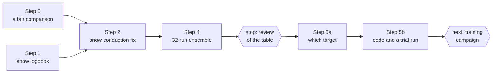
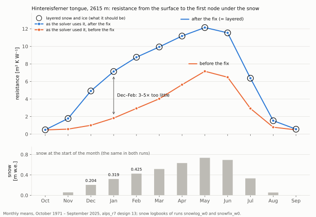
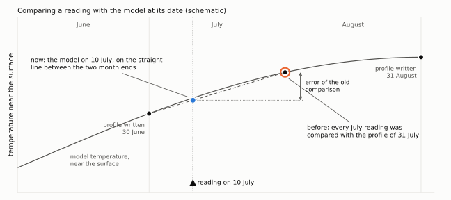
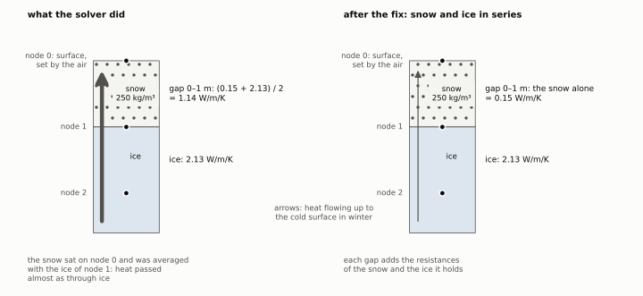
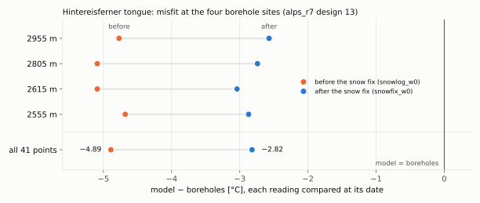
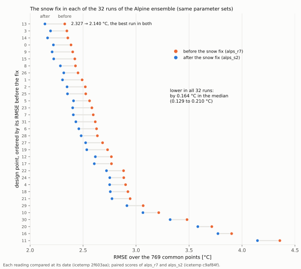
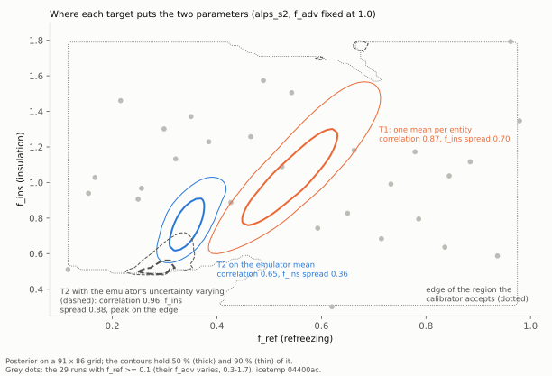

# 7. The snow, the comparison and the calibration target

> **In short.** After chapter 6 the mass balance was right, but the Hintereisferner tongue was
> still 4–5 °C too cold, and no calibration parameter could reach it. Before adding physics or
> calibrating anything, we checked the ruler and the code we already had. The comparison read the
> model at the *end* of each reading's month, profiles dated only to a year were compared with
> January, and "leave one glacier out" kept half of the Colle Gnifetti saddle in training. Worse,
> **the winter snow on glacier ice barely insulated**: across the boundary between snow and ice the
> solver averaged the two conductivities, as if insulation in front of concrete were half concrete.
> Fixing it cut the Hintereisferner tongue's cold misfit from −4.89 to −2.82 °C and the RMSE of all
> ice points from 2.50 to 1.72 °C in the best run. Rerun with all 32 parameter sets of the Alpine
> ensemble, the fix lowered the RMSE in every run (by 0.164 °C in the median) and left the firn
> groups unchanged; the Grenz tongue and Tête Rousse, already slightly too warm, warmed further, so
> something there had been compensating. Apart from the Hintereisferner tongue, still about 3 °C too
> cold, the largest misfits are where the fix does not act: in the firn of Monte Rosa and at
> Corvatsch. Of three ways to compare model and boreholes, comparing every 1 m depth bin (T2) tells
> the two calibration parameters apart at a small cost in RMSE; coded and tried on the Alpine
> ensemble, it works, but the emulator's own uncertainty can still blur the two. **Main lesson: a
> process written into the code is not necessarily what the solver does — test it against an exact
> answer.**
>
> *Status (2026-10-12): Steps 0–2 and 4 done (icetemp `2f603aa`, `161f993`, `c9af84f`; GloGEM
> `3b33e4b`, `c400a50`), and the spin-up check passed. The fix stays. Step 5a chose the target T2
> (one misfit per 1 m depth bin; decisions of 2026-10-12), and Step 5b coded it (icetemp `19559dc`,
> `638ad43`, `04400ac`). A trial calibration on the Alpine ensemble works, but shows that the
> emulator's own uncertainty pulls T2 to the edge of the trusted region: how to handle that is the
> open decision before the training campaign. Firn memory and the snowline calibration were left out
> (chapter 6); borehole l9b stays as listed.*

## What we believed

After chapter 6 every training run used its own glacier's mass balance, and the firn line sat in
the right place. The best of the 32 Alpine runs (`alps_r7`, design 13: f_ref 0.52, f_ins 1.09,
f_adv 1.05) left two misfits: the Hintereisferner tongue ice, −4.4 to −5.0 °C at its four sites
(41 points), and Colle Gnifetti below 40 m. We believed that:

- **the cold tongue was the model's own equilibrium**, under a surface averaging about −5.5 °C, and
  that some process real tongues have was missing (chapter 6 listed winter snow insulation,
  refreezing of snowmelt in spring, and water in crevasses);
- **the winter snow already insulated the ice.** Chapter 2 had given snow its own conductivity
  (GloGEM `1aef7f6`) for exactly that purpose;
- **the comparison was fair**: since 28 September each reading had been compared with the model at
  its own month;
- **the held-out test was independent**: "leave one glacier out" left out one RGI outline at a
  time.

**No calibration had been run, and none was until the trial in Step 5b.** Every other glacier
number in this chapter comes from forward runs with one fixed parameter set each; the test column of
Step 2 is a single synthetic band, and Step 5a's numbers are estimates from smooth fits over the
runs of the Alpine ensemble.
A calibration can only move what its parameters reach, and on the ice sites all three moved the
temperature by just 0.12–0.24 °C per prior standard deviation (chapter 6). So the plan of
30 September, approved on 8 October, allowed only two kinds of change before any calibration:
**bug fixes** (the code, the comparison or the data do not do what they should) and
**measurements**. A new process would be considered only if a misfit is larger than the parameters
can reach, appears on several glaciers, has a cause with its own signature, and pays in a paired
ensemble test (Step 4).

The plan has six steps. Step 3 (firn memory) ended as a decision, recorded in chapter 6:



## What we measured

### Step 0: the ruler itself

Every later number is measured with the comparison, and checking it needs no IDL time, so it came
first. We re-matched the 32 archived `alps_r7` runs with the two fixes of Step 0, both explained
below: each reading compared at its own date instead of at the end of its month, and profiles dated
only to a range spread over the months they cover. On the 769 points that have a model value in all
32 runs, the model value moved by (RMS over the 32 runs):

| depth | 0–5 m | 5–10 m | 10–15 m | 15–30 m | > 30 m |
|---|---|---|---|---|---|
| 614 points, date fix only | 1.10 °C | 0.28 °C | 0.06 °C | 0.03 °C | < 0.01 °C |
| 155 points with range-dated profiles, all deeper than 10 m | — | — | 0.31 °C | 0.16 °C | 0.03 °C |
| all 769 points | 1.10 °C | 0.28 °C | 0.11 °C | 0.07 °C | 0.02 °C |

The reading's date matters in the top 10 m, where the seasons reach; deeper down most of the change
comes from the range-dated profiles (Gorner and Grenz tongues, Col du Dôme). Design 13 stays the
best run; with both fixes its RMSE goes from 2.360 to 2.327 °C (the date fix alone gave 2.337 °C in
the plan's check), and the median of the 32 from 2.671 to 2.631 °C. The overall fit hardly changes,
but the near-surface shape does, and that shape is exactly where f_ref and f_ins leave different
fingerprints (Step 5). The Hintereisferner tongue, which has no range-dated profile, looks
0.1–0.3 °C colder: its readings were taken in summer, when the middle of a month is colder than its
end.

| Hintereisferner tongue, model − boreholes | 2555 m | 2615 m | 2805 m | 2955 m |
|---|---|---|---|---|
| model at the end of the reading's month | −4.38 °C | −4.89 °C | −5.00 °C | −4.63 °C |
| model at the reading's date | −4.68 °C | −5.09 °C | −5.09 °C | −4.77 °C |

Three more things turned up:

- **Profiles dated only to a year or a range** took their month from the start of the range, so a
  profile dated to a year was compared with January.
- **The held-out test leaked.** The folds were RGI outlines, and the Colle Gnifetti saddle straddles
  two of them. The pipeline's own validation, which split by glenglat name, even separated
  Gornergletscher@2525 from Grenzgletscher@2525, two names for one model column. A "held-out"
  glacier was partly in training.

  ```
     RGI7 01225 (Gorner/Grenz)                  │  RGI7 01230 (Monte Rosa east face)
     Grenz@4445   Grenz@4475   Grenz@4485       │  Grenz@4455   Grenz@4465
     └──────── one firn saddle (Colle Gnifetti), split by the outline ────────┘
  ```

- **Borehole l9b on the Grenz tongue** (glenglat source `ryser2013`) is listed at 2015 m, an
  elevation estimated from map contours, while its published position lies next to borehole l9a
  at 2545 m, drilled the day before. The plan proposed moving it to 2545 m as a documented override.
  **Decision (2026-10-08): keep it as listed.** The data stay as glenglat publishes them, and
  Step 0d was dropped; this paragraph records the doubt.

### Step 1: a logbook of the snow the thermal model sees

*Analogy:* before calling a sleeping bag broken, measure how thick it is, and put one thermometer
outside and one inside.

GloGEM now writes three small files per glacier (GloGEM `3b33e4b`; only when the thermal model's
output is switched on, and silent in the spin-up):

- `firnice_snowclim_<id>.dat`: per band and calendar month, averaged over October 1971 – September
  2025, the snow at the start of the month and its depth, the surface temperature, the temperature
  at the first node under the snow (and at 1 m and 2 m), and the **resistance** of the
  snow-holding top layers — how hard it is for heat to cross them — both as the solver uses it and
  as layered snow and ice should give;
- `firnice_snowmay_<id>.dat`: the snow on 1 May of every year, to compare with WGMS winter balances;
- `firnice_snowbh_<id>.dat`: the monthly snow at the borehole bands, which Step 5 needs to know
  whether a shallow summer reading sat under modelled snow.

```
 ice band in January (Hintereisferner tongue, 2615 m)
   node 0 ● surface: T_surf = min(0 °C, air)              logged: T_surf
          │ snow                                           logged: snow (m w.e.) and its depth
   node 1 ●
          │ snow, then ice
   node 2 ● first node under the snow                      logged: T_ice
   R = thickness ÷ conductivity, added up from the surface to the first node under the snow:
       as the solver uses it (R_used), and for layered snow and ice (R_series)
```

The logbook only writes; it changes nothing. The check proves it: the run `snowlog_w0` repeats
`alps_r7` design 13 with the logbook on, and all 65 profile files and the firn line logs came out
byte-identical to the archived run.

On the Hintereisferner tongue at 2615 m it reads:

| 2615 m, monthly means | December | January | February |
|---|---|---|---|
| snow at the start of the month | 0.204 m w.e. | 0.319 m w.e. | 0.425 m w.e. |
| surface temperature | −11.85 °C | −12.85 °C | −11.41 °C |
| ice at the first node under the snow | −8.00 °C | −8.27 °C | −7.70 °C |
| resistance as the solver used it | 1.0 m² K W⁻¹ | 1.8 m² K W⁻¹ | 2.9 m² K W⁻¹ |
| resistance of layered snow and ice | 4.9 m² K W⁻¹ | 7.1 m² K W⁻¹ | 8.8 m² K W⁻¹ |

In midwinter heat crossed the snow-holding layers **3–5 times too easily**. The amount of snow was
not the problem. WGMS has winter balances by elevation band for Hintereisferner in five years
(2010, 2011 and 2013–2015); in the same years the model carries on 1 May:

| snow on the tongue, mean of the five years | 2550–2600 m | 2600–2650 m | 2650–2700 m | 2700–2750 m |
|---|---|---|---|---|
| model, 1 May (mean of its 10 m bands) | 0.65 m w.e. | 0.67 m w.e. | 0.70 m w.e. | 0.73 m w.e. |
| WGMS winter balance | 0.47 m w.e. | 0.60 m w.e. | 0.74 m w.e. | 0.86 m w.e. |

The model's snow grows less with elevation than the measured one: about 40 % more than WGMS in the
lowest band, 12 % more in the band of the 2615 m site, 15 % less at 2700–2750 m. That is well within
the factor of 2 beyond which the plan would have called it a mass-balance question. The snow was
there; its insulation was short-circuited.

Over the whole year (the blue line is the same logbook after the fix of Step 2):



With almost no snow, in September and October, the three nearly agree: the resistance is then that
of the top metre of ice. Thin early-winter snow was short-circuited worst: in December heat crossed
it about 5 times too easily. As the snowpack thickens towards May the factor falls below 2, while
the missing resistance stays at about 5–6 m² K W⁻¹ from January to June.

## What was wrong

### The model was read at the end of the month

*Analogy:* a thermometer read on 10 July is compared with what the model printed on 31 July. Near
the surface, three weeks of summer warming lie between the two.

GloGEM writes each monthly profile after the month's last time step, and every reading of that
month was compared with this end-of-month profile. Readings are taken on any day of the month, so
near the surface the comparison carried up to a month of seasonal change:



### The snow on the ice was short-circuited

*Analogy:* picture a wall of 1 m of insulation in front of 1 m of concrete. Heat must pass both;
their resistances add, and the insulation decides how much gets through. The solver instead
averaged the two conductivities, as if the insulation were half concrete, so heat passed almost as
through concrete.

In the model, temperatures sit on nodes (0, 1, 2 … 9 m, then 14 m …), each standing for a slice of
the column reaching halfway to its neighbours (chapter 4), and heat flows through the gap between
two nodes. On ice bands with winter snow two errors combined:

1. **The snow sat half a layer too high.** The snow filling 0–1 m was given to node 0, the surface
   node, whose temperature is set by the air.
2. **Every gap got the mean conductivity of its two nodes.** Inside smooth firn that is fine; where
   snow meets ice it is not. One metre of snow (0.15 W m⁻¹ K⁻¹) over ice became a gap of
   1.14 W m⁻¹ K⁻¹.



Two smaller inconsistencies came with it: a node's heat capacity did not follow what its slice
actually held, and where the ice emerges, the snow-filled top nodes rose 3.6 times faster than the
ice beneath them.

**Why this is a bug and not missing physics.** A column in steady state has an exact answer:
across each material the temperature rises by heat flow × thickness ÷ conductivity. The snow
conductivity was introduced (`1aef7f6`, chapter 2) precisely so that snow would insulate; the
solver never carried it out at the snow–ice boundary. It is the third time the snow's insulation
was lost in the code: chapter 2 found it cancelled out of the diffusivity (`1aef7f6`) and thin snow
invisible (`d072e0f`); this chapter found it averaged away.

## What we changed and why

| step | change | commit |
|---|---|---|
| 0 | each reading compared with the model at its date; range-dated profiles spread over their months; folds by glacier system; tests | icetemp `2f603aa` |
| 1 | snow logbook (diagnostic only) | GloGEM `3b33e4b` |
| 2 | snow and ice in series on ice bands | GloGEM `c400a50` |
| 2 | test column: GloGEM's thermal model on one band against the exact steady answer | icetemp `161f993` |
| 4 | paired scores of two ensembles run on one design (a measurement; the model is unchanged) | icetemp `c9af84f` |

### Step 0: each reading at its date, whole glacier systems held out

The model value for a reading is now interpolated between the profile at the end of the previous
month and the profile at the end of the reading's month:

  T_model(reading) = T_before + f · (T_after − T_before)

| symbol | meaning |
|---|---|
| T_before | model at the reading's depth at the end of the previous month |
| T_after | model at the reading's depth at the end of the reading's month |
| f | fraction of the month elapsed on the reading's day: day ÷ days in the month (1 on its last day) |

Readings in the run's first month have no profile before them and keep the month-end value. A
straight line between two month ends is not exact, since the model steps in between, but it is far
closer than the month end alone.

- **Profiles dated only to a range longer than a month** are spread evenly over the months they
  cover inside the run window, each at mid-month.
- **Folds** hold out whole glacier systems: entities that share an RGI outline or a glenglat name
  are one system. Gorner, Grenz, Breithornplateau and the Colle Gnifetti saddle (01225 + 01230)
  are held out together.
- **Tests** (`tests/`, 6 tests): a field that is linear in time is recovered exactly, a sine wave
  within the error of the straight line, readings on a month's last day and in the run's first
  month give the month-end value, the old data format still works, a range-dated profile is spread
  over its months inside the run window, and Monte Rosa is one system.

Only the comparison changed; GloGEM and its output did not.

### Step 2: snow and ice in series

Each gap between two nodes now has its own conductance. Inside firn or ice it is the mean of its
two nodes, exactly as before. On ice bands the snow fills the gaps from the surface down, each at
the firn-curve density of the node above it, and in a gap that holds snow the resistances of snow
and ice add, the textbook rule for layered material (Patankar 1980):

  Δz / k_gap = s / k_snow + (Δz − s) / k_ice

| symbol | meaning | unit |
|---|---|---|
| Δz | thickness of the gap between two nodes | m |
| s | snow inside that gap | m |
| k_snow | snow conductivity: Calonne (2011) × f_ins, never above ice | W m⁻¹ K⁻¹ |
| k_ice | ice conductivity: Yen (1981), ≈ 2.1 near 0 °C | W m⁻¹ K⁻¹ |
| k_gap | what the solver uses for that gap | W m⁻¹ K⁻¹ |

Each node's heat capacity is now that of what its slice holds, and ice-band nodes keep the density
of ice, so the snow nodes rise with the ice.

**What stays the same:** firn bands, where snow stays inert (`d072e0f`; the fix acts on ice bands
only, by decision of 2026-10-08); no meltwater heat in ice (`97dfbf2`); the mass balance. The
drift spin-up of chapter 5 follows by itself, because it sums the solver's own coefficients. GMIP4
runs with the thermal model off, so its results do not change.

#### Test (a): the IDL code against an exact answer

A one-band test column (icetemp `161f993`) runs GloGEM's thermal model, unchanged, to steady state:
surface held at −30 °C, 0.3 W m⁻² of heat from below, constant ice conductivity, a fixed snowpack,
no melt, no ice flow. In steady state the same heat flows through every gap, so the exact
temperature at each node follows from the snow geometry alone, independently of the code. Both
solvers (implicit and explicit):

| snow | 0.15 m w.e. | 0.30 m w.e. | 0.45 m w.e. |
|---|---|---|---|
| largest error before the fix | 1.05 °C | 1.95 °C | 2.19 °C |
| after the fix | < 0.00001 °C | < 0.00001 °C | < 0.00001 °C |

The test had to fail first, on the old code, to show that it can see the bug.

#### Test (b): the seven glaciers

`snowfix_w0` against `snowlog_w0`: same parameters (design 13), each reading compared at its date,
on the 769 points of Step 0. Before the fix the run reproduces design 13 of the re-matched
`alps_r7` exactly (2.327 °C).

- Bands that are firn in every month changed by at most 0.001 °C: the fix stays on the ice.
- The logbook's resistance as used now equals that of layered snow and ice on ice bands (the blue
  line in the logbook figure): the edit is wired in.
- At 2615 m the ice under the snow is now 8.3 °C warmer than the surface in January instead of
  4.6 °C (December 7.1 instead of 3.9 °C, February 7.1 instead of 3.7 °C).

| borehole group | points | measure | before the fix | after the fix |
|---|---|---|---|---|
| Hintereisferner tongue, 2555–2955 m | 41 | bias | −4.89 °C | −2.82 °C |
| Gorner tongue | 46 | RMSE | 1.19 °C | 0.72 °C |
| Hohsaas | 21 | RMSE | 0.98 °C | 0.62 °C |
| Grenz tongue | 52 | bias / RMSE | +0.27 / 0.91 °C | +1.05 / 1.46 °C |
| Tête Rousse | 106 | bias | +0.78 °C | +0.92 °C |
| all ice points | 196 | bias / RMSE | −0.94 / 2.50 °C | −0.08 / 1.72 °C |
| all firn points | 488 | bias / RMSE | +0.35 / 2.36 °C | +0.35 / 2.36 °C |
| points without a firn/ice label (Bossons, Tête Rousse, Corvatsch) | 85 | bias / RMSE | +0.79 / 1.60 °C | +0.86 / 1.60 °C |
| all points | 769 | bias / RMSE | +0.070 / 2.327 °C | +0.299 / 2.140 °C |

The commit message of `c400a50` reports other pooled numbers: 783 points, RMSE 2.374 → 2.194 °C
and bias +0.009 → +0.234 °C. Its quick comparison picked the boreholes by RGI number, so it also
scored Breithornplateau@3815: 14 firn points that are not in the ensembles, read from the nearest
band file, the Grenzgletscher column at 3895 m. The tongue groups do not include them and are the
same in both.



Every Hintereisferner site warmed by about 2 °C; the two sites with a stop check fixed before the
run (2555 and 2615 m: between +1 and about +3.5 °C) warmed by +1.81 and +2.05 °C. The plan had
expected about half of the misfit to go; a little less went, and the tongue is still about 3 °C
too cold. The Gorner tongue and Hohsaas improved. The Grenz tongue and Tête Rousse, already
slightly too warm, warmed further; the Grenz tongue's stop check (no site warmer by more than
+2 °C) passed, with +0.15 to +1.08 °C. **The fix stays anyway**: it is a bug fix. Where the fit got
worse, something else may have been compensating, or the modelled snow there is too thick; that is
to be looked at, not reverted. Step 5 has to know it: the cold Hintereisferner tongue asks for a
lower f_ins (more insulation), the slightly warm firn sites, and now the warmer Grenz tongue and
Tête Rousse, for a higher one. How strongly f_ins now acts on each, Step 4 measured (below).

#### Test (c): the spin-up

The drift-corrected spin-up of chapter 5 should follow the fix by itself. It was checked against a
brute-force spin-up of 3000 plain cycles with the fix (`snowfix_ref3000_w0`, four glaciers, all
profiles and months):

| glacier (RGI7) | largest difference to 3000 cycles |
|---|---|
| Grenz/Gorner (01225) | 0.001 °C |
| Monte Rosa east face (01230) | 0.001 °C |
| Tête Rousse (00777) | 0.000 °C |
| Hintereisferner (03116) | 0.005 °C |

The pass mark was 0.01 °C for 01225 and 01230. Tête Rousse alone would test nothing: all its bands
are firn in the spin-up, so the changed code never runs there. Hintereisferner still falls back to
200 plain cycles (chapter 5's open stall), but that fallback is within 0.005 °C of the reference:
the stall is unexplained but harmless.

## Step 4: the snow fix on all 32 parameter sets (ensemble `alps_s2`)

*Analogy:* the same 32 parcels, each weighed on the old scale and on the repaired one. A parcel
weighed twice differs only by what the repair did, so the 32 differences show the repair alone,
and whether it helps every parcel or only some.

The runs above use a single parameter set. Step 4 reran the 32 parameter sets of `alps_r7` (the
same design, seed 11) with the snow fix as `alps_s2`, and scored both ensembles with the Step-0
comparison on the same 769 points, those with a model value in every run of both (icetemp
`c9af84f`, `score_paired_ensembles.py`). The difference at each design point is then the effect of
the fix alone. An independent second implementation of the scoring agreed on all 460 numbers. The
rule for what stays was fixed before looking: a bug fix always stays, and if the fit gets worse we
look for what was compensating instead of reverting; a new process would have to gain at least
0.05 °C of pooled RMSE, in the best run and in the median, cost no borehole group more than
0.1 °C, and leave f_ref and f_ins no harder to tell apart.

### Every run improved

| all 769 points | before the fix (`alps_r7`) | after (`alps_s2`) | after − before |
|---|---|---|---|
| RMSE of the best run (design 13 in both) | 2.327 °C | 2.140 °C | −0.188 °C |
| its bias | +0.070 °C | +0.299 °C | +0.229 °C |
| median RMSE of the 32 runs | 2.631 °C | 2.471 °C | −0.160 °C |
| median bias | −0.143 °C | +0.063 °C | +0.207 °C |

Run by run, the RMSE fell in **all 32 runs**, by 0.164 °C in the median (0.129 to 0.210 °C). That
is the median of the 32 changes; the 0.160 °C in the table is how far the median RMSE moved, a
slightly different number. The bias rose in every run, by 0.245 °C in the median (0.179 to
0.323 °C): the fix warms the model, so the bias came closer to zero in 16 runs and moved away from
it in the other 16.



Because every run moved by about the same amount, their order barely changed. The best five are
the same five design points before and after, with two pairs swapped:

| design point | f_ref | f_ins | f_adv | RMSE before (rank) | RMSE after (rank) |
|---|---|---|---|---|---|
| 13 | 0.52 | 1.09 | 1.05 | 2.327 °C (1) | 2.140 °C (1) |
| 14 | 0.43 | 0.89 | 1.29 | 2.356 °C (3) | 2.165 °C (2) |
| 3 | 0.54 | 1.51 | 1.27 | 2.347 °C (2) | 2.193 °C (3) |
| 9 | 0.66 | 1.18 | 0.75 | 2.402 °C (5) | 2.208 °C (4) |
| 0 | 0.46 | 1.26 | 1.35 | 2.386 °C (4) | 2.220 °C (5) |

The design spans f_ref 0.00–0.98, f_ins 0.30–1.79 and f_adv 0.42–1.47. As far as 32 runs can tell,
the fix does not move where the good parameter sets lie.

### Where it acted

Per borehole group, at the median over the 32 runs. The change is taken run by run; the table
gives its median and range:

| borehole group | points | RMSE before → after | change of the RMSE, run by run | bias before → after |
|---|---|---|---|---|
| Hintereisferner tongue (ice, < 3000 m) | 41 | 4.97 → 2.81 °C | −2.16 (−3.10 to −1.50) °C | −4.89 → −2.79 °C |
| Gorner tongue | 46 | 1.21 → 0.71 °C | −0.51 (−1.20 to −0.20) °C | −0.90 → −0.17 °C |
| Hohsaas | 21 | 0.97 → 0.61 °C | −0.35 (−0.37 to −0.16) °C | −0.50 → −0.20 °C |
| Grenz tongue (< 3000 m) | 52 | 0.91 → 1.47 °C | +0.54 (−0.91 to +0.77) °C | +0.26 → +1.07 °C |
| Tête Rousse | 106 | 1.12 → 1.19 °C | +0.07 (−0.13 to +0.17) °C | +0.78 → +0.92 °C |
| Hintereisferner firn (≥ 3000 m) | 16 | 0.69 → 0.69 °C | 0.00 in every run | −0.34 → −0.34 °C |
| Monte Rosa high firn (3000–4400 m) | 176 | 3.26 → 3.26 °C | 0.00 in every run | −1.37 → −1.37 °C |
| Colle Gnifetti (≥ 4400 m)¹ | 146 | 2.62 → 2.62 °C | 0.00 in every run | +1.27 → +1.27 °C |
| Mont Blanc / Bossons | 124 | 2.16 → 2.16 °C | 0.00 in every run | +0.09 → +0.09 °C |
| Corvatsch | 41 | 2.37 → 2.37 °C | 0.00 in every run | +1.92 → +1.92 °C |
| all ice points | 196 | 2.51 → 1.71 °C | −0.81 (−0.99 to −0.59) °C | −0.96 → −0.06 °C |
| all firn points | 488 | 2.80 → 2.80 °C | 0.00 in every run | 0.00 → 0.00 °C |
| points without a firn/ice label | 85 | 1.79 → 1.81 °C | +0.01 (−0.08 to +0.03) °C | +0.70 → +0.77 °C |

¹ Of it, the 48 points deeper than 40 m are put down to the climate before 1942, which the runs do
not have (accepted): on average +1.63 °C too warm at the median, +1.77 °C too warm in design 13.

Monte Rosa is split at 4400 m, where the Colle Gnifetti boreholes begin. Chapters 5 and 6 split it
at 4200 m, which put the firn of the upper Grenz basin, Lysjoch and Seserjoch (4200–4400 m) into
one group with Colle Gnifetti; in these ensembles the first is too cold and the second too warm,
so in a joint group their misfits would largely cancel.

The fix acts on ice bands only, and so it did: no firn group moved, and no value at a point
labelled firn changed by more than 0.544 °C (at Tête Rousse, where the borehole label and the
model's own firn line need not agree). The three ice groups that were too cold improved in every
run: the Hintereisferner tongue by 2.16 °C in the median, the Gorner tongue by 0.51 °C, Hohsaas by
0.35 °C. The Grenz tongue got worse, by 0.54 °C at the median and by up to 0.77 °C; Tête Rousse
got slightly worse, by 0.07 °C (at most 0.17 °C). By depth, the gain sits in the top 15 m, where
the winter snow acts: the median RMSE fell from 3.24 to 2.79 °C at 0–5 m and from 3.31 to 2.98 °C
at 5–15 m, while below 30 m it rose slightly, from 1.64 to 1.69 °C (bias +0.46 → +0.63 °C).

### How strongly the parameters act

For each point, its model value over the 29 runs with f_ref of at least 0.1 was fitted by a plane
in the three parameters, each counted in prior standard deviations. The slope is how far the point
moves, in °C, when that parameter moves by one prior standard deviation; the table gives the median
size of the slope over the points, before → after:

| points | f_ins | f_adv |
|---|---|---|
| ice, top 15 m (62 points) | 0.138 → 0.279 °C | 0.033 → 0.010 °C |
| ice, deeper than 15 m (134 points) | 0.113 → 0.074 °C | 0.168 → 0.006 °C |
| Hintereisferner tongue (41 points) | 0.141 → 0.326 °C | 0.038 → 0.010 °C |
| Grenz tongue (52 points) | 0.144 → 0.107 °C | 0.186 → 0.008 °C |
| Gorner tongue (46 points) | 0.128 → 0.096 °C | 0.234 → 0.012 °C |
| Tête Rousse (106 points) | 0.001 → 0.001 °C | 0.000 → 0.000 °C |
| firn (488 points) | 0.690 → 0.690 °C | 0.082 → 0.082 °C |
| all 769 points | 0.461 → 0.468 °C | 0.067 → 0.037 °C |

f_ref, the meltwater heat, acts on firn as before (1.497 °C per prior sd) and on ice hardly at all
(0.004 °C per prior sd, before and after). Two things changed:

- **f_ins now acts on the Hintereisferner tongue** (0.141 → 0.326 °C per prior sd) and on shallow
  ice in general (0.138 → 0.279 °C): now that the snow insulates, how well it insulates matters.
  On the Grenz and Gorner tongues it weakened slightly.
- **f_adv barely acts on deep tongue ice any more** (ice deeper than 15 m: 0.168 → 0.006 °C per
  prior sd; Grenz tongue 0.186 → 0.008, Gorner tongue 0.234 → 0.012). Before the fix it was the
  strongest of the three there. Over all points it was already the weakest and is now weaker still
  (0.067 → 0.037 °C per prior sd, against 0.871 for f_ref and 0.468 for f_ins). Why, is still open
  (below).

**No parameter reaches Tête Rousse.** Over these 29 runs its median slope is at most 0.001 °C per
prior sd for all three parameters, and 48 of its 106 points (49 after the fix) do not move at all:
the model holds them at the melting point. The higher f_ins that its warm bias asks for (Step 2)
would not change it.

### What it means

- **The fix stays.** It is a bug fix, and it also pays: 0.188 °C of RMSE in the best run and
  0.160 °C in the median of the 32 runs, more than three times the 0.05 °C a new process would
  have to gain, and a gain in every run.
- **Judged like a new process, it would pass the gain test and fail the group test:** the Grenz
  tongue gets worse by more than 0.1 °C (+0.54 °C at the median). Tête Rousse stays inside the limit
  at the median (+0.07 °C), but not in every run (up to +0.17 °C). The third test, whether f_ref and
  f_ins become harder to tell apart, is Step 5a's.
- **Something was compensating.** The short-circuit let the winter cold into the ice under the snow
  on every ice band. On the Grenz tongue and at Tête Rousse that cold had partly offset a warm
  error, which now shows more fully: their bias rose from +0.26 to +1.07 °C and from +0.78 to
  +0.92 °C (medians). What that error is, is open (below); Step 5 checks whether firn and ice points
  ask for the same f_ins.
- **The firn groups pull f_ins both ways.** The Monte Rosa high firn is too cold (−1.37 °C at the
  median) and Colle Gnifetti too warm (+1.27 °C): one asks for a lower f_ins, the other for a higher
  one. The slight warmth of all firn points together in Step 2 (+0.35 °C in design 13) hid this.

As the plan requires, Step 5 started only after this table had been reviewed (2026-10-09).

## Step 5: the calibration target

A calibration needs a target: the way model and boreholes are compared. Think of the firn as a room
heated in summer and cooled in winter: **f_ref is the heater** (meltwater heat refreezing in the
firn), **f_ins is the wall** (how easily heat moves through the firn and, since Step 2, through the
snow on the ice). A warmer room can come from either, so the mean temperature cannot tell them
apart, but their fingerprints with depth and season differ. Three targets were on the table:

| target | one number per | sees |
|---|---|---|
| T1 (until now) | borehole entity (one glacier's boreholes in one 10 m band) | the level |
| T2 | point (an entity's 1 m depth bin) | + the shape with depth |
| T3 | point and month | + the season |

First, the tie-break in the band matching that Step 4 had found was fixed: an entity exactly on the
edge between two 10 m bands is now compared with its own band (icetemp `436f3ed`). The common points
became 771 (from 769); the best run is still design 13, at 2.319 °C before the snow fix and
2.129 °C after it, and the snow fix still lowers the RMSE in all 32 runs.

### Step 5a: which target tells the two parameters apart

Step 5a (notebook `06_calibration_target.ipynb`, icetemp `de98c42`) used the 29 runs of `alps_s2`
with f_ref of at least 0.1 (771 points, 66 entities on the 7 test glaciers) and held f_adv at 1.0.
It ran no calibration. Two smooth stand-ins fitted to the 29 runs (a polynomial response surface and
an emulator) predicted where each target would put the parameters, and how well those parameters
would do on a glacier system left out of the fit. The rule had been fixed before looking:

| check | passes if | T1 | T2 | T3 |
|---|---|---|---|---|
| told apart | f_ins spread left ≤ 0.5 and correlation ≤ 0.8 | no (0.66; 0.88) | yes (0.19; 0.58) | yes (0.12; 0.34) |
| consistent | fits to the level alone and to the shape alone within 3 sd | — | no (5.4 sd) | no (6.9 sd) |
| RMSE | held-out RMSE at most T1's + 0.10 °C | 2.19 °C | + 0.07 °C | + 0.08 °C or + 0.23 °C¹ |
| honest | misfit ratio between 0.5 and 2 | 1.99 | 0.61 | 0.59 |

¹ +0.08 °C through the stand-ins, +0.23 °C with the best real runs: not resolved.

T2 therefore ends in the plan's **outcome 2**: only "consistent" fails. The level of the profiles and
their shape ask for different parameters, the shape for less refreezing. Fitted to every depth bin
(T2), the parameters move to f_ref about 0.31–0.34 and f_ins about 0.66–0.78, where T1 had about
0.54 and 1.0. The disagreement sits on Monte Rosa's high firn (3000–4400 m), 1.4 °C too cold in the
median run of Step 4; the parameters partly make up for that. The price, 0.07 °C of held-out RMSE,
is within the margin.

The other checks:

- **The firn sets f_ins; the ice barely does.** Fitted to the firn points alone, T2 gives nearly the
  pooled answer (f_ins 0.75–0.79). The ice points alone pin f_ins down only loosely (spread 0.74–0.77)
  and pull both ways: the Hintereisferner tongue wants more insulation, the other tongues less
  (f_ins about 1.2 without the Hintereisferner tongue).
- **The Hintereisferner tongue stays about 2.4 °C too cold** at the T2 optimum; leaving it out moves
  f_ins by less than a quarter of its prior standard deviation. No parameter reaches it.
- **Readings at the melting point** (76 of the 771 points lie within 0.1 °C of it): treating them as
  one-sided ("at least this warm") changes nothing measurable, so they stay ordinary readings.
- **Measuring the shallow depths from the snow surface** instead of the ice surface barely moves the
  fit and does not fit better; the depths stay as measured.
- **Colle Gnifetti below 40 m** (48 points; ice older than the model's climate record) is kept out
  of the fit and reported apart.
- **Old against new readings:** an extra error for readings before 1979 changes nothing; it is not
  added.
- **The per-entity offset inside the fit** makes the held-out RMSE worse (2.75–3.12 °C against
  2.34–2.45 °C on `alps_r7`); it is estimated after the fit instead.
- **f_adv stays at 1.0:** with three parameters it fails its own rule with every target.
- **The caveat is the emulator's own error.** Evaluated where the emulator is uncertain, its error
  term hides the difference between the parameters: with it, T2 mostly does not tell them apart on
  these 29 runs (correlation up to 0.89). Where the emulator is accurate, at design 13, T2 does
  (correlation 0.72, f_ins spread 0.34). The training campaign has to put runs where the result is.

**Decisions (2026-10-12):** the error model of August (model error 3.5 °C², correlated over 15 m of
depth within an entity), the target T2, and the RMSE margin of 0.10 °C.

### Step 5b: the code

T2 compares every 1 m depth bin of every entity (icetemp `638ad43`):

  log L(θ) = −½ [ rᵀ Σ⁻¹ r + log det Σ ],   r = y − G(θ),   Σ = D + S + E(θ)

| symbol | meaning |
|---|---|
| θ | the two parameters (f_ref, f_ins); f_adv = 1.0 |
| y, G(θ) | the borehole temperature of a depth bin, and the emulated model there |
| D | measurement error: glenglat's, times 3 for profiles marked "estimated" |
| S | model error: 3.5 °C², correlated with depth within an entity (falls to 1/e over 15 m) |
| E(θ) | the emulator's own uncertainty at θ |
| Σ⁻¹, log det Σ | weigh each misfit by the error expected there; count correlated rows about once |

Until now each entity's misfits were averaged first (T1), and the per-entity offset sat inside Σ.
Now each depth bin counts, and the offset is estimated afterwards. D + S does not depend on θ and
has one block per entity, so the calibrator prepares it once and adds E(θ) by a cheap update
(the Woodbury identity): 0.95 ms per evaluation on 771 rows instead of 42 ms, with the same value
to 16 digits.

The other changes:

1. **Fixed parameters** (icetemp `19559dc`). The check of the design range read the wrong column
   whenever the fixed parameter was not the last one; it worked for f_adv only by luck. A parameter
   the emulator does not see can no longer be calibrated by accident.
2. **The design varies only the free parameters** (`19559dc`): f_adv = 1.0 in every run, f_ref from
   0.1 (below it Tête Rousse sits at the melting point and the emulator's error estimate breaks).
3. **Colle Gnifetti below 40 m** is left out of the fit by a named rule (`638ad43`).
4. **Adoption is judged through the emulator, one glacier system at a time** (icetemp `04400ac`).
   The calibrated parameters alone, without offsets, are scored on each system left out of the fit.
   They must beat the run at the prior mean and stay within 0.10 °C of the T1 calibration, and the
   sampling must pass the existing gate: the chains agree (R-hat at most 1.05) and match a grid
   search, the misfit ratio lies between 0.5 and 2, and at least 5 training runs lie close to the
   result. Until now adoption was judged on the analytical surrogate against two simple baselines;
   that comparison is still reported, with the warm/cold classification.
5. **The configuration** holds the decisions as defaults (`04400ac`): target T2, f_adv fixed, f_ref
   from 0.1, the emulator keeping 99.9 % of the variance (at 99 % about half the f_ins information
   is lost), the Colle Gnifetti rule and the margin.

Checks: the old target T1 gives exactly the numbers it gave before, at 5 parameter sets; the fast
and the full likelihood agree; at run 13 the misfit ratio is 0.635, the value in 5a's log;
21 tests cover the rest.

### A trial calibration on `alps_s2`

The new code then ran a whole calibration on `alps_s2`: the 29 runs, an emulator keeping 99.9 % of
the variance (7 components), Colle Gnifetti below 40 m left out (723 points). It tests the code; it
is not a calibration to adopt (7 glaciers, and a design in which f_adv still varies).



| | T1 | T2 on the emulator mean | T2 as coded (E varying) |
|---|---|---|---|
| peak (f_ref, f_ins) | 0.54, 1.02 | 0.34, 0.74 | 0.29, 0.50, on the edge |
| correlation | 0.87 | 0.65 | 0.96 |
| f_ins spread left | 0.70 | 0.36 | 0.88 |
| held-out RMSE, one glacier system at a time | 2.19 °C | 2.26 °C | 2.32 °C |

The run at the prior mean (f_ref 0.55, f_ins 1.0) scores 2.12 °C held out.

- **The code works end to end** and refuses adoption here for the right reasons: no training run lies
  close to the result, and the RMSE rule fails.
- **On the emulator mean, T2 does what 5a predicted:** it tells f_ref and f_ins apart and costs
  0.074 °C of held-out RMSE against T1, the number 5a had found.
- **With the emulator's uncertainty varying, T2 runs to the edge.** Where there are few runs the
  emulator is uncertain, and an uncertain prediction forgives a misfit. T2's misfits include large
  systematic ones (Monte Rosa's high firn), so the forgiveness pays more than its penalty, and the
  best point moves to the edge of the region the calibrator accepts. There the two parameters are
  no longer told apart. Two MCMC runs of 3000 steps disagreed (f_ins spread 0.37 and 0.92); the grid
  shows that the second is right. This is 5a's caveat, now in the real likelihood.
- **No calibration beats the prior mean on these 7 glaciers.** The prior mean happens to sit on the
  best run, design 13 (the emulator's lowest RMSE is at f_ref 0.54, f_ins 1.10). T2 trades a little
  RMSE for telling the parameters apart, so against this prior mean it cannot win on RMSE alone.

How the campaign deals with both is open (below).

## What is still open

- **How the emulator's uncertainty enters the T2 likelihood** (a decision before the campaign). As
  coded, the uncertainty varies with the parameters, and on 29 runs it pulls T2 to the edge of the
  region the calibrator accepts (trial calibration above). The campaign's second stage, 20 runs
  around the first stage's result, only helps if that result is not itself pulled to the edge. One
  way out is to fit the first stage on the emulator mean, place the second stage's runs there, and
  adopt only if the fit with the uncertainty varying then agrees with it.
- **Beating the run at the prior mean.** On the 7 test glaciers neither target does, because the
  prior mean sits on the best run. Whether that also holds on all 25 glaciers, and whether "beat
  the prior mean" should stay an adoption condition for a target chosen to tell the parameters
  apart rather than to lower the RMSE, is open.
- **The Hintereisferner tongue is still about 3 °C too cold** (−2.57 to −3.04 °C by site in the best
  run, −2.79 °C at the median of the 32 runs). The most likely cause is heat the tongue gets in the
  melt season and the model lacks (for example a wet snowpack held at 0 °C in spring). Chapter 6's
  surface held at 0 °C in melt months moved the tongue by only about 0.5 °C, but that test ran
  before the snow fix and put the 0 °C on top of the snowpack; a wet snowpack holds 0 °C right at
  the ice. That this matters more (about +1.8 °C at 10 m) is so far only an estimate from the plan's
  Python copy of one column. It is new physics: not scheduled, and looked at only after the
  calibration works, with an explicit go-ahead.
- **The Grenz tongue and Tête Rousse got warmer** (bias +0.26 → +1.07 °C and +0.78 → +0.92 °C, at
  the median of the 32 runs): before the fix, something compensated there. The plan's first check,
  whether the modelled snow there is too thick, is still to be done. Step 5a found that the firn
  sets f_ins and the ice points pull both ways (the Hintereisferner tongue toward more insulation,
  the other tongues toward less), so one f_ins serves the firn, not every tongue.
- **Apart from the Hintereisferner tongue, still the most biased group, the largest misfits are
  where the fix does not act.** The Monte Rosa firn holds 322 of the 769 points: below 4400 m
  (176 points) its RMSE is 3.26 °C and its bias −1.37 °C at the median of the 32 runs (2.73 /
  −0.83 °C in the best run), on Colle Gnifetti (146 points) 2.62 °C and +1.27 °C. Corvatsch is too
  warm by 1.92 °C, more than any other group. The fix leaves firn alone: no value at a point
  labelled firn moved by more than 0.544 °C (at Tête Rousse). At Corvatsch the parameters barely
  act either: 30 of its 41 points do not move across the 29 runs with f_ref of at least 0.1 (the
  model holds them at the melting point).
- **Three snow simplifications now matter.** They are recorded, not changed: the thermal model keeps
  the snow of the start of the month for the whole month; last summer's leftover snow is removed
  only in January; the model measures depth from the snow surface, the boreholes from the ice
  surface (Step 5a: measuring the shallow readings from the snow surface does not fit better, so the
  depths stay as measured).
- **f_ins and f_adv on ice.** Chapter 3 found f_ins nearly inert on ice and asked whether that was
  physics or an implementation limit. On the Hintereisferner tongue the short-circuit was part of
  the answer: f_ins now moves the tongue ice by 0.326 °C per prior sd instead of 0.141 (Step 4, the
  median over its 41 points). The plan's estimate of 0.04 → 0.52 °C measures something else: the
  effect at 10 m depth in its Python copy of the 2615 m column, at equilibrium and without ice
  flow, so the two do not compare one to one. But after the fix f_adv barely acts on deep tongue
  ice any more (ice deeper than 15 m: 0.168 → 0.006 °C per prior sd; Grenz tongue 0.186 → 0.008,
  Gorner tongue 0.234 → 0.012). Why, is not yet understood. A parameter that acts almost nowhere
  cannot be calibrated: f_adv stays fixed at 1.0 (Step 5a).
- **Borehole l9b** (Grenzgletscher@2015, 10 points) has no model band of its own and is read from
  the nearest one, at 2175 m, 160 m higher. It stays as listed (decision of 2026-10-08, Step 0).
- **Carried over** from chapter 6: Colle Gnifetti below 40 m (the climate before 1942; 48 points,
  on average +1.77 °C too warm in design 13; accepted, and since Step 5b left out of the fit) and the
  old-versus-new borehole pairs. From
  the plan of 30 September: the meltwater depth (Herron–Langway stage 1 multiplied by the
  accumulation rate, deferred) and Tête Rousse's deep warm bias, for the next physics review.

## Sources

- Plan: "Snow insulation, a fair comparison, and a calibration target that tells two parameters
  apart" (2026-09-30, decisions 2026-10-08 and 2026-10-12), archived as
  `plans/2026-09-30_snow_comparison_target_plan.md` (condensed) and
  `plans/2026-09-30_snow_comparison_target_plan_full.md` (full)
- Commits: icetemp `2f603aa` (Step 0), `161f993` (test column), `c9af84f` (paired scorer, Step 4),
  `436f3ed` (tie-break), `de98c42` (Step 5a), `19559dc`, `638ad43`, `04400ac` (Step 5b);
  GloGEM `3b33e4b` (snow logbook), `c400a50` (snow fix). Earlier: GloGEM `1aef7f6` (snow
  conductivity), `d072e0f` (snow layers by depth), `97dfbf2` (no meltwater heat in ice)
- Step 5a: `notebooks/06_calibration_target.ipynb`, `scripts/icetemp_analysis/target_analysis.py`
  and the stage scripts in `scripts/icetemp_analysis/step5a/` (outputs in the scratch folder
  `/scratch_net/vierzack04_fourth/jabeer/tmp_icetemp_trees/step5a/`)
- Step 5b checks and the trial calibration: `scripts/icetemp_analysis/step5b/` (its README lists each
  script; outputs in `/scratch_net/vierzack04_fourth/jabeer/tmp_icetemp_trees/step5b/`)
- Runs: `data/bayescal/snowlog_w0` (Step 1, `alps_r7` design 13), `snowfix_w0` (Step 2),
  `snowfix_ref3000_w0` (test c, 3000 plain cycles); `alps_r7_w0` … `w5` re-matched with the Step-0
  comparison in `/scratch_net/vierzack04_fourth/jabeer/tmp_icetemp_trees/rescored/alps_r7_step0/`
  (a scratch folder; the re-match can be redone from the raw profiles archived in
  `/itet-stor/jabeer/net_scratch/icetemp_profiles/alps_r7_w*/`, with `runner.reparse_archived`);
  `alps_s2_w0` … `w5` (Step 4)
- Step 4 table: `/scratch_net/vierzack04_fourth/jabeer/tmp_icetemp_trees/step4_wf/scorer/full_r7_vs_s2.md`
  (a scratch folder; made by `scripts/icetemp_analysis/score_paired_ensembles.py`, whose header
  gives the command to redo it)
- Tie-break effect: `/scratch_net/vierzack04_fourth/jabeer/tmp_icetemp_trees/step4_wf/scorer/band_fix_effect.py`
  (a read-only scratch script: design 13 before and after the snow fix, `snowlog_w0` and
  `snowfix_w0`, matched with each entity's own band; its output is in
  `/scratch_net/vierzack04_fourth/jabeer/tmp_icetemp_trees/step4_book/band_fix_effect.log`)
- Tests: `scripts/icetemp_analysis/snow_conduction_harness.pro` and `snow_conduction_check.py` (test
  column); `tests/test_obs_matching.py`, `tests/test_glacier_systems.py`, `tests/test_band_choice.py`,
  `tests/test_fixed_params.py`, `tests/test_calibration_target.py`, `tests/test_heldout_parameters.py`
- Observations: glenglat; WGMS Fluctuations of Glaciers, 2017-06 release (winter balance by
  elevation band, Hintereisferner 2010, 2011 and 2013–2015)
- Literature: Calonne et al. (2011), snow conductivity; Yen (1981), ice conductivity; Patankar
  (1980), conduction through layered material
- Figures: `development_history/figures/make_ch07.py` (`ch07_posteriors` reads the grids written by
  `scripts/icetemp_analysis/step5b/surface_grids.py`)
- Code: icetemp `src/icetemp/calibration/{data,runner,validation,calibrator,design,pipeline,config}.py`; GloGEM
  `procedures/processing/firnice_temperature_model.pro`,
  `procedures/write/prepare_output_firnicetemp.pro`, `procedures/write/write_firnicetemp_validation.pro`
