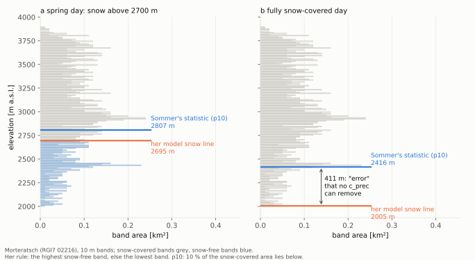
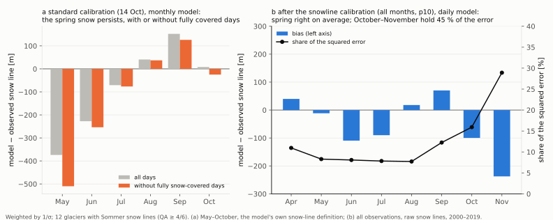
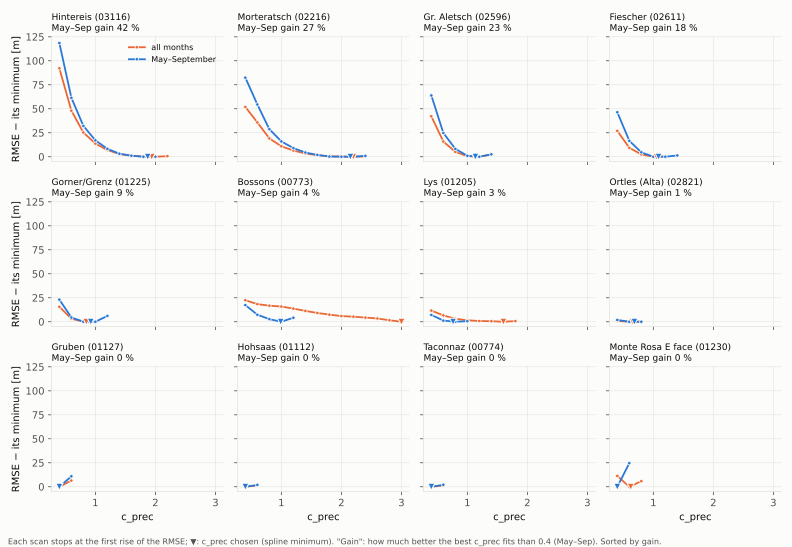
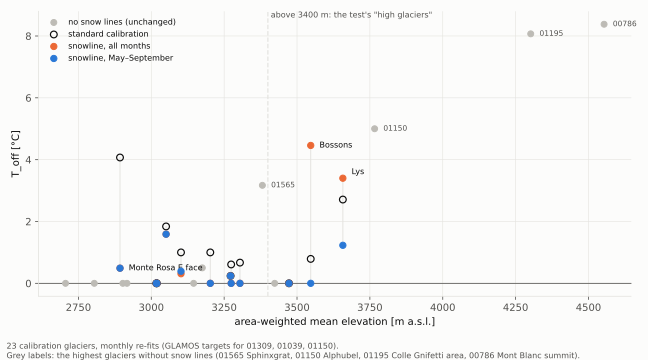
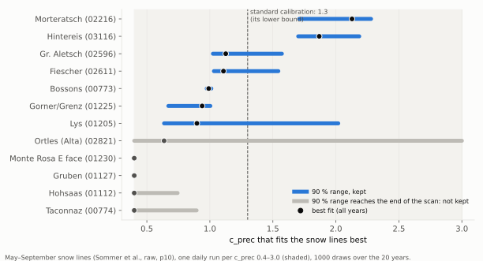
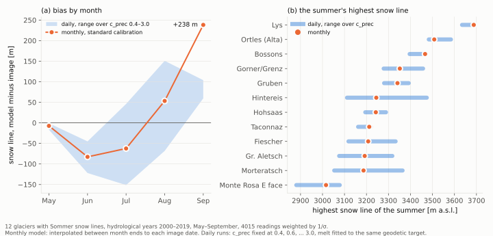

# 9. Snow and firn from data: what the mass balance hands the thermal model

> **In short.** Chapter 8 traced the misses at 3000–3500 m to too much winter snow and too much
> firn on small high glaciers. The same excess snow decides whether meltwater refreezing in the
> winter snow on ice keeps Tête Rousse's frozen bed.
>
> Letting the precipitation factor fall below its 1.3 bound brings the winter snow to GLAMOS's
> values, and with less snow Tête Rousse's frozen bed comes back. But the ELA moves only 10–50 m
> instead of the 120–200 m GLAMOS shows. With only one glacier-wide target, less snow is simply
> balanced by less melt. A second observation must pin where the snow survives: snow lines
> (Alexandra von der Esch's snowline calibration) and firn maps (Matthias Huss's firn model,
> Janosch's first paper).
>
> *Status (2026-10-14): Step 1 done; snow lines, GLAMOS and the firn model compared (Step 2);
> the firn ledger (Step 3b) gated and scored: not adopted (zone +1, cooling guard), kept for after
> Step 3a. Alexandra's code arrives as a GloGEM branch by the end of the week.*

## What we believed

- The mass-balance calibration (Huss & Hock 2015, as in GloGEM): one target per glacier, the
  geodetic balance 2000–2020. It sets the precipitation factor (bounded 1.3–2.3 in CentralEurope),
  then the degree-day factor, then the temperature offset.
- The thermal model takes from it the snow (insulation), the firn mask (where meltwater enters) and
  the accumulation (burial).
- We assumed the firn mask was good enough. Chapter 6 compared the ELA with WGMS for a few
  glaciers, but never for small high ones.

## What we measured

### The precipitation bound (Step 1; diagnostic, 4 zone glaciers)

Two calibrations of Tête Rousse (00777), Hohsaas (01112), Altels (01265) and Corvatsch (02103)
were run with GloGEM's own calibration, unchanged.
- **'ref':** bound 1.3, as the regional calibration.
- **'low':** bound 0.8, from a copy of the regional parameter table. The shared file and the code
  stay untouched.

The 'ref' run reproduces the regional calibration: c_prec identical, winter balance within 1 %,
ELA within 10 m. DDF and T_off trade off slightly differently, because on 4 glaciers the cell
means that seed T_off differ.

| glacier | c_prec | winter balance, m w.e. (GLAMOS) | ELA 2010s / 2020s, m (GLAMOS) |
|---|---|---|---|
| Corvatsch | 1.30 → 0.95 | 1.20 → 0.87 (≈ 0.83, 2013–25) | 3179 → 3192 / 3272 → 3283 (≈ 3380, 2013–25) |
| Hohsaas | 1.30 → 0.80 | 1.66 → 1.03 (≈ 0.97) | 3222 → 3247 / 3333 → 3345 (≈ 3460, 2018–25) |
| Altels | 1.30 → 0.80 | 1.55 → 0.94 | 2986 → 3043 / 3095 → 3143 |
| Tête Rousse | 1.30 → 0.80 | 1.63 → 1.00 | 3190 → 3201 / 3185 → 3202 |

```
 one target (the geodetic balance), two knobs that trade off:
   less snow (c_prec down) -> less melt needed (DDF down) -> where they balance (the ELA) barely moves
 so the winter snow comes right, the snow line does not
```

The thermal model on both calibrations (FRH, f_ref 0.85; below 15 m, 18 entities, 163 points):

| | 'ref' | 'low' |
|---|---|---|
| RMSE / bias, FRH | 0.96 / +0.65 °C | 0.85 / +0.51 °C |
| RMSE, with snow refreezing on ice (FRHS) | 1.08 °C | 0.95 °C |
| Tête Rousse hole 64 (32.5 m, measured −2.34 °C): FRH / FRHS | −0.43 / −0.07 °C | −0.91 / −0.39 °C |
| Corvatsch, 4 entities | temperate (bias +0.8 to +2.7 °C) | identical |
| robust class changes | | none |

- **Tête Rousse improves.** With less snow, the snow-refreezing switch keeps its frozen bed: hole 64
  is at −0.39 °C, below the melting point. So the switch failed in chapter 8 because of the excess
  snow, as suspected.
- **Corvatsch does not move at all.** Its firn line rises by only 15 m, so the borehole bands stay
  in firn and meltwater keeps them at 0 °C.
- **Hohsaas gets slightly too cold.** The bias at 3275 m goes from −0.86 to −1.21 °C.

### Snow lines and GLAMOS against today's calibration (Step 2; agent diagnosis)

A GloGEM mass-balance run with full output (monthly snow line, ELA, winter and annual balance,
1990–2025) was compared with two datasets:
- the transient snow lines of Sommer et al. (12 of our glaciers; corrected snow line, QA ≥ 0.67,
  weighted by 1/σ, May–October 2000–2025);
- the GLAMOS series.

Biases are model minus observation, in metres:

| glacier (RGI7, km²) | wRMSE | bias May–Jun | Jul–Aug | Sep–Oct | end-of-summer snow line − model ELA |
|---|---|---|---|---|---|
| Aletsch (02596, 82) | 333 | −208 | +54 | +315 | +48 |
| Gorner/Grenz (01225, 57) | 311 | −283 | +37 | +170 | −21 |
| Fiescher (02611, 31) | 294 | −277 | +106 | +108 | +65 |
| Morteratsch (02216, 16) | 317 | −199 | +84 | +273 | +45 |
| Bossons (00773, 11) | 421 | −252 | +13 | +48 | −238 |
| Lys (01205, 11) | 377 | −407 | +39 | +53 | −82 |
| Taconnaz (00774, 5) | 402 | −456 | −84 | +4 | −196 |
| Monte Rosa east face (01230, 4) | 452 | −281 | −442 | −153 | −415 |
| Hohsaas (01112, 1.8) | 204 | −185 | −67 | +6 | 0 |
| Gruben (01127, 1.2) | 226 | −138 | −126 | −51 | −122 |
| Ortles (02821, 1.2) | 283 | −313 | +12 | −78 | −119 |

- **Spring snow lasts too long on every glacier.** The May–June snow line is 140–460 m too low. The
  model's snow line is the end-of-month state, so the true bias is larger.
- **By the end of summer the glaciers split.**
  - The big valley glaciers are right to slightly high (−21 to +135 m).
  - The small or steep high glaciers keep their snow line, and so their firn line, 80–420 m too
    low.
- **The precipitation bound changes only the winter balance** (Hohsaas May–June −185 → −184 m). The
  calibration keeps the annual target and gives back less snow as less melt.

GLAMOS, glacier-wide, model minus GLAMOS over the same years:

| glacier | years | winter balance, regional / 0.8 bound | annual balance | ELA |
|---|---|---|---|---|
| Aletsch | 1990–2025 | +0.34 | +0.09 | +29 m |
| Corvatsch | 2013–25 | +0.38 / +0.05 | +0.74 / +0.81 | −150 / −138 m |
| Hohsaas | 2018–25 | +0.54 / −0.05 | −0.08 / +0.09 | −126 / −116 m |
| Tortin | 2015–25 | +0.08 | −0.14 | −6 m |
| Sex Rouge | 2012–25 | −0.19 | +0.30 | (one year with an ELA on the glacier) |
| Alphubel | 2016–25 | +0.96 | −0.58 | +21 m |

- **The calibration target itself may be too positive for small glaciers.**
  - Corvatsch's geodetic target (Hugonnet et al., 2000–2019) is −0.25 m w.e. a year, but GLAMOS
    measures about −1.3 over 2013–19, when the model gives −0.6.
  - At 3200–3350 m the model's band balance on Corvatsch and Hohsaas is 1.1–1.6 m w.e. too
    positive, with either calibration.
  - The outlines differ: GLAMOS Corvatsch is 0.17–0.23 km², RGI7 0.45 km². The band comparison at
    equal elevations is not affected by that.
- **Measured or inferred:**
  - measured (seasonal stakes): Corvatsch, Sex Rouge, Aletsch;
  - mostly inferred (GLAMOS method 0): Hohsaas and Alphubel;
  - Tortin's winter balance is inferred.

### The firn model against the thermal model's firn (Step 2; agent diagnosis)

The firn model (`firn_model/firn_change.pro`) was ported to Python. The port agrees with the IDL
original cell by cell (to 5e-7, IDL's output rounding) on all ten glaciers. It was then run on the
GLAMOS distributed mass balances of 9 calibration glaciers, 1970–2025, and averaged to GloGEM's
10 m bands. Firn thickness is converted at an assumed 600 kg/m³.

| zone bands | decade | firn model: firn share / thickness | thermal model: firn share / wet depth |
|---|---|---|---|
| Corvatsch 3295–3365 m | 1970s | 0.50 / 1.2 m | 1.00 / 12.8 m |
| | 1990s–2000s | 0 (no firn 1982–2013) | 1.00 / 12.8 m |
| | 2010s | 0.16 / 1.5 m | 1.00 / 12.8 m |
| Hohsaas 3275–3345 m | 1980s | 1.00 / 15.7 m | 1.00 / 36.5 m |
| | 2000s | 0.09 / 5.0 m | 0.99 / 36.4 m |
| | 2020s | 0 | 0.44 / 36.4 m |
| Aletsch (Jungfraufirn) 3415–3535 m | 2010s–2020s | 0.99–1.00 / 48–51 m | 1.00 / 68 m |

- **Corvatsch and Hohsaas: the diagnosis holds.**
  - The thermal model keeps permeable firn 20–30 years too long: Corvatsch until 2023–25, where
    the firn model has none from 1982; Hohsaas until 2022–23, where the firn model loses it in
    1998–2003.
  - It also soaks it far deeper than the firn could be: 13–36 m against at most about 3–17 m.
- **Jungfraufirn: the firn extent agrees.** Only the depth is wrong: water reaches 68 m against a
  firn base of about 48 m.
- **The meltwater depth limit (Herron & Langway close-off times perm_frac, 75–90 m, fixed per band)
  is deeper than any firn column the firn model produces.** Step 3b (firn thickness from the mass
  balance) targets exactly this.
- **Glacier-wide on Aletsch, the thermal model has less firn than the firn model** since the
  1990s (7 km² in the 2020s). So the excess firn is a small-glacier problem, not a general one.
- **Caveats:**
  - the GLAMOS outlines (about 2003) differ from RGI7: Hohsaas covers 0.19 of 1.79 km², all above
    3215 m. GLAMOS uses the Swiss Glacier Inventory, where Hohsaas is separate from the
    Triftgletscher below it; RGI7 01112 counts both (Janosch). The geodetic target of 01112 is
    therefore for the combined outline. The same may apply to other small Swiss glaciers;
  - the records of Fiescher, Gorner and Morteratsch start in 2005–2008, from zero firn;
  - the measured-period grids differ strongly from the fixed-date ones in some years (Gorner 2025:
    +0.11 against −3.14 m w.e.);
  - Corvatsch's 2022 grid misses the summer;
  - the firn model's thickness is capped by its 20-year rule.

### Are the targets of small glaciers too positive? (agent diagnosis, 2026-10-14)

34 GLAMOS series overlapping 2000–2019 were matched to RGI7 by overlaying cells. The geodetic
target (Hugonnet et al., `geodetic/RGIv7.0/aggregated_2000_2020/11_mb_glspec.dat`) was then
compared with GLAMOS, adjusted to the full period with the regional anomaly where the series is
shorter.

| group (outlines matching within 0.7–1.3) | Δ = target − GLAMOS, median |
|---|---|
| under 1 km², all (N = 10) | +0.26 m w.e. a⁻¹ |
| under 1 km², measured (seasonal stakes, N = 5) | +0.24 |
| 1 km² or more, measured (N = 8) | +0.04 |
| rank correlation of Δ with area / median elevation | −0.41 (p 0.03) / −0.45 (p 0.02) |

- **Small glaciers' targets are mildly too positive**, by about +0.25 m w.e. a year, with much
  scatter: two of the five measured ones go the other way. This fits the geodetic noise of small
  glaciers (stated errors 0.2–0.35).
- **Corvatsch is the outlier, at +0.98.**
  - About half comes from the outline: GLAMOS's glacier fills only 46 % of RGI7 02103, and the
    rest lies lower and to the north.
  - The rest is geodetic noise.
  - The period is not the cause (correction −0.04).
- **Wherever GLAMOS measures only part of a larger RGI7 outline** (Hohsaas, Felskinn, Corvatsch),
  Δ is +0.6 to +1.0. The Hohsaas and Felskinn series are short and modelled, so this is weak
  evidence.
- **Side finding, core GloGEM:** the calibrated balance lies above the raw target for 94 % of the
  4073 CentralEurope glaciers, by a median of +0.05 m w.e. a year. The calibration stops as soon as
  it is within the tolerance, approaching from one side.
- **For the snowline calibration:** the target is a second error source on small glaciers. A
  snowline constraint cannot correct a wrong annual target. Where GLAMOS exists, its balance is the
  better target for the diagnostic recalibration.

### The firn model's layer removal (decision 1 of the firn-ledger plan)

`firn_change.pro` handles a negative year as follows:
- it wipes every older layer thinner than |b| without reducing |b|;
- then it takes the full |b| again from the next, thicker layer.

So it removes more than the year's loss. Running both rules on the GLAMOS grids of the 9 glaciers
(the exact port, scratch `firnmodel/mc/`):

| | firn area | firn mass |
|---|---|---|
| all glaciers and years: mass-conserving ÷ original | 1.036 | 1.016 |

The difference concentrates where the firn is being lost on small glaciers:

| glacier, decade | firn area, original rule | mass-conserving |
|---|---|---|
| Hohsaas, 2000s | 0.034 km² | 0.066 km² |
| Sex Rouge, 2000s | 0.011 km² | 0.024 km² |
| Alphubel, 2000s | 0.041 km² | 0.064 km² |
| Tortin, 2020s | 0.045 km² | 0.078 km² |
| Aletsch, 2020s | 37.6 km² | 41.5 km² |

In the loss phase of small glaciers, the original removal roughly halves the firn area and makes
the firn disappear earlier. The GloGEM ledger uses the mass-conserving rule (decision 1). Whether
the published firn maps should be revisited is for Janosch and Matthias.

### Step 3b: the firn ledger as the meltwater limit — not adopted (2026-10-14 evening)

**The rule.** `firnice_perm_limit = 'firn'` (GloGEM worktree `firn-ledger`, `20ba803`; plan
`plans/2026-10-14_firn_ledger_plan.md`):
- each band keeps annual firn layers from GloGEM's own band balance: a positive year adds a layer,
  a negative year removes its amount from the newest layers (mass-conserving), and layers become ice
  after 20 years;
- the meltwater reaches at most the ledger plus this winter's snow, never past the Herron–Langway
  depth.

**Review and gate.** An independent review found no code error. The gate passed all four checks:

| check | result |
|---|---|
| defaults | byte-identical (373 files) |
| mass-balance files | identical |
| IDL ledger against the Python reference | equal to 5e-5 m w.e. (139 266 band-years) |
| wet depth against the logged limit | never past it (72 259 firn band-years) |

What the ledger does to the water path:

| zone bands, 2020s | ledger | water reaches, 'hl' → 'firn' |
|---|---|---|
| Hohsaas 3275–3345 m | 8 m w.e. (14 m) | 36 → 19 m |
| Jungfraufirn 3415–3535 m | 25 m w.e. (36 m) | 68 → 37 m |
| Corvatsch 3295–3365 m | 13 m w.e. (21 m) | unchanged, 13 m: the column is shallower than the firn |

**The rule** (scorer `90bcbb2`, 7 f_ref values, out of sample):

| condition | result |
|---|---|
| 1. net robust zone gain ≥ 2 | **+1: fails** (Tête Rousse 3145 m polythermal → cold, as measured; bias +1.45 → +0.51 °C) |
| 2. A's conditions against FRH | pass: M1 2.58 → 2.59, zone M1 1.82 → 1.80, cold +1; warming error 0.56 → 0.58, interval 0.00–0.05 |
| 3. no cooling of 'hl'-temperate firn | **fails: 6 band-decades**, all in 1972–1991 at low firn bands near the firn line (Tortin 2855–2885 m, Morteratsch 2875 m, Ortles 3225 m), cooled 0.24–0.62 °C below the melting point |
| 4. frozen-bed table | pass (12 of 14) |
| zone target D against H | +1 (needs 2) |

- **By the rule, 'hl' stays.** The branch `firn-ledger` is kept, to be run again on the
  recalibrated mass balance (Step 3a), as the plan foresaw.
- **What else changes:**
  - Tête Rousse improves (RMSE 0.98 → 0.88 °C);
  - Alphubel South 3805 m gets colder (bias −0.82 → −1.43 °C) and Tortin slightly worse;
  - all other outlines are unchanged: at most borehole bands the ledger lies below the readings,
    or the water runs out first;
  - Taconnaz is unchanged (its maximum water depth 99 → 79 m, median still 34 m).
- **Why so little:** the ledger follows GloGEM's own balance. Where that balance is too positive
  (Corvatsch +0.9 to +1.2 m w.e. a year at 3300 m, Hohsaas), the ledger is thick, and the cold sites
  stay inside the firn. The extent and the depth are the mass balance's to correct (Step 3a).
- **The cooling guard** flags low firn bands at the firn line in the first two decades, where the
  ledger started thin from a small reference balance.

### What the ledger's cooling guard flagged (2026-10-15, read-only check)

The six band-decades that failed the guard are firn-line bands with thin or young firn over ice,
not a start-up artefact:

| band (RGI7) | the ledger | water reaches: ledger / 'hl' |
|---|---|---|
| Tortin 2855–2885 m (01039) | firn only from 1977–78, after good years: 3–4 m w.e. over ice | 8–9 m / 19–29 m |
| Morteratsch 2875 m (02216), Ortles 3225 m (02821) | reference balance near zero: about 1 m w.e. | 4–5 m / 19–24 m |

- **'hl' soaks 19–29 m deep through what is ice**, so the ledger is the more plausible model there.
- **The guard cannot tell mature temperate firn from a thin young layer at the firn line.** For the
  rerun after the snowline recalibration, it will protect only bands with a mature firn column (at
  least 15 layers in the ledger), fixed before the rerun (plan of 2026-10-15, decision 1).
- **Yesterday's verdict stands:** the ledger also failed the zone condition.

### Is the winter snow wrong in level or in its height profile? (Step 1a, 2026-10-15; agent diagnosis)

GloGEM now writes the band winter balance (`bwelev_<id>.dat`, GloGEMflow `26e6fbe`). It was
compared with the GLAMOS band winter balances over the elevations and years both cover (fixed date,
1 October – 30 April).

| glacier (RGI7) | GLAMOS years | winter balance, GLAMOS → model (m w.e.) | ratio | ratio trend with height in measured bins (per 100 m) |
|---|---|---|---|---|
| Sex Rouge (01309) | 14, measured | 1.63 → 1.45 | 0.89 | −0.14 |
| Tortin (01039) | 11 | 1.11 → 1.20 | 1.08 | −0.06 |
| Corvatsch (02103) | 11, measured | 0.80 → 1.25 | 1.57 | +0.04 |
| Hohsaas, upper part (01112) | 8 | 1.05 → 1.81 | 1.72 | −0.43 |
| Alphubel N (01150) | 10 | 0.73 → 1.68 | 2.31 | −0.60 |
| Aletsch (02596) | 49, measured | 1.15 → 1.62 | 1.40 | −0.01 (2300–3700 m) |
| Fiescher (02611) | 18, inferred | 1.42 → 1.46 | 1.03 | – |
| Gorner (01225) | 18, inferred | 0.79 → 1.33 | 1.68 | – |
| Morteratsch + Pers (02216) | 21, inferred | 1.25 → 0.93 | 0.74 | – |

- **Within a glacier the profile shape is about right.**
  - The model-to-GLAMOS ratio is flat with height; on the small glaciers it falls slightly.
  - Scaling the model to GLAMOS's mean leaves 0.05–0.17 m w.e. on the small glaciers (0.4–0.9
    before).
  - The precipitation gradient (1.5 % per 100 m) is not too steep within a glacier.
- **Between glaciers the level differs strongly**, and the excess grows with the glacier's mean
  elevation (r = 0.92 over 9 glaciers; about +0.14 in the ratio per 100 m).
  - One regional precipitation factor cannot fix this; a per-glacier factor without the 1.3 floor
    can. That is what the snowline calibration provides.
  - The cause is not settled: the distance each glacier is extrapolated from its ERA5 point, or
    wind stripping snow off exposed summit glaciers.
- **The one shape problem is on big glaciers above about 3600–3700 m:** GLAMOS's winter balance
  decreases with height there, and the model's high-elevation cap (12.5 % at most) is too weak.
  But GLAMOS has no winter points there, so that decline is GLAMOS's own model, not a measurement.
- **What a precipitation/melt scan cannot fix:** the gradient of the annual balance.
  - It is too shallow at Sex Rouge (0.65 against 1.43 m w.e. per 100 m) and Hohsaas (0.60 against
    1.02).
  - It is too steep on Fiescher's tongue, which is about 6 % debris-covered.
  - Alphubel N gets 2.3× the snow and still loses too much, so its melt is far too high.
- **For small glaciers without snow lines** (under 1 km²), the elevation relation of the excess
  could serve as a prior for the precipitation factor, alongside GLAMOS where it exists.

### The snow-line observations, ready for the calibration (Step 1b, 2026-10-15)

`scripts/icetemp_analysis/snowline/prepare_snowline_targets.py` (data in `data/snowlines/`)
writes one observation file per calibration glacier from the Sommer et al. product. It covers the
12 glaciers of 1 km² or more, about 600–1300 observations each from 2000–2025 at QA ≥ 4/6. It also
writes the constraint per glacier:

| constraint | glaciers |
|---|---|
| geodetic + snow lines | Bossons, Taconnaz, Hohsaas, Gruben, Lys, Gorner/Grenz, Monte Rosa east face, Morteratsch, Aletsch, Fiescher, Ortles, Hintereis |
| GLAMOS balance instead of the geodetic target | Sex Rouge (8 years of seasonal stakes), Tortin, Alphubel |
| geodetic only, flagged | Corvatsch: the GLAMOS outline covers half of RGI7 02103 |
| geodetic only | Pelvoux, Tête Rousse, Mont Blanc summit, Grenzgletscher 4305 m (01195), Altels, Sphinxgrat, Titlis |

- The files reproduce the scores of 2026-10-14 exactly.
- **QA comes in sixths.** The earlier filter `QA ≥ 0.67` dropped the 4/6 level, so the scores of
  2026-10-14 used QA 5/6 and 1 only.

Questions for the port of the snowline calibration (Alexandra's branch):
- **Weights.** Sommer's uncertainty is nearly constant (an error budget with a floor of about
  106 m), so weighting by 1/σ does almost nothing. Her σ (Loibl et al.) was the spread along each
  snow line.
- **Which statistic.** Sommer gives the 10th percentile of snow-pixel elevations; she used the
  median.
- **Uneven sampling.** 7–19 observations a year in 2000–2012, 23–55 in 2013–2019. Recent years
  dominate unless weighted per year.
- **Model timing.** She ran GloGEM daily. We have only the end-of-month snow line, and
  interpolating between month ends shifts the bias by −40 to −120 m. That needs a daily snow line
  or a fixed rule.
- **Fully snow-covered glaciers** (15–31 % of the observations). The product cannot go below the
  glacier's 10th-percentile elevation, while the model returns the glacier's minimum. These cases
  should be one-sided limits.
- **Elevation reference.** The raw snow line (SRTM, February 2000) fits GloGEM's fixed 2003
  geometry better than the surface-corrected one.

### Alexandra's earlier snowline calibration, recovered from the git history (2026-10-15)

Her deleted branch survives as three unreachable commits in the local GloGEM repository, on top of
`ef61ec2`:
- `716a39e`: `read_snowlinedata.pro`;
- `2bc3c65`: the snowline calibration;
- `5a1cf4d`, 24 April 2025: its switch in `input.pro`.

It is kept as the **local** branch `alex-snowline-recovered` (not pushed). It is older than her
paper, so the branch she uploads remains the reference.

How it worked (`glogem_daily_snow.pro`, the one-script GloGEM, daily):
- An outer loop scans the precipitation factor: 0.8, 1.0, …, 2.2 in steps of 0.2 (the paper says
  0.8–3.0).
- For each value, phases 2–3 run as usual: the degree-day factor, then T_off only if needed, to
  match the geodetic balance.
- After each value, `compare_snowline_rmse.pro` compares GloGEM's **daily** snow line (the highest
  snow-free band) with every observation on its day of year. It uses a weighted RMSE with weights
  1/σ.
- At the first rise of the RMSE, a cubic spline through the values so far (`SPL_INIT`/
  `SPL_INTERP`) gives the minimum, and one final run is made at that factor. So it is a greedy
  search that assumes a single minimum.
- Observations: one file per region, `snowline/snowline_<period>/<region>_snowline_median.dat`,
  holding glacier id, median snow line, its standard deviation, year and day of year.

For the port this answers most of the open questions: daily, the median, 1/σ, per-glacier
stopping. What remains is the adaptation to our monthly thermal runs and to Sommer's nearly
constant σ.

### The port of the snowline calibration, and what it says about our snow (2026-10-16)

Alexandra uploaded her code as the branch `Snowline-calibration` (16 Oct). It is now ported into
GloGEMflow as procedures, on the GloGEM branch `snowline-calibration` (worktree
`GloGEM_wt_snowline`; documentation `docs/source/calibration/snowline.md`).
- `calibrate_snowline = 'y'` runs her scan of c_prec (daily runs only).
- `calibrate_cprec_file` keeps c_prec fixed in a standard calibration, for the glaciers it lists.
  This is how the daily result is carried into the monthly model: c_prec is fixed, and DDF and
  T_off are fitted again.

**Checks.**
- With the switches off, every calibration file is byte-identical to GloGEMflow (monthly, 23
  glaciers; daily, 4). So is the forward-run output, daily and monthly.
- Python replicas of the RMSE, the snow line and the spline step agree with IDL
  (`scripts/icetemp_analysis/snowline/check_snowline_port.py`).
- An independent review found two points to fix:
  - a crash when the first glacier of a run has no snow lines (fixed, and tested on all 23
    calibration glaciers);
  - the gridded T_off of the second calibration round couples fixed and free glaciers in the same
    grid cell (documented).
- The review also found a bug in her script, which the port does not have: in a catchment
  spanning several grid cells, phase 3 took the DDF of another glacier.

**Her snow line is not the snow line of the Sommer product.**
- Her model snow line is the highest snow-free band, or the lowest band when the whole glacier is
  under snow. Sommer's value is the 10th percentile of the elevation of the snow-covered pixels.
  A fully snow-covered glacier therefore gives its own 10th-percentile elevation: about 400 m
  above the terminus of Morteratsch, 1100 m on Bossons.
- On those days the comparison carries a fixed error that no c_prec can change. The RMSE curves
  are flat (225–914 m), 10 of 12 glaciers stop at the lowest value (0.8), and Lys runs to the
  highest (3.0) with T_off +5.8 °C.
- The port therefore has an option, `snowline_definition = 'p10'`. It computes the product's
  statistic from the modelled snow-covered area. Her definition stays the default, as it suits
  snow lines traced at the snow-ice boundary (Loibl et al., 2025).


- The spring finding of 14 Oct survives this: leaving out the fully snow-covered days makes the
  May bias larger (−374 m → −510 m), not smaller.

**Inputs.**
- ERA5 daily; the raw snow lines on the SRTM surface of February 2000, which suits GloGEM's fixed
  inventory geometry.
- At c_prec = 1, the daily and the monthly model put the same precipitation on 11 of 12 glaciers
  (within 0.4 %); the 0.2 mm d⁻¹ threshold removes almost nothing.
- Taconnaz gets 22 % more in the daily run, because the two paths pick different grid points.
- c_prec is therefore carried over by amount (`cprec_transfer.py`).

**The remaining error, by month.**
- After the calibration (all months, p10), the spring snow lines are right on average: April
  +40 m, May −12 m, June −109 m.
- The largest errors are now in October and November: in November the model is −240 m too low,
  with an RMSE of 550 m. These two months hold 45 % of the squared error.
- The model covers the lower glacier with autumn snow where the images still show bare ice.
  Less precipitation means less autumn snow, which is why several glaciers run to the lowest
  value.
- So a second variant uses the snow lines of May–September only. These reflect how winter snow
  and summer melt balance, which is what c_prec should explain. Autumn scenes are also the
  hardest to classify (low sun, fresh and patchy snow).



**c_prec by glacier** (daily, p10, raw snow lines; "low" / "high": the minimum lies at the end of
the range 0.8–3.0):

| RGI7 | glacier | all months | May–Sep | gain over the range |
|---|---|---|---|---|
| 03116 | Hintereis | 1.94 | 1.87 | 38 % |
| 02216 | Morteratsch | 2.20 | 2.15 | 16 % |
| 02596 | Gr. Aletsch | 1.12 | 1.13 | 15 % |
| 02611 | Fiescher | 1.06 | 1.09 | 9 % |
| 01225 | Gorner/Grenz | 0.80 low | 0.92 | 6 % |
| 01205 | Lys | 1.60 | 0.80 low | 4 % |
| 00773 | Bossons | 3.00 high | 0.99 | 4 % |
| 01230 | Monte Rosa E face | 0.80 low | 0.80 low | 3 % |
| 02821 | Ortles (Alta) | 0.80 low | 0.80 low | 0.3 % |
| 00774, 01112, 01127 | Taconnaz, Hohsaas, Gruben | 0.80 low | 0.80 low | 0 (still lowest at 0.4) |

- "Gain" is how much better the best value fits than the lowest one, in a scan from 0.4 (all
  months).
- Four glaciers are clearly constrained, and give the same c_prec in both variants.
- For the others the curve is flat: a minimum "low" means only that less snow does no harm. It
  is not an optimum. Taconnaz, Hohsaas and Gruben keep improving down to 0.4 × ERA5, which is
  not physical.
- Every scan stops at the first rise of the RMSE, however small. The fit tolerance alone moves
  the RMSE by about ±0.5 m.



**Does the recalibration raise T_off?** (test fixed in the plan; monthly re-fit of the 23
calibration glaciers, GLAMOS targets for Sex Rouge, Tortin and Alphubel, against the same
calibration without fixed c_prec)

| sample | median T_off (before → all months / May–Sep) | share above 2 °C | both bounds |
|---|---|---|---|
| all 23 | 0.61 → 0.00 / 0.00 °C | 26 % → 26 % / 17 % | 11 → 7 / 8 |
| mean elevation above 3400 m (7) | 2.71 → **4.46** / 1.23 °C | 57 % → 71 % / 43 % | 6 → 4 / 5 |
| the 12 with snow lines | 0.73 → 0.12 / 0.00 °C | 17 % → 17 % / 0 % | 5 → 1 / 2 |

- **All months: flagged.** Bossons gets c_prec 3.0 and T_off +4.5 °C; Lys rises from 2.7 to
  3.4 °C.
- **May–September: not flagged.** Bossons drops to 0.0 °C and Lys to 1.2 °C.
- In both variants, T_off disappears on Hohsaas, Gruben and Gorner. Monte Rosa east face drops
  from 4.1 to 0.5 °C.
- The five highest glaciers (Sphinxgrat, Pelvoux, Alphubel, the Colle Gnifetti area, Mont Blanc
  summit) have no snow lines and keep T_off up to 8.4 °C.
- All re-fits close the targets (mean deviation 0.03, at most 0.10 m w.e.).



### The afternoon of 16 October: a target fix, a wider zone, and her numbers reproduced

Janosch's comments on the plan of the afternoon led to four changes.

**The geodetic target was averaged over 19 of its 20 years** (GloGEM `d075c98`; pushed for main as
`fix/geodetic-target-period`, `a1fb2fa`).
- `calibrate_single_glacier.pro` averaged hydrological years 2001–2019 (`n gt p0`): January–September
  2000 and October–December 2019 of the Hugonnet period were left out. It has been so since the first
  commit of the code.
- OGGM 1.6.2 averages calendar years 2000–2019, all 20.
- Now the calibration runs from 1999 and averages the 20 hydrological years 2000–2019.
- The extra year is a spin-up. Started in 2000 without the previous year's snow, the first year comes
  out up to 0.106 m w.e. too negative (mean 0.031). One spin-up year is within 0.002 m w.e. of two.
- Effect on the 23 calibration glaciers: c_prec changes on Morteratsch only (1.395 → 1.371), DDF on
  12 (mean +0.011) and T_off on 10 (mean +0.019 °C, at most +0.21 on Bossons).
- Janosch chose the spin-up year (rather than averaging from the first year without one).

**The zone is now 3000–3800 m.**
- Janosch's paper places the firn–no-firn transition, the band where being right about snow and firn
  matters most, up to 3800 m.
- With it the zone holds 27 of the 105 scored entities (20 before):

| where the zone entities lie | entities |
|---|---|
| glaciers without snow lines: Tête Rousse (00777) 8, Corvatsch (02103) 4, Alphubel (01150) 2, Altels (01265) 1 | 15 |
| snow lines that do not fix c_prec: Hohsaas (01112) 5, Taconnaz (00774) 3 | 8 |
| a glacier the snow lines fix: Aletsch (02596) | 4 |

- So the snowline recalibration can hardly change zone target D. Its value lies with the big glaciers,
  their boreholes and fronts.
- The scorer's zone limits change before the next run set; this is recorded as an amendment.

**Full refreezing stopped without the thermal model** (`07d694d`).
- `refreezing_full = 'y'` stopped with "Variable is undefined: TL_RF" whenever the firn and ice
  temperature model was off, i.e. in every calibration. Its state was set only in the thermal model's
  set-up since the modular split.
- It is now set for every glacier, and runs that worked are unchanged.

**Her numbers reproduced without her files (gate 3).**
- Her paper has no data archive, and her result folders are not readable for us. But her High
  Mountain Asia snow lines are, and her supplement (Table S3) lists the calibrated parameters of her
  12 test glaciers.
- The port, run with her settings (ERA5-Land daily, RGI6, full refreezing, her snow-line definition and
  range, the old target period), against her table:

| RGI6 | glacier | standard: ours / hers (c_prec, DDF, T_off) | snowline: ours / hers |
|---|---|---|---|
| 13.45334 | Urumqi West | 0.800, 3.343, 0.00 / 0.800, 3.267, 0.00 | 1.156, 4.323, 0.00 / 1.138, 4.500, 0.00 |
| 13.06974 | Suek | 1.278, 3.000, 0.00 / 1.292, 3.000, 0.00 | 0.937, 2.388, 0.00 / 0.961, 2.500, 0.00 |
| 13.06361 | Karabatkak | 1.688, 3.000, 0.00 / 1.593, 3.000, 0.00 | 0.800, 1.750, 0.00 / 0.837, 1.860, 0.00 |
| 13.08624 | Tuyuksu | 1.676, 3.000, 0.00 / 1.706, 3.000, 0.00 | 0.800, 1.750, −0.21 / 0.800, 1.750, 0.00 |
| 13.08055 | Sary-Tor | 0.800, 4.298, 0.00 / 0.800, 4.383, 0.00 | 0.800, 4.500, 0.00 / 0.800, 4.500, 0.00 |
| 13.11609 | Golubin | 2.500, 2.879, 0.00 / 3.000, 2.846, 0.00 | **0.800, 1.750, −1.52 / 2.400, 2.825, 0.00** |
| 13.08054 | Bordu | 0.800, 4.113, 0.00 / 0.800, 4.157, 0.00 | 1.021, 4.500, 0.13 / 1.053, 4.500, 0.23 |
| 13.07064 | Glacier 354 | 0.800, 4.364, 0.00 / 0.800, 4.386, 0.00 | 1.027, 4.500, 0.22 / 1.023, 4.500, 0.27 |
| 13.18096 | Abramov | 1.500, 3.000, 0.00 / 1.573, 3.000, 0.00 | **0.800, 1.750, 0.00 / 3.000, 4.500, 1.00** |
| 14.14311 | Patsio | 0.800, 4.500, 1.00 / 0.800, 4.500, 1.00 | 1.548, 4.500, 2.67 / 1.604, 4.500, 3.00 |
| 14.15990 | Chhota Shigri | 0.800, 4.500, 0.26 / 0.800, 4.500, 0.27 | 1.070, 4.500, 1.00 / 1.050, 4.500, 1.00 |
| 15.03954 | Yala | 0.800, 4.500, 0.82 / 0.800, 4.500, 0.84 | 1.673, 4.500, 1.88 / 1.536, 4.500, 1.87 |

- The standard calibration agrees closely on 9 of 12 glaciers: c_prec within 0.03, DDF within 0.09,
  T_off within 0.02 °C. Karabatkak and Abramov differ by about 0.1 in c_prec. Golubin sits at our
  regional upper bound of 2.5, while hers reached 3.0: a different bound in her set-up, not a model
  difference.
- The snowline calibration agrees on 10 of 12 glaciers (c_prec within about 0.15, T_off within
  0.33 °C).
  - Abramov and Golubin differ strongly: ours stops at the lowest value (0.8), hers ran to 3.0 and 2.4.
    Not explained yet; her data folder is readable, so a run on her exact inputs can test it.
- At Yala the snowline c_prec differs by 0.14 while T_off agrees. The curve is flat there (78.43 m at
  1.6, 78.49 m at 1.8), and a rise of 0.07 m ended the scan, so a tiny difference moves the stop by a
  step.
- Her files use calendar days (day 366) and contain observations with σ = 0 (left out; none on her
  test glaciers).

**Which glaciers keep their snowline c_prec: a bootstrap over years** (step A1, rule fixed in the
plan; `cprec_bootstrap.py`).
- One snowline run per single c_prec (0.4, 0.6, … 3.0), with DDF and T_off fitted as in the scan and
  the fixed target period, then a daily forward run with the p10 snow line.
- Per glacier: the c_prec with the lowest weighted RMSE against the May–September snow lines, over the
  whole range (not the scan's first rise). The 20 hydrological years are resampled 1000 times for its
  90 % range.
- A glacier keeps its c_prec only if that range reaches neither end of the scan.
- All 168 fixed-value runs close their targets (largest deviation 0.047 m w.e.).
- The forward runs reproduce the calibration's own snow line to within 0.5 m RMSE.



- **Kept (7):** Bossons 0.99 (0.98–1.01), Lys 0.90 (0.64–2.02), Gorner/Grenz 0.94 (0.67–1.00),
  Morteratsch 2.13 (1.71–2.28), Aletsch 1.13 (1.02–1.57), Fiescher 1.11 (1.03–1.54), Hintereis 1.87
  (1.70–2.19).
- **Not kept (5):** Taconnaz, Hohsaas, Gruben and Monte Rosa east face (best at the lowest value,
  0.4), and Ortles (range 0.40–3.00).
- Bossons' curve is shallow (4 % gain), but its minimum barely moves when the years are resampled.
  Lys is wide but stays inside the range.

**The recalibration with the 7, and T_off** (step A2; monthly re-fit on the fixed target period,
against the same calibration without fixed c_prec):

| sample | median T_off before → after | share above 2 °C | both bounds |
|---|---|---|---|
| all 23 | 0.64 → 0.25 °C | 26 % → 22 % | 10 → 10 |
| mean elevation above 3400 m (7) | 2.74 → 1.59 °C | 57 % → 43 % | 5 → 5 |
| the 7 recalibrated | 1.00 → 0.00 °C | 14 % → 0 % | 2 → 2 |

- **Not flagged.** T_off falls or stays at zero on all 7:
  - Gorner 0.69 → 0, Bossons 1.00 → 0;
  - Fiescher 1.00 → 0.49, Aletsch 1.88 → 1.67, Lys 2.74 → 1.59.
- Morteratsch (1.37 → 2.12) and Hintereis (1.30 → 1.86) get more snow and more melt (DDF 3.0 → 4.1
  and 3.1 → 3.9), with T_off still 0.
- The re-fit closes every target: mean deviation 0.036 m w.e.; the largest, 0.125, is the same in the
  baseline.

**Does the snow get better in the monthly model? (step B, rule fixed in the plan; agent
diagnosis, scratchpad `stepB/`)**
- The test: monthly forward runs 1999–2025 with the standard calibration and with the 7 snowline values,
  both with the p10 snow line, against Sommer's May–September snow lines and against GLAMOS.
- The 16 unchanged glaciers are bit-identical between the two runs.
- **(a) The snow line fits better: true, but by about 1 %.**
  - On the 7 glaciers, the weighted RMSE goes from 319.8 to 316.0 m; resampling the years, every draw
    improves (−5.9 to −1.9 m).
  - Only Morteratsch (−33 m), Hintereis (−31 m) and Bossons (−6 m) improve. Aletsch (+12.7 m), Fiescher
    (+5.8 m), Gorner (+2.3 m) and Lys (+0.8 m) get slightly worse.
- **(b) The winter balance does not move away from GLAMOS: false.**
  - Gr. Aletsch is the only changed glacier with a full-outline GLAMOS series (25 measured years). Its
    gap grows from 0.064 to 0.117 m w.e. (GLAMOS 1.25, before 1.32, after 1.14), and the ELA error
    from +76 to +100 m.
  - Morteratsch moves much closer (0.40 → 0.10 m w.e.; ELA error +118 → +42 m), but GLAMOS measures
    only its Pers tributary there (outline ratio 0.46).
- **So by the rule, the thermal runs do not use this recalibration** (Janosch decides).
- **Why the daily c_prec does not carry over.** The monthly model's snow line is far too high in late
  summer, whatever c_prec: August +201 m, September +296 m on the 7 glaciers, with end-of-month values.
  The daily model, in which c_prec was chosen, shows far less (September +70 m on the 12 glaciers, in
  the daily run of the all-months calibration; not the same sample, but the same pattern).
  - On Aletsch, Fiescher, Gorner and Lys, a lower c_prec raises a monthly snow line that is already too
    high.
  - The snow lines that matter for the thermal runs are the monthly model's. A c_prec chosen with them
    is the next candidate.

### Daily or monthly snow for the thermal model? (2026-10-16, evening)

**The question (Janosch):** the daily model reproduces the snow lines better. Should the thermal model
run on the daily GloGEM too?

**The comparison, on the same satellite snow lines.**
- **Monthly model:** standard calibration (`fwdB_none_fixed`), its snow line interpolated between month
  ends to each image date.
- **Daily model:** the bootstrap runs, c_prec fixed at each value 0.4–3.0, melt fitted to the same
  geodetic target (`boot/f*`).
- **The sample:** 12 glaciers, hydrological years 2000–2019, May–September, 4015 readings weighted by
  1/σ.
- Script: `scripts/icetemp_analysis/snowline/daily_vs_monthly.py`.



| month | bias, monthly | bias, daily (range over c_prec) | wRMSE, monthly | wRMSE, daily |
|---|---|---|---|---|
| May | −7 m | −17 to −1 m | 328 m | 328–329 m |
| June | −83 | −122 to −45 | 254 | 251–279 |
| July | −62 | −151 to +46 | 243 | 226–286 |
| August | +53 | −68 to +151 | 264 | 233–278 |
| **September** | **+238** | **+60 to +104** | **403** | **275–321** |

- **May to August:** the monthly model lies inside the daily model's range, so the two are equally
  good.
- **September:** the daily model is better at every c_prec.
- **The summer's highest snow line is the same in both** (panel b; July–September, mean over the
  years). This is the line that decides where snow survives and becomes firn.
  - On average the monthly value sits in the middle of the daily range (0 m difference).
  - It lies inside the range on 10 of 12 glaciers, and 9 and 15 m above it on the other two.
  - On the image dates: images 3333 m, monthly 3291 m, daily 3194–3358 m.

**Why the monthly model misses the September snow:**

```
 snow-line
 elevation          the summer's highest point: decides where snow survives (firn),
    ▲               the same in both models
    │                           ●━━━━━━━━━● monthly: stays high to the end of September
    │                         ╱   ╲
    │                       ╱       ╲
    │                     ╱           ● daily and images: September snowfalls bring it down
    │                   ╱
    │   ●━━━━━━━━━━━━●
    └───┬───────┬───────┬───────┬───────┬───────┬──▶
       May     Jun     Jul     Aug     Sep     Oct
```

- **Snow or rain is decided by the month's mean temperature** (threshold 1.5 °C, ±1 °C). A September
  mean above 2.5 °C makes all of the month's precipitation rain, although on the cold days it snowed.
  - The melt already uses the spread of the daily temperatures within the month (`variab`); the
    snowfall does not.
  - Spreading the snowfall the same way would change the snow share at a monthly mean of +2 °C from
    25 % to 37–48 %, at +3 °C from 0 to 25–31 %, and at 0 °C from 100 % to 59–77 % (ERA5 spread at
    Aletsch, Mont Blanc and Monte Rosa, June–September).
- **Snow that falls and melts again within one month** never shows in a month-end value.

**What daily snow would change in the thermal model:**
- **The firn line: hardly anything,** because the highest snow line is the same.
- **The winter snow cover would start a few weeks earlier,** in September instead of October.
  - That acts through the snow insulation (f_ins).
  - The boreholes tell f_ins and refreezing (f_ref) apart only weakly (chapter 3), so the effect could
    hardly be tested.
- **The daily temperature swings: nothing at 10–20 m.** A daily swing fades to about a third within
  20 cm of ice; the yearly cycle reaches about 3 m, and monthly steps resolve it.

**What a daily thermal model would cost** (code survey of 16 Oct):
- **Computing time:**
  - the thermal model is over 90 % of a calibration run (about 30 minutes for the 23 glaciers);
  - called daily, it would take 10 to 30 times longer.
- **The solver itself is ready for daily steps;** everything around it is monthly-only:
  - the reference forcing and the spin-up;
  - b_ref, the reference balance that sets the firn mask, the vertical ice flow and the percolation
    depth;
  - the snow logbooks and the profile output.
- **What a daily run does today:** it stops at one of four places, or, if those are avoided, runs
  silently wrong with b_ref = 0.
- **The Python pipeline** dates and matches everything in months.
- **Every calibration** would have to be redone.

**Decision (Janosch, 16 Oct):**
- **The thermal model stays on the monthly GloGEM.**
- **Kept for later:**
  - a daily mass balance feeding a monthly thermal model;
  - snowfall spread over the month's daily temperatures.

**Consequence for the monthly snow-line test.** It uses only the readings a monthly model can follow:
the snow line's rise through the summer, up to each year's highest reading. The September readings
after that point are left out, because no monthly c_prec can fix them (in step B, c_prec moved the
September bias by only 17 m).

**A side finding: the monthly thermal year has 360 days.**
- **The cause:** the thermal solver's step (`rf_dt` in `settings.pro`) is a 30-day month in three
  steps, whatever the month's real length.
- **The effect:**
  - heat conduction, ice flow and geothermal heat run 1.4 % short each year, while the meltwater heat
    is complete;
  - that acts like raising f_ref by 1.4 %, far less than one step of the f_ref scan.
- **It is fixed together with the thermal reruns (C).**

## What was wrong

- **Calibrating to one glacier-wide target cannot fix where snow survives.** The precipitation
  factor sets how much snow falls; the snow line also depends on how the melt and the snow change
  with height. Lowering c_prec trades snow for melt and leaves the ELA nearly in place.
- **On small glaciers, the target may be too positive.** The geodetic balances of glaciers under
  about 1 km² can disagree strongly with GLAMOS (Corvatsch −0.25 against about −1.3 m w.e. a
  year). A too positive target keeps the firn line low, whatever the snow.
- **Possible cause, not yet tested:** the precipitation gradient (1.5 % per 100 m above the ERA5
  cell, the regional table). On small glaciers high above their cell it adds much snow at the top.
  The GLAMOS band winter balances of Corvatsch are nearly flat with height.
- **Spring snow persists too long everywhere**, by 140–460 m in May–June. That changes the
  insulation and the timing of meltwater for every glacier, not only the small ones.
- **The model's snow line was not the product's.** GloGEM reports the highest snow-free band (the
  lowest band under full snow cover); the Sommer product reports the 10th percentile of the
  snow-covered area. Compared directly, fully snow-covered days add a fixed error that no
  precipitation factor can remove (2026-10-16).
- **Autumn snow lines pull c_prec down.** After the snowline calibration, October–November
  carry 45 % of the remaining error: the model snows on the lower glacier too early.
- **The monthly model cannot show the September snowfalls.** It splits snow from rain on the
  month's mean temperature and reports month-end values, so its September snow line is 238 m too
  high. The summer's highest snow line, which sets the firn, is as good as the daily model's
  (2026-10-16).
- **The monthly thermal year had 360 days** (`rf_dt` counts 30-day months); small, fixed with the
  thermal reruns.

## What is next

- **The monthly snow-line test (approved 2026-10-19).**
  - Fourteen monthly calibrations with c_prec fixed at 0.4–3.0 for the 12 snow-line glaciers.
  - Each scored on the rise of the snow line up to each year's highest reading.
  - The bootstrap over years, the re-fit of the 23, the T_off test, and the snow check against
    Sommer and GLAMOS (`compare_snow.py`).
  - Then Janosch's decision on adoption.
- **The firn model** (`glogemflow_icetemp/firn_model/firn_change.pro`, Beer et al. 2026), driven
  by the GLAMOS distributed mass balances, on our 9 Swiss calibration glaciers. Its firn extent and
  thickness by band and year are compared with the thermal firn mask and the meltwater depth.
- **The snow lines:**
  - today's calibration against the Alpine transient snow lines (Sommer et al., ESSD preprint
    essd-2026-35) and the GLAMOS ELAs;
  - then Alexandra's snowline calibration, ported from her GloGEM branch into a procedure on
    GloGEMflow.
- **Firn thickness for the meltwater depth:** a bookkeeping per band with the firn model's rules
  (Step 3b of the plan).

## Sources

- Plan: `plans/2026-10-14_snow_firn_probabilistic_plan.md`, `plans/2026-10-14_plan_additions.md`
- Diagnostic calibrations:
  `/scratch_net/vierzack04_fourth/jabeer/tmp_icetemp_trees/week2/zonecal/{ref,low}/`; the
  regional-table copy is in `zonecal/data_lowc/`
- Runs: `data/bayescal/zcal{ref,low}_{FRH,FRHS}_r0.85_i1.017_a1.00[_nodeep]_w0`
- GLAMOS: `/itet-stor/jabeer/glazioarch/GlacioBaseData/MassBalance/glacier/{corvatsch,hohsaas}_fix.dat`
- Literature: Huss & Hock (2015); von der Esch et al. (in review, snowline calibration of GloGEM);
  Sommer et al. (2026, ESSD preprint); Beer et al. (2026, *The Cryosphere* 20, 5453–5473)

## Glossary

| term | meaning |
|---|---|
| c_prec | precipitation factor: multiplies the reanalysis precipitation; calibration phase 1 |
| DDF | degree-day factor, the melt factor for snow (ice: twice that); calibration phase 2 |
| T_off | temperature offset added to the reanalysis temperature; calibration phase 3, only if DDF reaches its bounds |
| target | the glacier's geodetic mass balance 2000–2020 (Hugonnet et al., 2021), which the calibration matches |
| Ba, Bw | annual and winter mass balance [m w.e.] |
| m w.e. | metres of water equivalent |
| ELA | equilibrium-line altitude: where the annual balance is zero; close to the firn line |
| firn line | lower limit of firn (snow older than one year) at the end of summer |
| GLAMOS | Glacier Monitoring Switzerland: measured mass balances and outlines (SGI) |
| WGMS | World Glacier Monitoring Service |
| RGI7 | Randolph Glacier Inventory version 7: outlines and IDs (RGI6: the previous version) |
| ERA5 | the ECMWF reanalysis (about 31 km); ERA5-Land: its land version (about 9 km) |
| SRTM | Shuttle Radar Topography Mission: the elevation model of February 2000 (the raw snow lines refer to it) |
| TSLA, SLA | (transient) snow-line altitude from satellite images (Sommer et al.; Loibl et al. for High Mountain Asia) |
| p10 | the 10th percentile of the elevation of the snow-covered area: Sommer's snow-line statistic; `snowline_definition = 'p10'` computes it in GloGEM |
| z10 | the elevation below which 10 % of the glacier area lies |
| QA | quality flag of the Sommer product, in sixths (QA ≥ 4/6 used) |
| RMSE, wRMSE | root-mean-square error; weighted (wRMSE) with 1/σ, σ the observation uncertainty |
| gain | how much better the best c_prec fits the snow lines than the lowest scanned value (0.4) |
| hydrological year | October to September, named after the year in which it ends |
| FRH | the central thermal forcing since 14 Oct: no T_off in the thermal energy inputs (F), ERA5's lapse rate (R), meltwater depth after Herron & Langway (1980) and latent heat per metre of water (H) |
| FRHS | FRH with meltwater refreezing in the winter snow on ice bands |
| FRHL | FRH with the firn ledger as the meltwater depth limit |
| 'hl' | the current meltwater depth limit, after Herron & Langway (1980) |
| firn ledger | annual firn layers per band kept from the mass balance; meltwater reaches no deeper than the firn they hold |
| cooling guard | the ledger rule's check that no firn band 'hl' keeps temperate is cooled by more than 0.2 °C |
| f_ref | the thermal model's refreezing parameter: the share of melt and rain that enters the column and refreezes |
| M1 | the main score of the thermal model: RMSE against borehole temperatures below 15 m, each outline weighted equally |
| entity | a borehole site (glacier and elevation band), scored as one unit |
| zone, zone target D | the 3000–3800 m band of the firn–no-firn transition (3000–3500 m until 16 Oct); target D: at least 2 more zone entities in the right temperature class than variant H |
| perm_frac | the old permeability fraction of the thermal model (chapter 1) |
| IDL | the programming language of GloGEM |
| bootstrap | resampling the observation years with replacement, to see how much a result depends on which years were observed |
| A0–A2, B, C | the steps of the plan of 16 Oct (afternoon): A the recalibration (A0 gate 3, A1 the bootstrap, A2 the monthly re-fit), B the snow check, C the thermal reruns |
| highest snow line | the highest snow line of a summer (July–September), close to the firn line |
| interpolated | the monthly model's snow line at an image date, read on the line between the two month-end values |
| `variab` | GloGEM's pattern of daily temperature deviations within a month; the monthly melt uses it, the snowfall does not |
| f_ins | the thermal model's snow-insulation factor |
| b_ref | the reference mass balance per band from the spin-up's average year; sets the thermal firn mask, the vertical ice flow and the percolation depth |
| `rf_dt` | the length of one thermal solver step: 10 days in monthly runs (a 30-day month in three steps) |
