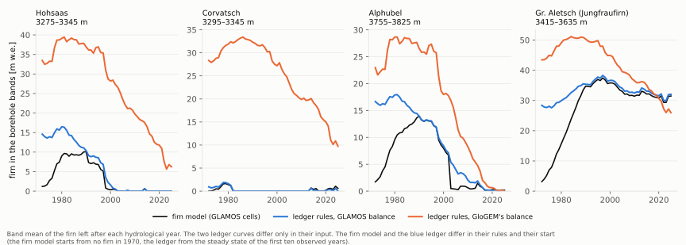

# 10. The firn ledger: how much firn the meltwater can really reach

> **In short.** The thermal model lets meltwater warm firn down to a fixed depth, the Herron &
> Langway close-off depth of 75–90 m in the zone. Real firn is far thinner, and changes from year to
> year. The firn ledger keeps each band's annual firn layers from the mass balance and stops the water
> at their base. Scored on 14 Oct it was not adopted (chapter 9).
>
> This chapter asks why. First (check 5): the ledger's rules reproduce Janosch's firn model (Beer et
> al. 2026) when both get the same GLAMOS balances. But fed GloGEM's own balance, the ledger holds
> 10–30 m w.e. of firn at Hohsaas, Corvatsch and Alphubel where the observations leave almost none.
> The ledger is right; its input is not.
>
> *Status (2026-10-19, evening; per-band table 20 Oct): check 5 and the batch done; the search for the
> missing heat continues in chapter 11.*
> - *The ledger is not adopted.*
> - *The right firn alone would not fix the zone sites: on the small glaciers it removes meltwater heat
>   that has been compensating for a missing heat source or a cold bias.*
> - *3b-ii is harmless but changes nothing measurable.*
>
> *Plan: `plans/2026-10-19_firn_ledger_plan.md`.*

## What we believed

- **The ledger** (GloGEM branch `firn-ledger`, switch `firnice_perm_limit = 'firn'`), for each band and
  hydrological year:
  - a positive balance adds a layer;
  - a negative balance removes its amount from the newest layers (mass-conserving);
  - layers older than 20 years become ice;
  - the meltwater reaches at most the ledger plus this winter's snow.
- **It uses only GloGEM's own band balance,** so it runs everywhere GloGEM runs, including the
  projections.
- **On 14 Oct** it improved only one zone site (Tête Rousse) and cooled six young firn-line bands
  (chapter 9). We suspected the input: GloGEM's band balance is too positive on small high glaciers
  (Corvatsch, Hohsaas), so the ledger is too thick there.

```
              band balance, per year            rules                    firn per band and year
 firn model   GLAMOS distributed grids  ──────► firn_change.pro ────────► the reference
 check 5a     GLAMOS band balances      ──────► the ledger's rules ─────► same as the reference?   (the rules)
 check 5b     GloGEM's band balances    ──────► the ledger's rules ─────► how far off, and where   (the input)
```

## What we measured

### Check 5: the ledger against the firn model (2026-10-19)

**How** (`scripts/icetemp_analysis/firn/ledger_vs_firnmodel.py`; outputs in `week2/firnmodel/check5/`):
- **The firn model's numbers, taken apart one step at a time:**
  - (A) the firn model;
  - (B) the same GLAMOS cells with the ledger's rules, one rule at a time;
  - (C) the ledger's rules on the GLAMOS *band* balance;
  - (D) the ledger GloGEM keeps, fed its own balance (the FRHL run of 14 Oct).
- **The data:** the 9 glaciers with GLAMOS grids, on the RGI7 10 m bands with at least 3 GLAMOS cells,
  1972–2025.
- **The check that the comparison itself is right:** the rule code, set to the firn model's rules,
  reproduces the Python port of `firn_change.pro` exactly on all 9 glaciers. The firn differs by
  0.0 m w.e., and no cell gets a different firn/no-firn verdict.



**5a: the rules are right.** In the borehole bands, the ledger's rules on the GLAMOS balance follow the
firn model:

| firn in the borehole bands, 2000s (m w.e.) | firn model (A) | ledger rules, GLAMOS cells (B) | ledger rules, GLAMOS bands (C') | GloGEM's ledger (D) |
|---|---|---|---|---|
| Hohsaas 3275–3345 m | 0.2 | 0.5 | 0.3 | **24.5** |
| Corvatsch 3295–3345 m | 0.0 | 0.0 | 0.0 | **23.9** |
| Alphubel 3755–3825 m | 2.6 | 5.1 | 5.0 | **14.1** |
| Gr. Aletsch 3415–3635 m | 33.5 | 33.5 | 34.5 | 40.9 |

- **The rule differences are small:**
  - the mass-conserving removal (a decision of 14 Oct) keeps up to 2.5 m w.e. more (Alphubel,
    2000s);
  - the firn model's running-sum gate never changes anything;
  - working on band means instead of cells adds at most 1.0 m w.e. (Aletsch, 2000s).
- **The 20-year ageing is the same convention** in both (ages 0–20 are kept). The "21 layers" noted on
  14 Oct is not a difference.
- **The two-years-in-a-row rule** only decides when a cell counts as firn on a map; it does not
  change the firn's thickness, which is what the ledger uses. So nothing changes in GloGEM.
  - Counting firn from the first year, and the mass-conserving removal, put the firn line lower than
    the firn model's: by up to 175 m on Aletsch in the 2020s, mostly by tens of metres.
- **The start differs by design.** The firn model starts from no firn in 1970, the ledger from a
  steady state (here: of the first ten observed years). The two meet by the 1990s.

**5b: the input is wrong.** Fed GloGEM's band balance, the same rules give far too much firn on the
small high glaciers:
- **Hohsaas and Corvatsch:** 25–39 m w.e. through the 1980s and 1990s, and still 6–12 m w.e. in the
  2020s. The observations leave almost none after 2000.
- **Alphubel:** too thick until about 2015.
- **Gr. Aletsch:** much closer, but 12–18 m w.e. too thick before 2000 and 4 m w.e. too thin in the 2020s.
- **The firn line** from GloGEM's ledger lies lower than the GLAMOS-driven one, by 100–200 m on
  Hohsaas and Corvatsch in the 2000s–2010s. In the 2020s it lies higher on the large glaciers
  (Aletsch +157 m, Morteratsch +133 m).

**What it means:**
- The ledger's water limit is wrong at the small zone glaciers because GloGEM's balance builds firn
  that is not there, not because of the ledger's rules.
- The snowline recalibration did not fix that balance (chapter 9).
- The open question is whether the ledger would help if the firn were right. That is the
  perfect-firn test, next.

### What was built and checked for the batch of 19 Oct

**The perfect-firn test** (GloGEM `firn-ledger`, `f8e8c4f`; a diagnostic switch, never for production).
The same thermal model and ledger, but on the 9 GLAMOS glaciers the ledger is fed the observed band
balance. Only the firn changes; melt, rain, snow and air temperature stay GloGEM's.

```
                                     the ledger is fed by          the firn mask (which bands are firn)
 FRH     ('hl', today)               -                              GloGEM
 FRHL    (the ledger as it is)       GloGEM's band balance          GloGEM
 FRHL-o  (observed firn thickness)   GLAMOS band balance            GloGEM
 FRHL-O  (observed firn line too)    GLAMOS band balance            GLAMOS (same rule: 5-year mean > 0)
```

- **The observed balances:** `firn/write_firn_obs.py` writes them from the band tables of check 5,
  for every band and year with at least 3 GLAMOS cells.
- **The start:** each band starts from the steady state of its first ten observed years. This applies
  only where the observations begin by 1972; Fiescher, Gorner and Morteratsch (from 2005–2008) keep
  GloGEM's start.
- **The close-off depth and the burial of observed bands** also use the observed start balance (a
  finding of the review).

**3b-ii, the firn column follows the ledger** (`184c9cd`, switch `firnice_firn_column = 'ledger'`):

```
 today (every firn band)              3b-ii (the column follows the ledger)
 0 m  ░ firn 250 kg/m³                0 m  ░ firn
      ▒ firn, denser with depth       8 m  ▒ firn base = ledger + this winter's snow
 35 m ▒ 830 (pores close)                  █ ice 900 kg/m³: conducts and stores heat like ice
 49 m █ ice                                █
```

- **Above the firn base the column is firn, below it ice.** The base is the ledger plus this
  winter's snow, the same depth that already caps the meltwater; the node straddling it is blended.
- **A firn band whose ledger is empty is an ice column:** its snow insulates as on ice, and its
  meltwater runs off.

**The thermal year now has 365 days** (GloGEMflow `a687448`):
- The thermal model counted every month as 30 days; now it uses each month's real length.
- The mass balance is unchanged, and the borehole temperatures move by at most 0.08 °C. It is in all
  the runs of the batch, so H and FRH are rerun too.

**An independent review** (max effort) of all three found no code error. It led to four changes
(`7851994`):
- the observed start balance also sets the close-off depth and the burial;
- an empty ledger gets no meltwater;
- the top node's slice is corrected;
- a wrong observation folder now stops the run.

**One known limitation is kept and stated:** from October to December, last summer's surviving
snow is counted twice (in the ledger and in the snow), so the firn base is about 1 m too deep then.
The ledger of 14 Oct and the spin-up have the same.

**The gate** (`firn/gate_b19.py`, all pass):

| check | result |
|---|---|
| defaults unchanged | the ledger branch's FRH = GloGEMflow's FRH (52 files byte-identical) |
| the new switches change nothing when off | FRHL unchanged (55 files); FRHL-o = FRHL on glaciers without observations |
| the mass balance is untouched | snow logbooks and ELA/AAR identical |
| the ledger is the Python reference | 31 968 band-years, at most 0.00004 m w.e. apart |
| observed bands take the observations | Hohsaas: all 1242 observed band-years, and all 23 start states |

**The rules, fixed before the runs** (icetemp `018592f`, `firn_batch_rule.py`):
1. **The ledger keeps the 14 Oct rule,** with the zone at 3000–3800 m and the cooling guard checked
   only on mature firn (at least 15 layers). On the 14 Oct runs that guard finds none of the six old
   failures; all were young firn-line firn.
2. **The perfect-firn reading** is on the zone bands of Hohsaas, Corvatsch, Aletsch and Alphubel (4 sites,
   15 bands; counted in sites since the amendment below):
   - if FRHL itself gains at least 2 robust sites over FRH, the ledger works already;
   - if only FRHL-O does, investing in the snow and firn lines pays off;
   - if FRHL-O does not, the right firn lines would not fix these sites.
3. **3b-ii is adopted unless it is worse than FRHL:**
   - M1 not worse by more than 0.1 °C;
   - no net loss of zone sites;
   - the guard holds;
   - the frozen-bed table holds.

**Counting sites, not bands** (amendment of 19 Oct, Janosch's decision while the batch ran, before any
result was looked at; icetemp `45e05e7`):
- **His question:** should the boreholes of one elevation bin be merged into one median, so that the
  benchmark has the model's dimension?
- **Why not a median:**
  - Within a model band there is little to merge: the scoring unit is already one site in one 10 m
    band, and only 3 of 102 glacier-band cells hold more than one site.
  - Boreholes sit at chosen places (ice-core saddles, hazard sites); a median does not turn them into a
    band mean.
  - A single value per band throws away depth and time. Depth is what separates f_ref from f_ins
    (chapter 7), and time is what the warming test needs.
- **But the question uncovered a real flaw:** the 105 scored entities come from 20 sites, and the 27
  zone entities from 7:

  | site | zone bands |
  |---|---|
  | Tête Rousse | 8 |
  | Hohsaas | 5 |
  | Corvatsch | 4 |
  | Jungfraufirn | 4 |
  | Taconnaz | 3 |
  | Alphubel | 2 |
  | Altels | 1 |

  Neighbouring bands of one site lie within about 70 m, where neighbouring holes already differ by
  2.2–2.7 °C (chapter 8). They are not independent evidence, and "a gain of 2" could be two bands of
  one site.
- **So the gain conditions now count sites.**
  - A site gains when more than half of its zone bands gain robustly and none loses; it loses in the
    mirror case.
  - The ledger needs a net gain of 2 of the 7 zone sites; the perfect-firn reading 2 of its 4 sites;
    3b-ii no net loss of sites.
  - The band counts are reported beside.
  - Rule A's loss conditions stay per band, the stricter way for losses.
- **Kept for the Bayesian calibration (Step 5):** each hole is modelled as the band's value plus a site
  deviation of about 1.5–1.9 °C, shared by all its readings. That brings the benchmark to the model's
  dimension without losing depth or time.

**The batch** (tag `b19`; 53 runs, started 19 Oct 13:01):
- H, FRH, FRHL, FRHL-o, FRHL-O, FRHL + 3b-ii and FRHL-O + 3b-ii, each at the 7 f_ref values;
- FRH and FRHL without deepening;
- FRHL with 15- and 30-year ageing.

### The batch's results (2026-10-19, scored 15:40)

All 53 runs finished; the scored set is the pre-registered one (105 entities, 800 points; none dropped).
Scorer `firn_batch_rule.py` (rules `018592f`, site counting `45e05e7`); outputs `week3/batch_rule/`.

| question | rule | result |
|---|---|---|
| 1. the ledger as it is (FRHL against FRH) | ≥ 2 zone sites gained, A's conditions, guard, frozen bed | **not adopted**: 0 sites (1 of Tête Rousse's 8 bands; net band gain +1); all other conditions pass (M1 2.58 → 2.59 °C, guard 0 of 2933, frozen beds 12 of 14) |
| 2. the perfect-firn test | FRHL-O ≥ 2 of the 4 sites | **"the right firn lines would not fix these sites"**: 1 site (Corvatsch, all 4 bands) |
| 3. 3b-ii (FRHL + column against FRHL) | adopted unless worse | passes, but changes nothing measurable: M1 2.5862 → 2.5861 °C, no site changes |

Reported:
- **Zone target D** (against H) is met by no variant; the observed-firn variants reach 1 site.
- **The ageing** hardly matters: M1 at f_ref 0.85 is 2.14, 2.12 and 2.11 °C for 15, 20 and 30
  years.
- **The temperate sites** are unchanged in every F-variant: Breithorn is cold instead of temperate,
  and Jungfraufirn is temperate where three of its four bands are measured cold.

**Why the right firn does not help: it removes heat that was compensating for something else.**
Band by band, readings below 15 m (f_ref 0.85; RMSE in °C, bias in brackets, model minus measured;
`firn/stage1_sites.py`, `week3/batch_rule/perfect_firn_bands.csv`). *A first version of this table gave
site means; Janosch rejected those (19 Oct): averages over bands and depths hide errors of opposite sign,
so every comparison is now per band at depth.*

| band (readings) | FRH | ledger, GloGEM balance | ledger, observed balance | ledger and mask observed |
|---|---|---|---|---|
| Corvatsch 3295, 3315 (1 each) | 1.1, 0.8 (warm) | 1.1, 0.8 | **0.2, 0.1** | 4.0, 4.3 (cold) |
| Corvatsch 3325, 3345 (1 each) | 2.7, 2.5 (warm) | 2.7, 2.5 | 1.7, 1.6 | 2.5, 2.7 (cold) |
| Hohsaas 3275–3345, 5 bands (8) | 0.0–0.9 | 0.0–0.9 | 0.6–1.3 (cold) | **1.7–3.2 (cold)** |
| Sex Rouge 2785, 2815 (1, 5) | 2.4, 1.3 (cold) | 2.4, 1.4 | 2.5, 1.3 | 2.4, 2.4 (cold) |
| Tortin 2895 (1) | 1.8 (cold) | 1.9 | 1.7 | 2.3 (cold) |
| Alphubel South 3755, 3785 (2, 1) | 3.5, 4.7 (cold) | 3.5, 4.8 | 3.5, 4.7 | 3.8, 4.1 (cold) |
| Alphubel South 3805, 3825 (10, 5) | 1.2, 1.4 (cold) | 1.6, 1.4 | 1.9, 1.6 | 2.0, 1.8 (cold) |

The depth profiles of these bands, with the right firn, are in chapter 11 (figure *Measured and modelled at depth*).

- **The small glaciers lose their meltwater heat with the right firn.** Where GLAMOS leaves no firn
  (Corvatsch, Hohsaas, Sex Rouge, Tortin), the observed mask makes the bands ice and their meltwater
  runs off. The sites then come out 2.3–3.4 °C too cold, colder than the measurements by more than
  the model was warm before.
- **So today's too-extensive firn has been compensating for a missing heat source, or a cold bias.**
  Its meltwater heat hid the error. Two known candidates:
  - the surface forcing, which is about 5 °C too cold in winter at 3300–3600 m (ERA5's lapse rate,
    week 1, chapter 8);
  - the refreezing of meltwater in the seasonal snow on ice bands, which the model leaves out
    (FRHS, chapter 9).
- **The observed firn thickness alone,** with the model's mask, helps at Corvatsch (the lower two
  bands come within 0.2 °C, the upper two within 1.7 °C; zone M1 on the four glaciers 2.23 → 2.13 °C).
  There the model still calls the band firn, so some meltwater heat remains.
- **The glaciers observed only from 2005–2008** (Fiescher, Gorner, Morteratsch) barely change; the
  observations act there for too few years.

**What it means for the plan of 19 Oct:**
- **By the rule,** investing in the mass balance's firn lines alone would not fix the zone sites.
  It would make the small ones too cold.
- **It does tell us what to fix first:** the heat that the wrong firn has been standing in for.
  The next test is the right firn together with each candidate: the right firn with a winter-corrected
  surface forcing, and the right firn with snow refreezing on ice. Each is diagnostic, on the GLAMOS
  glaciers.
- **If the right firn plus the missing heat reproduces Corvatsch and Hohsaas,** the firn lines are
  worth the investment, but only together with that fix.

## What is next

- **Done (chapter 11):** the right firn with each candidate for the missing heat. Snow refreezing on
  ice (S) is the heat; with S the right firn passes every condition of stage 2, and the ledger on the
  model's own balance still adds nothing.

## Sources

- Plan: `plans/2026-10-19_firn_ledger_plan.md`; the ledger's own plan `plans/2026-10-14_firn_ledger_plan.md`
- Scripts: `scripts/icetemp_analysis/firn/` (`firn_change_port.py`, `band_compare.py`,
  `ledger_vs_firnmodel.py`); `scripts/icetemp_analysis/firn_ledger.py` (the Python reference)
- GLAMOS distributed balances: `/scratch_net/vierzack06_fourth/mhuss/MassBalance_all/<glacier>/massbalance/results/`
- Literature: Beer et al. (2026, *The Cryosphere* 20, 5453–5473); Herron & Langway (1980)

## Glossary

| term | meaning |
|---|---|
| firn ledger | per elevation band, the annual firn layers built from the band balance; layers older than 20 years become ice; the meltwater reaches at most their base |
| firn model | Matthias Huss's `firn_change.pro` (Beer et al. 2026): the same bookkeeping per 25 m cell, driven by the GLAMOS distributed mass balance |
| GLAMOS | Glacier Monitoring Switzerland: measured mass balances, here as yearly grids |
| band balance | the year's mass balance of one 10 m elevation band [m w.e.] |
| m w.e. | metres of water equivalent |
| mass-conserving removal | a negative year removes exactly its amount, newest layers first (the firn model removes more when several thin layers lie on top; chapter 9) |
| running-sum gate | the firn model removes firn only where the running sum of the balance is positive |
| steady state | the starting ledger: one layer of a reference balance for each of the 21 years before the start |
| firn line | the lowest band where at least half the area has firn |
| borehole bands | the elevation bands of the boreholes on each glacier |
| zone | 3000–3800 m, the band of the firn–no-firn transition |
| FRH, FRHL | the central thermal variant (no T_off, ERA5 lapse rate, Herron & Langway meltwater); FRHL: with the ledger |
| FRHL-o, FRHL-O | the ledger fed the observed balance: o the thickness only, O also the firn mask |
| 3b-ii | the firn density follows the ledger instead of one fixed profile |
| robust zone site | a borehole site in the zone whose temperature class is right across the f_ref values; since 19 Oct a site counts as gained when more than half of its zone bands gain and none loses |
| site, entity | site: one borehole location (e.g. Hohsaas); entity: a site in one 10 m band, the unit the readings are compared in |
| floor | how close a band model can come to a single borehole: neighbouring holes differ by 2.2–2.7 °C, so about 1.5–1.9 °C |
| perfect-firn test | the thermal model with the ledger fed observed instead of modelled band balances: what the ledger would do if the model's firn were right |
| firn base | the depth of the ledger plus this winter's snow on the thermal density profile; caps the meltwater, and with 3b-ii sets the firn/ice column |
| close-off depth, burial | Herron & Langway's depth where firn pores close (caps the water under 'hl' and 'firn'); burial: the downward motion of the column by accumulation |
| cooling guard (mature firn) | no firn band that the baseline keeps temperate may be cooled by more than 0.2 °C; checked only where the ledger holds at least 15 layers |
| gate | checks a new switch must pass before its runs count: unchanged when off, mass balance untouched, matches its reference |
| 365-day thermal year | the thermal model's step now follows each month's real length (it counted 30-day months) |
