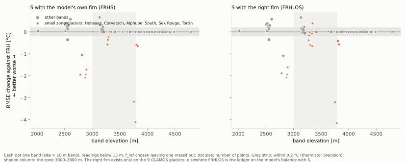
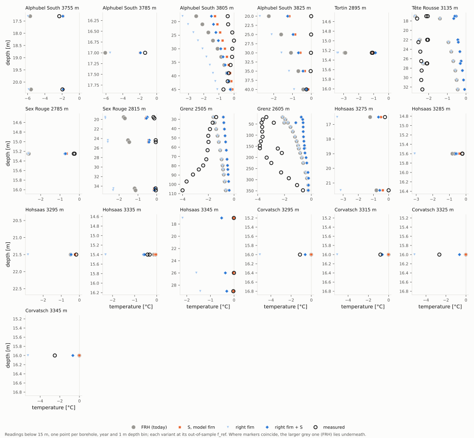

# 11. The missing heat: meltwater that refreezes on ice

> **In short.** With the right firn (chapter 10) the small glaciers of the zone came out 2–3 °C too
> cold. The model's too-extensive firn had been giving them meltwater heat that really comes from
> elsewhere. We tested three sources of that heat:
> - **S:** meltwater refreezing in the seasonal snow on ice bands, in the thermal model;
> - **W:** a milder winter surface, from the station lapse rates;
> - **B:** the same refreezing in the mass balance, via GloGEM's full refreezing model.
>
> S is the missing heat on the small glaciers. It repairs 13 bands by 0.2–4.1 °C (Alphubel South,
> Grubengletscher, Sex Rouge, Tortin, Hohsaas) and lowers the zone RMSE from 2.98 to 2.51 °C. It
> costs 11 bands 0.2–0.7 °C on the Grenz tongue and at Tête Rousse, which were already too warm, and
> Tête Rousse's frozen bed. With the right firn, S passes every condition. W overheats the cold
> summits. B's refreezing model was broken, also on `main`; repaired, it changes neither the mass
> balance nor the ice temperatures.
>
> *Status (2026-10-20, afternoon): stages 1 and 2 done. By the rule S was not adopted (one frozen bed
> lost); **Janosch adopted it**: it is a real physical process, and the remaining errors have other
> causes. The central thermal variant is now FRHS.*
>
> *Plans: `plans/2026-10-19_missing_heat_plan.md`, `plans/2026-10-19_missing_heat_status.md`; the plan of 20 Oct.*

## What we believed

- **Why the right firn made things worse.** In the model, meltwater warms the ice only where the band
  counts as firn. Today's model has firn far down the small glaciers, so their bands got meltwater
  heat. GLAMOS shows no firn there; with the observed firn mask that heat is gone, and the bands turn
  2.3–3.4 °C too cold (chapter 10). The measured ice is not that cold, so some other heat must reach it.
- **The candidate we suspected most: refreezing in the seasonal snow.** On a real ice band, the winter
  snow lies on cold ice. In spring, meltwater soaks into the snow and refreezes there and at the ice
  surface. Each kilogram that refreezes releases 334 kJ, right at the top of the ice. The model leaves
  this out on ice bands: their meltwater runs off without heat.

```
           an ice band in spring

   today's model                         with S (firnice_snow_refreeze)
   ░░░ snow   melt ──► runs off          ░░░ snow   melt × f_ref refreezes in the snow
   ███ ice    (no heat to the ice)       ███ ice    and at the ice surface: latent heat
                                                    warms the ice from the top
```

- **The other two candidates:**
  - **W:** the thermal surface uses ERA5's lapse rate, which is about 5 °C too cold in winter at
    3300–3600 m (chapter 8). Station lapse rates are milder in winter.
  - **B:** GloGEM's mass balance has a second refreezing model (`refreezing_full`) that refreezes
    meltwater in the snow on ice bands too. The default (parametrised) one caps refreezing with the
    firn mask, so it gives almost none on ice bands.

## What we measured

### How we compare: per band, at depth

Since 19 Oct every comparison of measured and modelled temperatures is made **per borehole band at
depth**, never as a mean over a borehole or a site (Janosch's rule). Averages hide errors of opposite
sign, a cold low band against a temperate high one, and they lose the curve with depth.

**What the calibration and the scoring did until 20 Oct** (checked in the code,
`calibration/data.py`, `_pool_by_depth_bin`):

| | until 20 Oct |
|---|---|
| unit | one entity per site × 10 m band × outline |
| depth | kept, in 1 m bins |
| several holes in one band | pooled into one mean per 1 m bin (37 of 108 entities have several holes) |
| several dates | pooled too: 233 of 887 bins below 15 m mix years, 55 span more than 5 years, 17 more than 20 years |
| the model | read at the same months with the same weights, so the pooled comparison was consistent |
| worst case | Colle Gnifetti (Grenz 4455 m): 9 holes from 1983 to 2021 in 14 bins, while the site warmed |

The pooling was meant to stop continuous loggers (up to thousands of readings at one depth) from
dominating. It also averaged holes and decades together.

**Since 20 Oct (decision 3):** the readings are pooled only **within one borehole and one year**
(`DataHandler(pool_within='hole_year')`, icetemp `9e79cf6`). A logger still gives one point per depth
bin and year; holes and decades stay apart.

```
  one band, one depth bin (16 m)        until 20 Oct          since 20 Oct
  hole A, 1991:  −10.9 °C  ┐
  hole A, 2003:  −10.4 °C  ├──► one mean, −10.4 °C       ──► three points, each read
  hole B, 2018:   −9.9 °C  ┘                                  against the model of its year
```

- The scored set stays the same: 105 entities, 19 outlines, 7 massifs. The points below 15 m go from
  800 to 1135.
- Re-scoring needs no new runs: the archived monthly profiles of each run are matched again
  (`rescore_hole_year.py`). With the old pooling this reproduces the stored results exactly
  (difference 0.00 °C, checked on two runs).

### Stage 1: a quick look at f_ref 0.85 (19 Oct)

Each candidate ran with the model's own firn and with the right firn (the ledger fed GLAMOS's band
balances, with the observed firn mask). Per band, readings below 15 m, RMSE in °C (bias in brackets,
model minus measured); `firn/stage1_sites.py`, outputs `week3/stage1/part1_*.csv`:

| band (readings) | today, FRH | right firn | **right firn + S** | right firn + W | **S, model firn** |
|---|---|---|---|---|---|
| Hohsaas, 5 bands (8) | 0.0–0.9 | 1.7–3.2 (too cold) | **0.2–0.5** | 1.1–2.1 | **0.0–0.3** |
| Corvatsch 3295, 3315 (1 each) | 1.1, 0.8 | 4.0, 4.3 (too cold) | **0.5, 0.2** | 2.6, 2.9 | 1.1, 0.8 |
| Corvatsch 3325, 3345 (1 each) | 2.7, 2.5 | 2.5, 2.7 | 2.0, 1.8 | 1.1, 1.3 | 2.7, 2.5 |
| Alphubel South 3755, 3785 (2, 1) | 3.5, 4.7 (too cold) | 3.8, 4.1 | **0.3, 0.6** | 2.2, 2.5 | **0.3, 0.6** |
| Tortin 2895 (1) | 1.8 (too cold) | 2.3 | **0.2** | 1.2 | **0.1** |
| Sex Rouge 2785, 2815 (1, 5) | 2.4, 1.3 (too cold) | 2.4, 2.4 | **0.5, 0.3** | 1.0, 1.0 | **0.4, 0.3** |
| Grenz tongue 2505–2605 (7 bands) | 0.5–2.0 (too warm) | same | 0.1–0.6 worse | up to 0.1 worse | 0.1–0.6 worse |
| Gorner tongue 2515–2555 (4 bands) | 0.5–0.9 | same | 2525, 2545: 0.3–0.4 worse; 2555: 0.4 better | about the same | as with the right firn |

- **S is the missing heat on the small glaciers.** Where the band is ice in the model (Alphubel South,
  Tortin, Sex Rouge with the model's firn; Hohsaas and Corvatsch with the right firn), S brings the band
  within 0.6 °C.
- **Where the model already calls the band firn,** S does nothing (Corvatsch with the model's firn): S
  acts only on ice bands.
- **Upper Corvatsch (3325, 3345)** stays 1.8–2.0 °C too warm. These holes are 1.5–2 °C colder than the
  lower ones, 30–50 m higher up on the same small glacier; a band model can hardly resolve that.
- **The cost: the Grenz tongue,** already too warm, gets 0.1–0.6 °C warmer. S adds heat on the
  ablation zone too.
- **W fails:** it helps upper Corvatsch, but overheats the cold Monte Rosa bands (4100–4500 m) by
  2–4 °C.
- By its rule (Corvatsch and Hohsaas within 1.7 °C, nothing else worse by more than 0.5 °C), no fix
  passed: upper Corvatsch, and one Grenz band 0.55 °C worse. **Janosch sent S to stage 2 anyway**: the
  stage checks ask whether a physical improvement helps, and 0.05 °C beyond the limit is within the
  thermistors' precision (0.2 °C typical).

### B: the mass balance's full refreezing model was broken

Preparing B, an independent review (max effort) found three flaws in `refreezing_full`, all also on
`main` (model changes G41):
- **The cold store was used once a year.** It was evaluated only once per hydrological year. An
  October melt month (on bare ice at once: no snow) used it up, and nothing refroze for the rest of
  the year, the normal case on the tongues.
- A conduction step restored the cold of a profile already reset to 0 °C.
- The thermal model's reference years left their state for the main run.

Repaired on local GloGEMflow (`01dbb65`), together with its 360-day year (`2cce026`, G40). The 23
calibration glaciers were recalibrated with it (B) and compared with the same recalibration on the
default scheme (C0), monthly 2000–2025:

| | C0 (default scheme) | B (full model, repaired) |
|---|---|---|
| refreezing on ice bands [mm w.e. a⁻¹] | 1.6 | **48** |
| refreezing on firn bands [mm w.e. a⁻¹] | 26 | 65 |
| snow line against Sommer's, RMSE May–Sep (12 glaciers) | 350.1 m | 349.5 m |
| winter balance against GLAMOS (8 series) | | within 0.05 m w.e. of C0 |
| ELA against GLAMOS (7 glaciers) | | within 13 m of C0 |

- **B refreezes 30 times more on ice bands, and the mass balance hardly notices:** the calibration
  absorbs it (T_off up by 0.02–0.15 °C).
- **A trap on the way:** the first comparison showed B's snow line 50 m worse. The two forward runs
  came from different GloGEM trees, and only the snowline tree knows `snowline_definition = 'p10'`;
  GloGEMflow ignored the setting silently and wrote another snow-line definition, up to 750 m apart in
  winter. With both on the same tree the difference vanished (model changes K32). The C0 calibration
  itself is identical on both trees.

**In the thermal model, B changes nothing** (stage 1 part 2, 20 Oct, f_ref 0.85; FRH, FRHS, FRHLO and
FRHLOS each on C0 and on B; `week3/stage1/part2_*.csv`):
- On the 55 bands of the 9 GLAMOS glaciers, B moves the RMSE by at most 0.2 °C in 54 or 55 bands, for
  every variant. The one larger change is a loss: Alphubel South 3785 m with FRH, 2.9 → 4.7 °C.
- **Why:** the thermal model takes its meltwater heat from the melt (× f_ref), not from the mass
  balance's refreezing. B reaches the ice temperatures only through the band balance (the firn mask,
  burial), and it hardly changes the balance.
- **So B does not join stage 2** (decision 2 of 20 Oct: only with a gain). The heat has to come in the
  thermal model itself, which is what S does.

### The gate (20 Oct)

The `firn-ledger` branch (all thermal switches of chapters 10 and 11) was moved onto the repaired
GloGEMflow (`232e090` on `01dbb65`). With every new switch at its default it writes byte-identical
thermal output to GloGEMflow itself (FRH at f_ref 0.85, 373 of 373 files), with the default and with
the full refreezing model.

### Stage 2: all seven f_ref values (20 Oct)

**How:** 42 runs (tag `s2`): FRH, H, FRHS, FRHLS, FRHLO and FRHLOS at the seven f_ref values, f_ins
1.017, all on the same code (`firn-ledger` `232e090`). Each massif is scored at the f_ref chosen on the
other six. Scored per borehole and year (1135 points below 15 m); the old pooling (800 points) gives
the same verdicts. Rule: decision 1 of 20 Oct, approved before the runs were read (`firn/stage2_rule.py`):
- **a change helps** if M1 drops by more than 0.1 °C, overall or in the zone, or if it gains sites;
- **it harms** if M1 rises by more than 0.2 °C, a site is lost, or a measured frozen bed is lost;
- **it is adopted** if it helps and does not harm.

| variant | M1 [°C] | zone M1 [°C] | bands right: cold / polythermal / temperate (of 81 / 18 / 6) | frozen beds found (of 14) | temperate beds called frozen |
|---|---|---|---|---|---|
| FRH (today) | 2.59 | 2.98 | 64 / 9 / 2 | 12 | 2 |
| H (with T_off) | 2.63 | 2.56 | 60 / 11 / 2 | | |
| **FRHS** (S) | **2.51** | **2.51** | 61 / 9 / 2 | 11 | 1 |
| FRHLS (ledger + S) | 2.51 | 2.51 | 61 / 9 / 2 | 11 | 1 |
| FRHLO (right firn) | 2.84 | 3.33 | 70 / 9 / 1 | 13 | 3 |
| **FRHLOS** (right firn + S) | **2.49** | **2.45** | 66 / 9 / 1 | 12 | 2 |

| question | helps | harms | verdict |
|---|---|---|---|
| S (FRHS against FRH) | zone M1 −0.47 °C (overall −0.08) | Tête Rousse's frozen bed | **not adopted by the rule** |
| the ledger with S (FRHLS against FRHS) | nothing (M1 within 0.003 °C) | nothing | not adopted: no gain |
| right firn + S (FRHLOS against FRH), reported | M1 −0.11, zone −0.53 °C; Corvatsch gained (all 4 bands) | nothing (frozen beds as FRH) | would pass every condition |
| S given the right firn (FRHLOS against FRHLO), reported | M1 −0.35, zone −0.88 °C | Tête Rousse's frozen bed | — |

Zone target D (two zone sites more than H) is met by no variant; FRHLO and FRHLOS reach one.



**Band by band, S changes 24 of the 105 bands by more than 0.2 °C:**
- **13 better, by 0.2–4.1 °C:** the small glaciers whose bands the model calls ice and makes too
  cold: Alphubel South 3755–3825 m (4.7 → 0.6 °C at 3785 m), Grubengletscher 2875–2885 m, Sex Rouge,
  Tortin, Hohsaas 3275–3295 m; and one Gorner band (2555 m).
- **11 worse, by 0.2–0.7 °C:** the Grenz/Gorner tongue (2505–2605 m, 8 bands) and Tête Rousse
  (3135–3195 m, 3 bands). All were already too warm under FRH.
- The other 81 bands stay within 0.2 °C.



**The frozen bed that decides it: Tête Rousse, hole 64, 32.5 m.**
- Measured −2.34 °C. FRH gives −0.44 °C: frozen, but already 1.9 °C too warm. FRHS gives −0.07 °C,
  which counts as temperate.
- S also puts one deep Grenz bed right (hole 175, 249 m: measured −0.19 °C; FRH −0.33 °C, called
  frozen; FRHS −0.21 °C). That change is within the thermistors' precision.
- In temperature classes: Tête Rousse 3135 m and Grenz 2555 and 2565 m go from cold (right, though not
  at every tolerance) to polythermal.

**What it means:**
- **S is the missing heat on the small glaciers.** It repairs the largest errors of the zone, up to
  4 °C, where the model calls the band ice.
- **Where S harms, the band was already too warm.** The warm Grenz tongue and Tête Rousse have
  another cause, and S adds to it. Candidates from the list of open items: the thermal spin-up on the
  2003 geometry (deep tongue ice), the Oct–Dec snow counted twice, and Tête Rousse's snow (in
  chapter 9 less snow restored its frozen bed).
- **The right firn pays off, but only together with S** (Janosch's question of 19 Oct). The right
  firn alone makes things worse (M1 2.84 °C); with S it passes every condition and gains Corvatsch.
- **The firn ledger on the model's own balance still adds nothing** (FRHLS = FRHS).

**Janosch's decision (20 Oct): S is adopted; the central thermal variant is now FRHS.**
- *"It is a real physical process and the remaining errors stem from other issues and might possibly
  be resolved through the right calibration. Also if one frozen bed gets flipped this can't be a
  reason why we neglect the adoption of a new real physical process."*
- **For the rules from now on:** a missing physical process is adopted when it helps overall; a single
  band or frozen bed that it worsens, on a band with another known error, is follow-up work, not a
  veto.
- **In GloGEM:** S moves alone onto GloGEMflow (branch `snow-refreeze-flow`); the firn ledger stays on
  its branch, as rules that were not adopted do.

## What is next

- **S onto GloGEMflow:** gate (defaults byte-identical; S as on the ledger branch), then the model-changes
  page.
- **The warm tongues and Tête Rousse:** find what makes them too warm before S (the spin-up on the
  2003 geometry is the first candidate).
- **Step 5, the Bayesian calibration,** with the depth bins per borehole and year and a site-offset
  term, so that one band's many holes do not outweigh the others.
- **The firn lines:** worth investing in only together with S (the perfect-firn reading).

## Sources

- Plans: `plans/2026-10-19_missing_heat_plan.md`, `plans/2026-10-19_missing_heat_status.md`, the plan of 20 Oct
- Scripts: `scripts/icetemp_analysis/firn/stage1_sites.py`, `firn/stage2_rule.py`, `firn/refreezing_check.py`,
  `rescore_hole_year.py`, `snowline/compare_snow.py`
- Runs: `data/bayescal/s1_*`, `s1c0_*`, `s1b_*`, `s2_*`, gate `g20*`; mass-balance runs
  `week2/snowcal/refit_none_main`, `fwd_none_main`, `refit_rffull2`, `fwdRF2`; outputs `week3/stage1/`,
  `week3/stage2/`, `week3/bcheck_main/`
- GloGEM: local GloGEMflow `2cce026`, `01dbb65`; branch `firn-ledger` `232e090`; model changes G40, G41, K32
  (`_wt_v3` `662e9f6`)

## Glossary

| term | meaning |
|---|---|
| S | snow refreezing on ice (`firnice_snow_refreeze`): on ice bands, meltwater × f_ref refreezes in the seasonal snow and at the ice surface, and its latent heat warms the ice |
| W | the station lapse rates for the thermal surface (milder in winter than ERA5's) |
| B | GloGEM's full refreezing model in the mass balance (`refreezing_full`), which also refreezes in the snow on ice bands |
| C0 | the recalibration of the 23 glaciers with the default refreezing, the fair baseline for B |
| FRH | the central thermal variant until 20 Oct: no T_off in the thermal inputs, ERA5's lapse rate, Herron & Langway meltwater |
| FRHS, FRHLS | FRH with S, the central thermal variant since 20 Oct; FRH with the firn ledger and S |
| FRHLO, FRHLOS | the ledger fed GLAMOS's band balances with the observed firn mask ("right firn"), without and with S |
| f_ref | the share of the meltwater that refreezes and heats the firn or ice |
| entity, band | a borehole site in one 10 m elevation band (and one outline), the unit the readings are compared in |
| RMSE, bias | root-mean-square and mean difference, model minus measured, over a band's readings below 15 m |
| M1 | RMSE over all readings below 15 m, each outline weighted equally |
| site | one borehole location; a site gains when more than half of its bands gain a correct temperature class and none loses |
| zone | 3000–3800 m, the band of the firn–no-firn transition |
| floor | how close a band model can come to a single borehole, about 1.5–1.9 °C |
| stage 1, stage 2 | quick look at f_ref 0.85; the full test at the seven f_ref values, f_ref chosen leaving one massif out |
| gate | the check that a branch with every new switch off writes exactly what its base writes |
| GLAMOS | Glacier Monitoring Switzerland: measured mass balances |
| m w.e. | metres of water equivalent |
