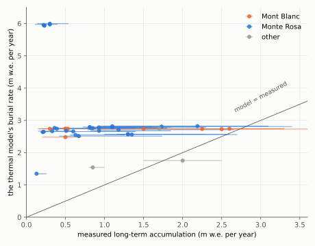
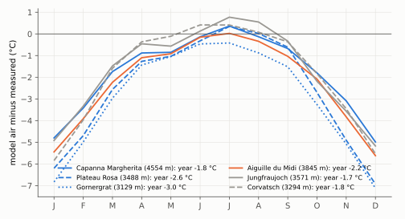
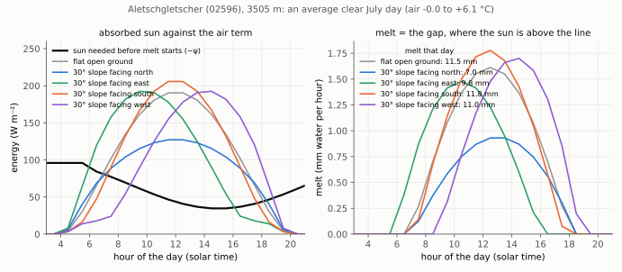
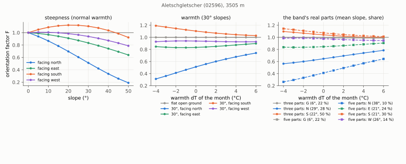
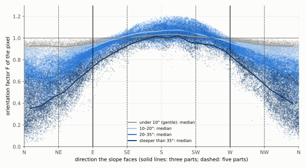
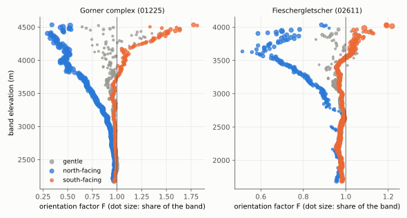
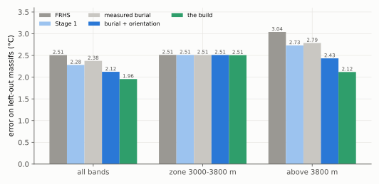
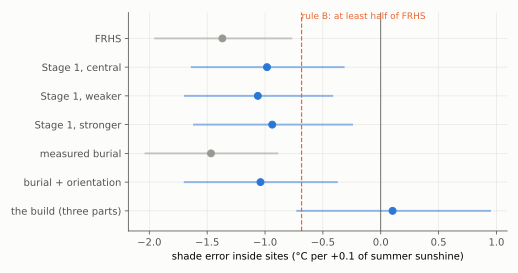
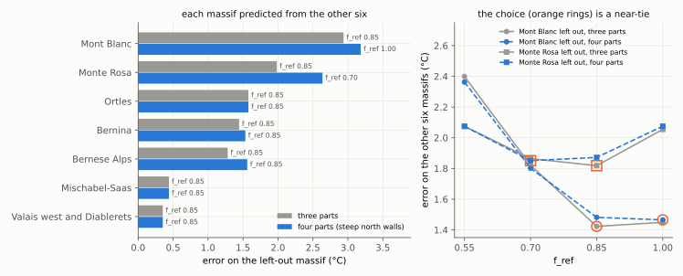

# 12. Sun and shade, burial, and the air: three tests, and orientation in the model

> **In short.** The review panel of 20 Oct found that the zone 3000–3800 m cannot be fixed by calibration alone,
> and that Mont Blanc and Monte Rosa want opposite amounts of meltwater heat. We tested three suspected causes, each
> against a rule fixed before its runs:
> - **sun and shade (orientation):** a factor F on the thermal model's meltwater, from an hourly energy balance on
>   the real slopes;
> - **burial:** the model buries the high firn under snow much faster than measured;
> - **the air:** ERA5's air temperature at height.
>
> None of them closes the gap between the massifs. Orientation lowers the overall error on left-out massifs
> (2.51 → 2.28 °C), but removes only about a third of the sun-and-shade pattern in the errors inside sites, so it
> fails its rule, twice. **Janosch kept it in the model**, as three parts per band (gentle, north, south), because
> it is physical and the map must show north against south faces. The burial is 2–20 times too fast at the high
> saddles but moves the borehole temperatures by only 0–0.8 °C. The air is about 2 °C too cold at every high
> station, equally at both massifs; it partly cancels a second error, the missing cooling of the snow surface. Both
> stay known limitations of v1.0.
>
> The build with three parts per band, corrected after a max-effort review, lowers the error on left-out massifs to
> 1.86 °C (above 3800 m from 3.04 to 1.87 °C) and removes the sun-and-shade pattern inside sites; all seven massifs
> choose f_ref 0.85. The zone, the frozen beds and the massif split stay unchanged. West faces get about 12 % more
> meltwater heat than east faces, but five parts (adding east and west) are worse at the boreholes (2.13 °C). Four
> parts (the steep north walls apart) bring the boreholes' part factors closer to their own, but are not better at
> the boreholes either (2.14 °C). Judged without the Mont Blanc / Monte Rosa split, the boreholes barely tell the
> splits apart. **Janosch chose five parts for v1.0 (23 Oct):** the map must show east and west faces, so that users
> such as CREALP can see where cold and polythermal glaciers lie.
>
> *Status (23 Oct, midday): the three-, four- and five-part builds are scored, and five parts are chosen (below). A
> section explains how the energy balance behind F works for north, south, east and west faces; every pixel's factor
> is stored. Plans: `plans/2026-10-20_step5_plan.md` (step 1b, revised 21 Oct, and the new step 1c). Decisions:
> `decision_log.md`.*

## What we believed

- **The zone's wrong bands have four causes** (review panel, 20 Oct): near the melting point (a matter of
  reporting), too much firn (Corvatsch; fixed by the observed firn), too much meltwater heat on a shaded north side
  (Taconnaz 3685–3785 m), and Tête Rousse too warm at depth.
- **The meltwater heat depends on air temperature only.** A shaded north face melts as much as a sunny saddle. In
  week 1 the sunshine at the hole itself had added skill where the band's sunshine had not (chapter 8).
- **Mont Blanc wants little meltwater heat, Monte Rosa a lot.** In stage 2 the best f_ref was 0.17 at Mont Blanc and
  1.0 (the end of the grid) at Monte Rosa. The best f_ref of a glacier follows the temperature correction T_off of
  its mass-balance calibration (rank correlation 0.78).

## What we measured

### Orientation: an investigation, then Stage 1

**How the factor works.** Only the thermal model's meltwater heat changes; the mass balance stays byte-identical.

```
   air temperature ──► today's melt M ──────────────────────────► mass balance (unchanged)
                            │
                            ▼
   sun on the real slope ─► F = melt on this slope ÷ melt on flat ground   (same weather; table by warmth)
                            │
                            ▼
                     thermal melt = F × M ──► × f_ref ──► heat in the firn and ice
```

- F comes from an hourly energy balance (Giesen & Oerlemans 2012): sun on the slope with its terrain horizon, plus
  heat from the air, over 1981–2020 Jungfraujoch weather.
- On flat ground the energy balance melts exactly what the model's degree-day melt gives in that band (June to
  September). So F carries only slope and shade, not a new melt level.
- F is tabled against the month's warmth (−4 to +6 °C): in a warm summer a shaded slope catches up.
- How the energy balance works, and how it treats north, south, east and west, is set out in detail in the section
  *How orientation enters the model* below.
- The investigation (four investigators, a design, two hostile critics, a revision; 20–21 Oct) built the factor and
  predicted from the existing runs that it would remove the shade error inside sites.

**Stage 1** (33 runs, tag `o1`, GloGEM `orientation-factor` `1192935`): F at the borehole bands only, in three
strengths (central, weaker, stronger), at f_ref 0.03–1.00. **Rule B, fixed before the runs** (icetemp `ab5ded4`):
adopt if the shade error inside sites is at least halved, also without Taconnaz and Lys (where the idea came from),
and nothing gets worse overall, as for S.

*The shade error inside sites is shown for every test in the figure at the end of the build section.*

| measure (out of sample, below 15 m) | FRHS | Stage 1, central |
|---|---|---|
| shade error inside sites (°C per +0.1 sunshine) | −1.37 | −0.98 |
| same without Taconnaz and Lys | −1.15 | −1.04 |
| overall error on left-out massifs | 2.51 °C | 2.28 °C |
| without Taconnaz and Lys (also left out of the choice) | 1.36 °C | 1.19 °C |
| above 3800 m | 3.04 °C | 2.73 °C |
| zone 3000–3800 m | 2.51 °C | 2.51 °C |
| regime classes, sites, frozen beds | — | unchanged |
| best f_ref Mont Blanc / Monte Rosa | 0.17 / 1.0 | 0.17 / 1.0 |

- **The rule fails on its first condition.** A reduction of a quarter lies inside the slope's own uncertainty, so it
  cannot be credited to sun and shade.
- **Most of the overall gain is between whole glaciers** (Lys alone gives 85 %), not between the sunny and shaded
  bands of one site. Outside Taconnaz and Lys there is a real but modest gain at Bossons and on the large Monte Rosa
  outline (about 0.2 °C each).
- **The quick estimate from existing runs was a poor guide:** it had predicted the tilt would vanish and the overall
  gain would be smaller.

### Burial: the snow that buries the firn

The thermal model buries its firn at the band's reference-period mass balance (`b_ref`). A throwaway GloGEM branch
printed it at the borehole bands; a literature search (mainly Suter's 2002 thesis, Konrad 2013, Licciulli 2020,
Bohleber 2018, Eichler 2000, Preunkert 2024, Gilbert & Vincent 2013, Vincent 1997/2007, Smiraglia 2000, Mariani
2014, Gabrielli 2016, GLAMOS) gave the measured long-term accumulation at 41 of them.



*The model buries most high summits and saddles 2–20 times too fast: Colle Gnifetti (0.14–0.6 measured; 2.6 and,
on its second outline, 6.0 modelled), Dôme du Goûter (0.5 against 2.7), Seserjoch, Lys, Fiescherhorn. It agrees at
the Col du Dôme ice-core site (2.5), the 1994 Grenzgletscher core site (2.7) and Jungfraufirn (2.0).*

**The perfect-burial test** (8 runs, tag `b1`; GloGEM `burial-obs` `abf5cce`; rule icetemp `990cd82`): the measured
accumulation replaced `b_ref` at the 41 bands.
- **The split does not close:** best f_ref Mont Blanc 0.17, Monte Rosa 1.0, as before.
- **Burial moves the borehole temperatures by only 0.0–0.8 °C**, while the massif errors are 1.5–3.7 °C (Mont Blanc
  saddles too warm) and 1.5–7 °C (Monte Rosa saddles and Lys too cold).
- The overall error improves somewhat (2.51 → 2.38 °C; above 3800 m 3.04 → 2.79).

**The re-check of orientation on the measured burial** (25 runs, tag `o2`) fails rule B again: the shade error goes
−1.47 → −1.04. Correct burial makes the tilt slightly larger, so burial was not hiding the sun-and-shade signature.
Together, burial and orientation lower the error on left-out massifs from 2.51 to 2.12 °C.

### The air

The thermal model's air temperature (ERA5 at the glacier's grid point, ERA5's own lapse rate, no T_off) was compared
with measured series at seven mountain stations and three controls (no model runs).



*The model's air is about 2 °C too cold in the yearly mean at every high station: 4–6 °C in winter, within
±0.6 °C in summer. Monte Rosa (blue) and Mont Blanc (orange) are alike.*

- **Monte Rosa minus Mont Blanc:** 0.0 ± 0.3 °C in the yearly mean, +0.1 ± 0.2 °C in summer. The air does not explain
  the split.
- **It partly cancels a second error.** The model's snow surface is the air temperature capped at 0 °C, with no
  radiative cooling. At Colle Gnifetti the measured air is −12.0 °C (Capanna Margherita, 2003–2018; Mattea et al.
  2021), the measured firn at 15–20 m about −13 °C, the model's air −14.0 °C, and its firn about right. Correcting
  only the air overheats the cold firn, as the station lapse rates (W) did (+2–4 °C at Monte Rosa, chapter 11).
- **This is also why f_ref comes out near 1**, against about a seventh of the melt staying in the firn at Colle
  Gnifetti (Mattea et al. 2021): f_ref partly stands in for the missing surface physics.

### Tête Rousse: the spin-up's memory

The thermal column at Tête Rousse already runs down to the deepest reading (up to 70 m), so a bed at the wrong depth
cannot be the cause of its too-warm deep ice. A spin-up 1 and 2 °C colder than 1942–71 (GloGEM `1d6f970`,
`firnice_spinup_dT`) changes nothing there: every band stays 0.4–2.1 °C too warm, to two decimals. The model holds
its deep ice just below melting (about −0.1 °C) whatever f_ref and spin-up; the measured ice is −0.5 to −2.3 °C.
Elsewhere the colder spin-up cools the cold high sites with long memory (Fiescher −0.6 °C, Mont Blanc summit −0.3,
Bossons −0.2) and leaves the overall error unchanged.

## What was wrong

- **The sun-and-shade pattern in the errors is real** (its 90 % range stays clear of zero), but the melt factor
  explains only a third of it. Something else drives most of it; the candidates are the column flipping to
  water-heated near 0 °C, and less meltwater staying in the firn where melt is large.
- **Taconnaz 3685–3785 m and Tête Rousse share a likely cause:** the meltwater scheme switches a column to
  temperate as soon as water reaches the firn-to-ice depth. It is the one thing all the remaining problem bands
  point to.
- **The massif split is still unexplained:** not sun and shade, not elevation, not burial, not the air.

## What we changed and why

- **Orientation kept, by Janosch's decision against rule B** (21 Oct): it is physical, and the map must show north
  against south faces. The decision log says so; the paper claims the overall gain and only a weak within-site
  confirmation.
- **The build: three parts per band** (step 1c; see below).
- **Known limitations of v1.0, stated and not fixed:** the ERA5 air bias with the missing surface cooling (the
  coupled fix belongs to later work with a full surface energy balance), the over-burial of high saddles, the
  massif split, and the meltwater switch near 0 °C.

## How orientation enters the model

*Added 22 Oct at Janosch's request: how the energy balance behind F works, and how it treats north, south, east and
west faces. The numbers come from the model's own code (`part_factors.py`), run for one example band: Aletschgletscher
(02596) at 3505 m, a typical band of the zone. Its June–September melt is 518 mm, close to the median of 3500–4000 m.*

### The idea

GloGEM's melt knows only the air temperature, so a shaded north face melts as much as a sunny saddle at the same
height. The orientation factor F asks a small energy-balance model one question: **in the same weather, how much
more or less does this slope melt than flat open ground?** GloGEM's thermal melt is multiplied by that answer. The
mass balance never sees F.

### The energy balance, step by step

For every hour of June–September 1981–2020, the model computes the energy balance for each 25 m pixel of the glacier
and for flat open ground at the band's height:

```
  energy into the surface    Q  =  (1 − α) · S      +      ψ
                                   absorbed sun            air term
                                                           ψ = ψ0             while the air is below 1 °C
                                                           ψ = ψ0 + c · T     from 1 °C upwards
  melt in that hour          =  Q × 3600 s ÷ L_f   if Q is positive;   nothing if Q is negative
```

1. **The sun on the slope, S.** It has three pieces:
   - **The direct beam.** The model follows the sun's position every 10 minutes (from the glacier's latitude, the date
     and the hour) through a clear atmosphere: 75 % of the beam gets through at the zenith, and more in the thinner
     air at height. On a tilted slope the beam is multiplied by the cosine of the angle between the sun and the line
     standing straight out of the slope. A slope turned towards the sun gets the full beam. One tilted away gets less,
     and nothing once the sun is behind it.
   - **The terrain horizon.** The beam counts only while the sun stands above the surrounding ridges in its
     direction. These horizons cover 72 directions, from the 25 m terrain model (as in week 1).
   - **The diffuse light from the sky**, times the sky-view factor: the share of the sky the slope sees. This is 1 for
     open flat ground, 0.93 for an open 30° slope, and less in a deep cirque.
   - **The weather.** Each day's direct beam is scaled by Jungfraujoch's measured relative sunshine that day, spread
     evenly over the hours. The diffuse light is whatever remains of the measured global radiation after the direct
     part. On a sunny day the direction of a slope matters a lot. On an overcast day the light comes from the whole
     sky, and all slopes get about the same.
2. **The absorbed share, 1 − α**, with α = 0.80, the albedo of snow and firn: only a fifth of the sunlight warms the
   surface.
3. **The air term ψ** (Giesen & Oerlemans 2012) lumps all other energy exchanges together. The main ones are the
   longwave radiation the snow loses to the sky and the heat the air brings or takes away. Below 1 °C ψ is the
   constant ψ0; from 1 °C upwards it grows by c = 10 W m⁻² per degree. The hourly air temperature is built from three
   pieces:
   - the band's monthly air temperature, as the thermal model sees it;
   - plus Jungfraujoch's daily anomaly;
   - plus a daily cycle as wide as Jungfraujoch's daily range, coldest at 03:00 and warmest at 15:00 (solar time).
4. **ψ0 is matched to our own melt.** ψ0 is the one free number. It is set per band so that flat open ground melts
   exactly what GloGEM's degree-day melt gives in that band from June to September 1981–2020 (at least 30 mm).
   - It is a matching constant, not a measured flux. Over the 23 glaciers its median is +50 W m⁻² at 2000–2500 m,
     −14 at 2500–3000 m, −52 at 3000–3500 m, −95 at 3500–4000 m and −136 at 4000–4500 m.
   - A negative ψ0 means the sun must first supply that much absorbed energy before anything melts.
5. **The factor.** F is the melt of the slope divided by the melt of flat open ground, both summed over June–September
   of all 40 years. For a part of a band (gentle, north, south) it is the mean melt of the part's pixels divided by
   the flat-ground melt: an area average.
6. **The table by warmth.** The same calculation is repeated with every hour shifted by −4 to +6 °C, keeping ψ0. This
   gives 11 values per band and part.

Because ψ0 is matched to GloGEM's melt, flat open ground has F = 1 by construction. **F therefore carries only the
effect of slope and shade, not a new melt level.** The overall amount of meltwater heat is still set by GloGEM's melt
and by f_ref.

### One clear July day: north against south, east against west



*An average clear July day (Jungfraujoch days with at least 80 % of the possible sunshine) at the example band, for
flat open ground and for open 30° slopes facing north, east, south and west. Left: the sun each surface absorbs
(coloured) against the sun needed before melt starts (black, −ψ). Right: the melt per hour, which is the gap
wherever a curve lies above the black line.*

- **The black line is the bar the sun must clear.**
  - At night the air is below 1 °C, and the line sits at 96 W m⁻² (−ψ0).
  - From about 06:00 the air passes 1 °C and the line falls. It is lowest (35 W m⁻²) around 15:00, when the air is
    warmest (+6 °C).
  - A surface melts only while its sun is above the line, and it melts by the gap.
- **North against south: the angle to the sun.**
  - In July the noon sun stands about 65° high. A 30° north slope is tilted away from it and receives the beam at a
    flat angle. Over the day it absorbs 22 % less sun than flat ground (4.9 against 6.3 MJ m⁻²).
  - A 30° south slope is turned towards the sun. In July it absorbs about as much as flat ground (6.2 MJ m⁻²); in June
    and September, with a lower sun, it absorbs more. Over the whole summer its F is 1.10.
- **The threshold amplifies the difference.** The north slope absorbs 22 % less sun but melts 39 % less (7.0 against
  11.5 mm). Its weaker sun stays only a little above the line, so the gap shrinks much more than the sun does. The
  higher the line (colder air, higher bands), the stronger this amplification.
- **East against west: the timing of the sun.**
  - Without a horizon, a 30° east slope and a 30° west slope receive exactly the same sun over the day (5.7 MJ m⁻²
    each), mirrored about noon.
  - The east slope gets its sun in the morning, while the air is still cold and the line is high. The west slope gets
    it in the afternoon, when the air is warmest and the line is lowest.
  - So the west slope melts 12 % more (11.0 against 9.8 mm). **The whole east–west difference comes from the sun's
    timing against the daily cycle of the air, through the threshold.** A model that added up the energy over the
    day and let the negative hours cancel the positive ones would not see it.

### What decides F: steepness, direction and warmth



*F of open slopes facing north, east, south and west (left: against slope, in a normal month; middle: 30° slopes,
against how much warmer or colder the month is than 1981–2020), and of the example band's real parts with three and
with five parts (right; mean slope and share of the band in brackets).*

- **For north faces, steepness matters as much as direction.**
  - Facing north, F falls almost evenly with slope: 0.87 at 10°, 0.70 at 20°, 0.51 at 30°, 0.33 at 40° and 0.19 at
    50°.
  - Facing south, F rises to 1.12 at 20–25°. It falls again on steeper slopes, because the high summer sun strikes
    them at a flatter angle.
  - East and west lie in between, with west above east at every slope (at 30°: 0.94 against 0.83).
- **Warmth narrows the contrast.** In a month warmer than its 1981–2020 mean, the line drops, more of each slope's sun
  clears it, and the differences between slopes matter less.
  - The 30° north slope goes from 0.31 (4 °C colder) through 0.51 to 0.74 (6 °C warmer).
  - The south slope goes from 1.19 to 1.03.
  - East changes little in colder months (0.83–0.85) and rises in warmer ones (0.90 at +6 °C), because cold mornings
    matter less in a warm month. West stays at 0.93–0.94.
- **Height works like cold.** Higher bands have less degree-day melt, so their ψ0 is more negative and the line sits
  higher, and the same slope gets a more extreme F. That is why, over the 23 glaciers, the north parts fall with
  height: their median F is 0.91 at 2500–3000 m, 0.78 at 3000–3500 m, 0.61 at 3500–4000 m and 0.45 at 4000–4500 m.
  The south parts rise: 0.98, 0.98, 1.04 and 1.18.
- **Gentle parts sit a little below 1** (median 0.96–0.97). The reference is flat ground with an open horizon, while
  the gentle part of a real glacier lies in a basin whose ridges cut off the early and late sun.

### From the pixels into GloGEM

```
  the 25 m pixels of one band              the parts                  GloGEM, every month and band
  ┌──────────────────────────────┐                                   thermal melt M (degree days, no T_off)
  │ each pixel: slope, aspect,    │   mean melt of its pixels          │
  │ horizon, sky view; hourly     │──► ÷ flat-ground melt     ──►      warmth dT = band air − its 1981–2020 mean
  │ energy balance, 40 summers,   │   = F_G, F_N, F_S                  │          of this calendar month
  │ dT −4 … +6 °C                 │   (11 values each)                 F = the part's table at dT
  └──────────────────────────────┘                                    thermal melt = F × M ──► × f_ref ──► heat
```

- **The tables.** For each part there is one file per glacier (`orient_<id>.dat`: one row per band, F at the 11
  warmth steps). Each part run reads its own folder (`C_G`, `C_N` or `C_S`).
- **In GloGEM** (`firnice_thermal_forcing.pro`), every month and band:
  1. the month's warmth dT is the band's air temperature as the thermal model sees it (ERA5, ERA5's lapse rate, no
     T_off), minus the band's 1981–2020 mean for this calendar month (`forient_tref`);
  2. F is read off the table, linearly between the steps and held at −4 and +6 °C;
  3. the thermal melt becomes F × M. Everything after (f_ref, refreezing, the heat in the firn and ice) is unchanged.
     The mass balance keeps its own melt.
- **The table comes from June–September, but GloGEM applies it in every month.** Outside the summer there is little
  melt at these heights.
- **In a warm July** (+2 °C), the 30° north slope of the example gets 0.60 instead of 0.51.
- **In the spin-up** (the 1942–71 climate), dT is mostly negative, so north parts get even less meltwater heat and
  south parts more. Since 1972 the warming lets north faces catch up.

### Three parts against five

- **Three parts** split the tilted pixels at 90° and 270° (east and west).
  - The north part holds everything from east through north to west. So north-east and north-west faces count as
    north, along with the north halves of east and west faces.
  - The south part holds the rest.
  - The east–west difference is averaged inside each part.
- **Five parts** use sectors centred on north, east, south and west, cut at 45°, 135°, 225° and 315°. East and west
  get their own F, and the north part narrows to the faces between north-west and north-east.
- **In the example band:**

  | part | three parts: slope, share, F | five parts: slope, share, F |
  |---|---|---|
  | gentle (< 10°) | 6°, 22 %, 0.99 | 6°, 22 %, 0.99 |
  | north | 29°, 28 %, 0.65 | 38°, 10 %, **0.41** |
  | east | — | 21°, 24 %, 0.85 |
  | south | 22°, 50 %, 1.04 | 21°, 30 %, 1.07 |
  | west | — | 26°, 14 %, 0.98 |

- **What five parts add:** west and east faces get their own factor, west above east (0.98 against 0.85 here), as the
  clear July day predicts.
- **What goes wrong:** a part's F is the average of its pixels, and most pixels of the high bands are steep, while
  the drill sites are gentle (north-facing ones: median 17°). On north faces F falls steeply with slope, so a north
  part's F is set by its steep pixels, below what a gentle north-facing drill site would get.
  - Five parts make this worse. The narrow north sector drops the north-east and north-west faces, which get more
    sun, and it is steeper. Between 3300 and 3700 m on all 23 glaciers, its median slope is 30° against 28°, and 38 %
    of its pixels are steeper than 35° against 31 %. Its median F is 0.63 against 0.72. In some bands the difference
    is much larger (here 29° → 38°, F 0.65 → 0.41).
  - So a north hole reads a factor made for steeper, more shaded ground than its own, and f_ref rises to make up for
    it. This is the main reason the five-part runs did worse (above).



*Every 25 m pixel between 3300 and 3700 m on the calibration glaciers (dots), with the median F per 15° of direction
for four slope classes (lines); 103,000 pixels on the 16 glaciers that reach this height. Solid vertical lines: the
three-part boundaries; dashed: the five-part boundaries. The parts computed from these pixels are identical to those
of the corrected build.*

- **F follows the direction smoothly,** lowest facing north to north-east, highest facing south to south-west. The
  curve is shifted towards the west: at the same slope, west faces lie above east faces (20–35°: 0.92 against 0.85).
  This is the timing effect of the clear July day, now in the real terrain.
- **On the north side, steepness separates the pixels:** facing north, F is 0.93 below 10°, 0.82 at 10–20°, 0.66 at
  20–35° and 0.39 above 35° (medians). On the south side the slope hardly matters (1.01–1.07).
- **Most pixels are steep:** 60 % are steeper than 20° (12 % gentle, 28 % at 10–20°, 41 % at 20–35°, 19 % steeper).
  A part's F is their area average, so it is pulled towards the steep faces, not the gentle ones where boreholes are
  drilled.
- **The three-part cuts at east and west fall where F changes fastest.** A pixel facing just north of west (F about
  0.9) is averaged with the north faces (0.4–0.8).

### Other splits, tested on the stored pixels (no model runs)

Every pixel's factor is stored (22 Oct, `week3/orient_pixels`), so any split of a band can be scored without new
runs (`pixel_split_test.py`). **The yardstick is the hole's own factor:**
- In Stage 1, each hole got an F computed for the plane fitted to the terrain within 75 m of it (week 1), with its own
  horizon and sky view, through the same energy balance. That is the F the model would use if it knew the exact spot.
- A split is better when the factor of a hole's part comes closer to that.
- The yardstick is itself a model estimate, and ignores ice flowing in from above. The winning split still needs runs.

Over the 170 holes with a plane, three parts fit gentle and south holes well. North holes get far too little: a median
0.54 against their own 0.74. Half the north part's pixels are steeper than 28°, while the north-facing holes sit at
about 18°.

**The median instead of the mean** (Janosch's question) does not help:
- the north holes' typical part factor rises a little (0.54 → 0.60), but their average shortfall stays −0.12;
- the gentle holes get worse (gap 0.101 → 0.119), and the overall gap grows (0.116 → 0.126).

The mean is also the right number for the map: the mean of the pixels' factors is the part's total meltwater divided
by flat-ground melt, so it keeps the meltwater over the part's area correct.

**Splitting the north faces by steepness.** The north part is divided at 30° or at 35°, both thresholds named before
the test; the steeper pixels become a fourth part, "steep north walls" (X).

| split | north holes: part factor (own 0.74) | north holes: average shortfall | gap, all holes | gap, weighted by readings | correlation |
|---|---|---|---|---|---|
| three parts (today) | 0.54 | −0.12 | 0.116 | 0.073 | 0.81 |
| north split at 30° | **0.66** | **−0.05** | **0.102** | **0.067** | 0.82 |
| north split at 35° | 0.65 | −0.07 | 0.107 | 0.068 | 0.81 |
| five parts | 0.41 (own 0.59) | −0.11 | 0.108 | 0.075 | 0.83 |

- **The split at 30° is the best of all splits tested** on both gaps, and it cuts the north holes' shortfall by
  more than half. Gentle and south holes are unchanged: their parts are the same as with three parts.
- **The steep north walls are 17 % of the area of the borehole bands**, but only 3 holes (3 readings) lie in them.
  Their part matters for the map, where it separates the shaded walls from the gentler north slopes, not for the
  calibration.
- **Cost:** four runs per glacier instead of three. The gentle and south runs are identical to the corrected build's
  and can be reused, so the borehole test needs only the new north and steep-north runs (16 runs).
- **The runs (23 Oct) do not confirm it at the boreholes:** see *Four parts: the steep north walls apart*, below.
- **Not yet tested:** classes by exposure (shaded, middle, sunny, from each pixel's own F) instead of by direction.

### What this energy balance leaves out

- **One weather station for all glaciers.** Jungfraujoch supplies the sunshine, the daily anomalies and the daily
  cycle of the air everywhere.
- **The day's sunshine is spread evenly over its hours.** Alpine summer afternoons are often cloudier than mornings,
  which favours east faces. The 12 % west advantage is therefore probably an upper estimate.
- **A fixed albedo of 0.80:** no bare ice, and no darker summer firn.
- **No light reflected from the surrounding slopes**, and no longwave radiation from warm rock walls.
- **No surface temperature or cold content.** Whenever Q is positive the surface melts at once. The air term depends
  on air temperature only (no wind, no humidity).
- **ψ0 is a matching constant per band**, not a measured flux. The warmth table shifts all hours uniformly.

## The build: three parts per band

```
        one 10 m band of a glacier                 three runs per glacier            each borehole is scored
  ┌─────────────────────────────────────┐        ┌──────────────────────────┐        against the run of the
  │ gentle (slope < 10°)       F_G ≈ 1  │  ───►  │ run G: every band uses F_G │        part it sits in
  │ north-facing (270–90°)     F_N < 1  │  ───►  │ run N: every band uses F_N │
  │ south-facing (90–270°)     F_S > 1  │  ───►  │ run S: every band uses F_S │
  └─────────────────────────────────────┘        └──────────────────────────┘
```

- **Pixels:** EU-DEM 25 m inside GloGEM's glacier mask (431,000 pixels on the 23 calibration glaciers), with the
  terrain horizons of week 1, joined to the model bands by elevation.
- **The melt each band is matched to:** GloGEM now writes every band's thermal melt and air temperature per month
  (`firnice_write_melth`, off by default); one FRHS run gave them.
- **Checks:** the vectorised sun calculation equals the Stage-1 one exactly; fed the holes' own geometry, the code
  reproduces the 187 Stage-1 factor values to 5·10⁻⁷; the logged band climate equals the Stage-1 rebuild.
- **Holes:** each of the 199 calibration holes takes the part of its week-1 plane (a plane fitted to the finest DEM
  within 75 m), or of its EU-DEM pixel where it has none (29 shallow holes): 74 gentle, 69 north, 56 south. (The
  first build used the EU-DEM pixel for all; see below.)
- **Runs:** 24 (three parts × 8 f_ref), tag `o3`, redone as `o4` after the review; the mass-balance files are
  byte-identical across the three parts.



*The part factors on two large glaciers. North-facing parts get less meltwater heat with height, south-facing parts
more; gentle parts stay near 1. On the Gorner complex 60 % of the band area faces north.*

### What the build gives

**First build and the review.** The first build (tag `o3`) gave 1.96 °C. A max-effort review (22 Oct) then found that
at the high sites many holes got another factor than intended:
- pixels joined the bands by their EU-DEM height, which lies 8–28 m below GloGEM's own DEM there, so they landed one
  to three bands too low and the holes' own parts were often empty (Col du Dôme got 0.50 instead of about 1.0);
- holes took the part of the single 25 m pixel they sit in, not their week-1 plane (75 m), as the plan says;
- empty parts took the band mean, 0.13–0.15 too low for gentle and south parts.

The corrected build (tag `o4`, icetemp `23effe4`): pixel heights shifted onto GloGEM's DEM cell by cell, hole parts
from the week-1 planes, empty parts from the nearest band's same part; factors, the 24 part runs, merge and scores
redone. Scored like Stage 1 (out of sample, below 15 m, each point from the run of its hole's part); reported, not a
gate, since orientation was adopted on 21 Oct.



| measure | FRHS | Stage 1 (factor at the borehole bands) | first build | **corrected build** |
|---|---|---|---|---|
| error on left-out massifs, all bands | 2.51 °C | 2.28 | 1.96 | **1.86** |
| above 3800 m | 3.04 | 2.73 | 2.12 | **1.87** |
| zone 3000–3800 m | 2.51 | 2.51 | 2.51 | 2.52 |
| without Taconnaz and Lys (also left out of the choice) | 1.36 | **1.19** | 1.34 | 1.26 |
| shade error inside sites (°C per +0.1 sunshine) | −1.28 | −0.90 | −0.25 | +0.16 |
| same, without Taconnaz and Lys | −1.03 | −0.92 | −0.23 | +0.26 |
| scatter of a site's bands about the site mean | 1.63 | 1.63 | 1.72 | 1.72 |
| cold / polythermal / temperate bands right | 61 / 9 / 2 | 61 / 9 / 2 | 62 / 9 / 2 | **63** / 9 / 2 |
| in the zone: cold bands right | 4 of 18 | 4 of 18 | 5 of 18 | 5 of 18 |
| frozen beds found (temperate called frozen) | 11 of 14 (1) | 11 of 14 (1) | 11 of 14 (1) | 11 of 14 (1) |
| best f_ref Mont Blanc / Monte Rosa | 0.17 / 1.0 | 0.17 / 1.0 | 0.23 / 1.0 | 0.23 / 1.0 |
| f_ref chosen in the 7 left-out-massif fits | 0.55–1.0 | 0.70–1.0 | 1.0 in six | **0.85 in all seven** |

*Shade errors with all entities; without the three entities Stage 1 left out of the within-site measures: −1.37,
−0.98, −0.30 and +0.10 (figure below).*

- **The sun-and-shade pattern inside sites is gone,** also without Taconnaz and Lys; it now slightly overshoots
  (+0.16). Each hole sees the factor of its own side of the band.
- **The error on left-out massifs falls from 2.51 to 1.86 °C, above 3800 m from 3.04 to 1.87 °C.** Without Taconnaz
  and Lys the build beats FRHS (1.26 against 1.36), though not Stage 1 (1.19), whose factors were the holes' own.
- **All seven left-out-massif fits choose f_ref 0.85.** The first build had pushed f_ref to its upper limit; that was
  a consequence of its defects, not of the parts.
- **Unchanged:** the zone, the frozen beds, Taconnaz 3685–3785 m and the massif split (0.23 against 1.0).
- **The scatter inside sites grows a little** (1.63 → 1.72 °C), and the north part of a band is on average steeper
  (28°) than the north-facing drill sites (17°): a part's factor is an area mean that a single drill site need not
  match.



*The shade error inside sites (dots; lines: 90 % ranges over sites), without the three entities Stage 1 left out.
Stage 1 and the re-check flatten the tilt by about a third, short of the half rule B asked for; the corrected build
removes it.*

### Five parts instead of three

The three-part split cuts at 270°, right through west, the most common direction of the boreholes: 399 of the 1135
scored points lie on west-facing slopes (8 sites), against 119 north, 62 south and 12 east, and 543 on gentle ones.
A hole facing 260° counted as south, one facing 280° as north. A check without model runs (22 Oct,
`parts_scheme_compare.py`) with five parts (gentle; north, east, south, west as 90° sectors):
- **West really differs from east:** in the same band west faces get a median 12 % more meltwater heat (5–95 %: −3 to
  +49 %), as afternoon sun on warmer air should give. West lies between north and south, east between north and west.
- **The holes' part factors come closer to their own** (correlation 0.81 → 0.83, mean gap 0.116 → 0.108): east
  0.19 → 0.14, south 0.12 → 0.07, west 0.12 → 0.10; north worse, 0.12 → 0.16 (the narrower north sector holds the
  steepest faces). Weighted by readings the gain vanishes (0.073 → 0.075): most readings lie on gentle slopes.

**The 40 runs with five parts** (tag `o5`; the eight north runs first stopped on F = 0 for fully shaded north
parts, now written as 0.000001), merged and scored like the three-part build:

| measure | three parts (corrected) | five parts |
|---|---|---|
| error on left-out massifs, all bands | **1.86 °C** | 2.13 |
| above 3800 m | **1.87** | 2.33 |
| zone 3000–3800 m | 2.52 | 2.51 |
| without Taconnaz and Lys | **1.26** | 1.66 (worse than FRHS, 1.36) |
| shade error inside sites | +0.16 | +0.13 |
| scatter of a site's bands | **1.72** | 1.79 |
| f_ref chosen in the 7 left-out-massif fits | 0.85 in all | 1.0, the upper limit, in five |
| cold bands right (zone) | 63 of 81 (5 of 18) | 62 (4) |
| bands better / worse by more than 0.2 °C than with three parts | — | 13 / 26 |

- **Five parts are worse at the boreholes**, at Bossons (2.01 → 2.52 °C), Fieschergletscher (1.60 → 2.59),
  Morteratsch (0.62 → 2.03), Lys and Taconnaz; only Jungfraufirn improves (0.84 → 0.43, 5 points).
- **Why:** the narrower 90° sectors concentrate the steepest, most shaded faces in the north part (F down to 0), while
  the north-facing drill sites are gentler; their north holes get far too little heat, and f_ref rises to its limit to
  make up for it, which overheats the rest. The thinner sectors also leave more parts of a band without pixels (4460
  of 12,895 band-parts filled from a neighbouring band, against fewer with three parts).
- **So the east–west difference is real** (west faces 12 % more meltwater heat), **but a finer compass split does not
  help a band model at the boreholes.** On 23 Oct Janosch nevertheless chose five parts for v1.0, for the map
  (*The decision: five parts*, below).

### Four parts: the steep north walls apart

The pixel test above found that splitting the north faces at 30° brings the north holes' part factors much closer to
their own. **The runs** (tag `o6`, 22 Oct evening):
- 16 runs: the new north part (north-facing, 10–30°) and the steep north walls (30° and steeper), each at the 8 f_ref
  values. The gentle and south runs are those of the corrected build, whose tables are identical (to 0.00001).
- The tables were built from the stored pixel factors (`part_factors.py --from-pixels`). Built the same way, the
  three parts reproduce all 7737 parts of the corrected build.
- Seven holes moved from north to steep north. Three of them have one scored reading each: Altels 3015 m, Jungfraufirn
  3635 m and Corvatsch 3345 m.
- Merged and scored like the corrected build. The mass balance is identical in all four part runs.



*Left: each massif predicted with the f_ref chosen on the other six (labels: the f_ref chosen), three parts (grey)
against four (blue). Right: how well the other six fit at each f_ref, when Mont Blanc (circles) or Monte Rosa
(squares) is left out; orange rings mark the chosen value. With four parts both choices move, by margins of only
0.016 and 0.021 °C.*

| measure | three parts (`o4`) | four parts (`o6`) |
|---|---|---|
| error on left-out massifs, all bands | **1.86 °C** | 2.14 |
| above 3800 m | **1.87** | 2.32 |
| zone 3000–3800 m | **2.52** | 2.58 |
| without Taconnaz and Lys (also left out of the choice) | **1.26** | 1.32 |
| one f_ref (0.85) for every massif, all bands | **1.86** | 1.89 |
| scatter of a site's bands about the site mean | 1.72 | **1.62** |
| shade error inside sites (°C per +0.1 sunshine) | +0.16 | +0.16 |
| f_ref chosen in the 7 left-out-massif fits | 0.85 in all | 0.85 in five; 1.00 with Mont Blanc left out, 0.70 with Monte Rosa left out |
| cold / polythermal / temperate bands right; frozen beds found | 63 / 9 / 2; 11 of 14 | the same |

- **Four parts are not better at the boreholes.** On left-out massifs the error rises from 1.86 to 2.14 °C, and above
  3800 m from 1.87 to 2.32 °C.
- **Most of that rise comes from the choice of f_ref, not from the physics.**
  - With f_ref 0.85 for every massif (what every fold chose with three parts), four parts give 1.89 against 1.86 °C.
  - But two folds now choose differently, on near-ties. With Mont Blanc left out, the other six fit 1.00 better than
    0.85 by 0.016 °C. With Monte Rosa left out, they fit 0.70 better than 0.85 by 0.021 °C.
  - Each choice lands on the value the left-out massif likes least: Mont Blanc wants about 0.2, Monte Rosa 1.0. So
    Mont Blanc's error rises from 2.94 to 3.18 °C, and Monte Rosa's from 1.98 to 2.64 °C.
  - This is the massif split again: a small change anywhere can tip the choice on the coarse grid. Step 5 chooses
    f_ref on a continuous scale, but the split stays.
- **The north holes do get more meltwater heat, but the temperatures respond mixed.** At f_ref 0.85, 24 of the 105
  bands change by more than 0.05 °C.
  - Better: most Bossons bands (errors fall by 0.1–0.6 °C), and Taconnaz 3835 m (2.87 → 0.41 °C).
  - Worse: Grenzgletscher 3995, 4095 and 4335 m and Morteratsch 3855 m get warmer and miss by 0.3–0.9 °C more.
  - Worse: Jungfraufirn 3635 m (one reading, −0.6 °C measured). It is a steep face of 38° turned east-north-east (80°),
    which the three-part cut counts as north. It moved to the steep north walls and came out 1.6 °C colder (error 1.71
    → 3.29 °C).
- **What improves:** the bands of one site fit each other better (1.72 → 1.62 °C, back to FRHS's 1.63).
- **The yardstick and the temperatures disagree, as in Stage 1.** The holes' part factors came closer to their own,
  but the temperatures did not improve out of sample. The meltwater heat at the holes is not the main error.
- **My recommendation was three parts for v1.0:** best on left-out massifs, a third cheaper to run, and the steep
  north walls (17 % of the borehole bands' area) testable by only three single readings.

### The decision: five parts

**Janosch's objection (23 Oct): the comparison is judged mostly on the Mont Blanc / Monte Rosa split.** That is right:
a small change tips which f_ref a fold chooses, and the two massifs that disagree most then decide the score. So the
three splits were also compared on measures the fold choices cannot distort (`parts_compare.py`,
`week3/orient_parts_compare_all`):

| measure | three parts | four parts (steep north walls apart) | five parts (N, E, S, W) |
|---|---|---|---|
| error on left-out massifs (the usual score) | **1.86 °C** | 2.14 | 2.13 |
| one f_ref for every massif, all bands | **1.85** (at 0.85) | 1.89 (0.85) | 1.97 (1.00) |
| same, above 3800 m | **1.87** | 1.88 | 2.11 |
| same, zone 3000–3800 m | 2.52 | 2.58 | **2.51** |
| the other five massifs, each left out in turn | **1.14** | 1.23 | 1.43 |

- **Judged this way, the differences are small.** The boreholes barely tell the splits apart, so the split can be
  chosen by what the map needs.
- **The six-part split** (five parts with the steep north walls apart) fitted the holes' own factors best on the
  pixels (gap 0.099, north holes' shortfall −0.02). It was not run: Janosch judged five parts enough.
- **Janosch's decision: five parts for v1.0** (gentle; north, east, south and west as 90° sectors). The map must show
  east and west faces, so that users such as CREALP can narrow down where cold and polythermal glaciers lie.
  Calibration and map use the same split, because f_ref is calibrated with the factors the boreholes get.
- **What comes with it:**
  - every Step 5 design run becomes five part runs (a batch of 40 about 6.5 h instead of 4 h with three parts);
  - north-facing holes get too little meltwater heat (their part factor 0.41 against their own 0.59), because the
    narrow north sector holds steep shaded walls;
  - with five parts the folds choose f_ref 1.0, its upper limit, in five of seven cases, and the best single f_ref is
    1.00. Step 5's range for f_ref ends at 1.0, the physical limit (all meltwater refreezing and heating), so the
    calibration may sit against that limit.

## What is still open

- **Step 5 on the five parts:** every design run becomes five part runs; the pipeline merges them per hole before
  the emulator (`merge_part_outputs`). f_ref may sit at its upper limit of 1.0 (above).
- **The region-wide factors** for the map (all 4079 glaciers; about 3–4 h of computing plus one GloGEM run).
- **The meltwater switch near 0 °C** (Taconnaz, Tête Rousse) and the massif split: after v1.0.

## Sources

- Plans: `plans/2026-10-20_step5_plan.md` (step 1b revised and step 1c, 21 Oct).
- Investigation: `week3/orientation_investigation/` (workflow result, journal, scripts).
- Runs: `o1` (Stage 1), `b1` (burial), `o2` (re-check), `sd` (spin-up), `mth` (band melt), `o3` (the first build;
  merged `o3_*_oCP`), `o4` (the corrected build; merged `o4_*_oCP`), `o5` (five parts), `o6` (four parts: north and steep north; gentle
  and south from `o4`; merged `o6_*_oCP`); scores in
  `week3/orient_stage1/`, `week3/burial_test/`, `week3/orient_recheck/`, `week3/orient_parts_score/` (o3),
  `week3/orient_parts_score_v2/` (o4), `week3/orient_parts_score_5/` (o5), `week3/orient_parts_score_nx30/` (o6),
  `week3/orient_parts_compare_o4_o6/` (`parts_compare.py`: every f_ref, the folds, every band); factors in
  `week3/orient_parts_v2/`, `week3/orient_parts5/` and `week3/orient_parts_nx30/`; every pixel's factor in `week3/orient_pixels/pixels/`; the air check in
  `week3/airtemp_check/`; the burial literature in `week3/burial_research/`.
- The energy balance: `scripts/icetemp_analysis/orientation/orientation_eb.py` (physics), `part_factors.py` (pixels
  and parts); the example-band figures in `figures/make_ch12.py` (`Example`, `eb_day`, `eb_factor`).
- GloGEM (branch `orientation-factor`, local): `4f84a94`, `1192935` (the switch), `1d6f970` (spin-up shift),
  `2a3d1fd`, `53af4e5` (band melt output); `burial-obs` `abf5cce` (diagnostic); `diag-bref-print` `b1e51e2`
  (throwaway).
- icetemp: `cc0fa0a`, `7bcbb8f`, `ab5ded4` (Stage 1 tables and rule), `990cd82`, `ab09da1` (burial test), `f799b49`,
  `2039034`, `0d546ac`, `4f7937c` (the build).

## Glossary

| term | meaning |
|---|---|
| FRHS | the central thermal variant: no T_off in the thermal inputs, ERA5's lapse rate, Herron & Langway meltwater, and the snow refreezing S |
| f_ref | the share of meltwater that refreezes and heats; an "effective" parameter |
| orientation factor F | how much more or less a slope melts than flat ground in the same weather; multiplies the thermal model's meltwater only |
| part (G, N, S) | the gentle (slope under 10°), north-facing and south-facing share of a 10 m band; each has its own F and its own model run |
| five parts (G, N, E, S, W) | the gentle share plus four 90° sectors centred on north, east, south and west |
| four parts (G, N, X, S) | three parts with the north faces split at 30°: north 10–30° (N) and the steep north walls (X) |
| the hole's own factor | F computed for the plane fitted to the terrain within 75 m of a borehole (Stage 1): the yardstick for a split |
| fold | one left-out-massif fit: f_ref chosen on six massifs, then used to predict the seventh |
| near-tie | two f_ref values that fit the other six massifs almost equally well, so a small change flips the choice |
| energy balance | melt computed from the energy a surface receives (absorbed sun plus the air term), instead of from air temperature alone |
| semi-empirical | the sun is computed physically, the rest of the exchanges are lumped into one air term with constants from the literature (Giesen & Oerlemans 2012) |
| S | the sunlight reaching a surface: direct beam plus diffuse light from the sky (W m⁻²) |
| albedo α | the share of sunlight a surface reflects; 0.80 for snow and firn here |
| air term ψ | all energy exchanges except the sun, lumped: ψ0 below 1 °C air, ψ0 + c·T above |
| ψ0 | the air term in air below 1 °C; set per band so that flat ground melts what GloGEM's degree-day melt gives |
| c | how much the air term grows per degree of air temperature: 10 W m⁻² K⁻¹ |
| T_tip | the air temperature (1 °C) from which the air term starts to grow |
| −ψ (the line) | the absorbed sun needed before a surface starts to melt |
| incidence angle | the angle between the sun's rays and the line standing straight out of a slope; the beam is scaled by its cosine |
| terrain horizon | the elevation angle of the surrounding ridges in each direction; the sun counts only above it |
| sky-view factor | the share of the sky a surface sees; scales the diffuse light |
| relative sunshine | measured hours of sunshine divided by the possible hours that day (Jungfraujoch) |
| solar time | time by the sun: noon is when the sun is highest |
| dT (warmth) | how much warmer (+) or colder (−) a month is than the band's 1981–2020 mean for that calendar month |
| threshold amplification | because melt counts only above the line, a slope with a little less sun melts much less |
| MJ m⁻² | megajoules per square metre: energy over a day (1 MJ m⁻² melts about 3 mm of water) |
| shade error inside sites | within one borehole site, how much warmer than measured the model is per step of less summer sunshine |
| rule B | the adoption rule fixed before Stage 1: shade error at least halved, also without Taconnaz and Lys, and no harm overall |
| burial (b_ref) | the snow added on top of the firn each year (m water equivalent per year), which carries the firn downward |
| T_off | the temperature correction of each glacier's mass-balance calibration; kept out of the thermal inputs |
| EU-DEM | the European 25 m terrain model |
| left-out massif | the error measure: each massif predicted with the f_ref chosen on the other six |
| zone | 3000–3800 m, the firn–no-firn transition |
