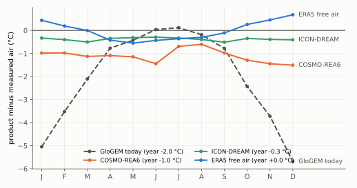
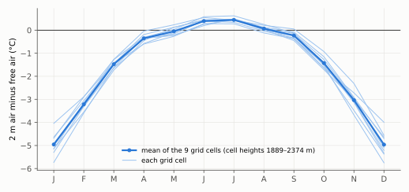

# 13. The air from above: ERA5's free air for the thermal model

> **In short.** Chapter 12 found the thermal model's air about 2 °C too cold at every high station, 4–6 °C in winter.
> We searched for a better climate product for the Alps (literature, and 10 products scored at the same stations).
> The best air is not another product. It is **ERA5's own free air**, the temperature of its pressure levels read at
> the band's height:
> - **The size of the fix.** At the 7 stations above 2800 m (1971–2025) it is +0.1 °C in the year, +0.6 °C in winter
>   and −0.3 °C in summer, against today's −2.1, −5.2 and +0.1 °C.
> - **The cause.** In winter, ERA5's 2 m air at the grid cell is 3.6–5.0 °C colder than its own free air at the same
>   height (a cold layer over the model's smooth snowy ground). GloGEM lapses that cold value up to the summits.
> - **The other products.** COSMO-REA6 halves the winter error but stays about 1 °C cold all year and covers only
>   1995–2019. ERA5-Land and CHELSA keep the error.
>
> Janosch decided on 22 Oct to test the free air in the thermal model now, with the mass balance unchanged. The test
> runs it with and without a snow-surface cooling (Gilbert et al. 2014), because today's too-cold air stands in for
> the missing cooling. A rule fixed before the runs decides.
>
> *Status (22 Oct, afternoon): data, switch and rule done. The review found the free air read a month late (fixed)
> and the site count of rule 3 wrong (amended before any run). The gate on the fixed switch is running; the 72 test
> runs start after the five-part orientation runs. Plan: `plans/2026-10-22_freeair_plan.md`. Report: `glogemflow_development/reports/Alpine
> air temperature beyond ERA5.md`.*

## What we believed

- **The air bias was a known limitation of v1.0** (21 Oct, chapter 12): about 2 °C too cold at all high stations,
  equally at Mont Blanc and Monte Rosa. It partly cancels a second error, the missing radiative cooling of the snow
  surface. The coupled fix was left for later work with a full surface energy balance.
- **ERA5 was the only choice for an Alps-wide, 1940–present forcing.** No other product had been checked at our
  stations.

## What we measured

### Ten products at the same stations

Every product was moved from its grid cell to the station's height with GloGEM's own lapse rate and compared with the
same monthly station series as in chapter 12. The fair window is 2010–2016, the months every product covers.



*Mean of the 7 stations above 2800 m, 2010–2016. Today's air (dashed) is about right in summer and 4–6 °C too cold
from November to February. ERA5's free air stays within ±0.7 °C in every month; ICON-DREAM is close; COSMO-REA6 is
about 1 °C cold in every month.*

| product (7 stations above 2800 m, 2010–2016) | year | winter | summer | match of ups and downs | covers |
|---|---|---|---|---|---|
| GloGEM today (ERA5 2 m air + lapse rate) | −2.0 | −4.8 | 0.0 | 0.87 | 1940– |
| **ERA5 free air at the station height** | **0.0** | **+0.4** | **−0.4** | **0.98** | 1940– |
| ICON-DREAM-EU (DWD) | −0.3 | −0.4 | −0.4 | 0.96 | 2010– |
| E-OBS (uses 2 of the stations) | −0.1 | −0.3 | 0.0 | 0.97 | 1950– |
| MeteoSwiss grid (Switzerland only; uses 4 of the stations) | −0.4 | −0.8 | −0.3 | 0.96 | 1961– |
| COSMO-REA6 (DWD) | −1.0 | −1.2 | −0.9 | 0.92 | 1995–2019 |
| COSMO-R6G2 (its successor) | −1.1 | −1.1 | −1.5 | 0.80 | 2002– |
| ERA5-Land | −1.8 | −4.0 | 0.0 | 0.91 | 1950– |
| CHELSA V2.1 | −2.7 | −5.7 | 0.0 | 0.61 | 1979–2019 |

- **The three stations that feed no gridded product** give the cleanest test. In winter, the free air is +1.1 °C at
  Capanna Margherita, +0.5 at Plateau Rosa and +0.3 at Passo del Moro, against −4.5, −5.6 and −5.0 °C today.
- **Over all observed months (1971–2025, the full ERA5 series):**

  | 7 stations above 2800 m | year | winter | summer | typical monthly error |
  |---|---|---|---|---|
  | GloGEM today | −2.1 | −5.2 | +0.1 | 3.2 |
  | ERA5 free air | +0.1 | +0.6 | −0.3 | 0.8 |

- **COSMO-REA6, the question of 22 Oct.** It is the best of the 2 m products in winter, and the literature ranks it best
  for year-to-year swings (Scherrer 2020). But at our summits it is about 1 °C too cold in every season. It ends in
  August 2019 and cannot drive a 1942–71 spin-up. Its successor R6G2 is half a degree colder in summer.
- **ERA5-Land and CHELSA V2.1 keep the error.** Both start from ERA5's 2 m air and only shift it in height.

### Why ERA5's 2 m air is too cold



*At the nine grid cells of the test (cell heights 1889–2374 m), 1995–2022. In December and January the 2 m air is
about 5 °C colder than the free air at the same height; the gap is gone from May to September.*

```
   real mountains                          ERA5 (0.25°, smooth ground at ~2100 m)
   summit 3500 m  ── in the free air       free air at 3500 m  ── right
        │                                       │
   valley floor   ── cold pool in winter   2 m air over the smooth snowy "plateau" at 2100 m ── cold layer
                                                │  GloGEM: + lapse rate × (band − 2100 m)
                                                ▼
                                           band air at 3500 m  ── carries the cold layer up: 4–5 °C too cold
```

- Bocchetta delle Pisse (2410 m) shows the same without any lapse rate: it sits at its grid cell's height and is
  5.4 °C too cold in winter today, but only 0.6 °C with the free air.
- The literature describes this failure for exactly our method: Cao et al. (2017) found 2 m air plus a pressure-level
  lapse rate too cold at high elevation in the Swiss Alps in winter, and pressure-level air right at mountain sites.

### The data

- **ERA5 monthly means on 18 pressure levels (400–1000 hPa), 1940–2025**, temperature and geopotential, for the whole
  CentralEurope box. Requested by Janosch in two parts on the Copernicus Climate Data Store (the whole series costs
  148,608 units against a limit of 120,000), downloaded through its API on 22 Oct, on the glogem share
  (`climatedata/reanalysis/monthly/era5_pressure_levels/CentralEurope/`, with a README).
- Over 1995–2022 it equals Lander's file, from which GloGEM's lapse rates come, to 0.001 K.
- **The free-air table:** per grid cell and month, the temperature at 500–5000 m every 100 m, linear in the height of
  the levels (`scripts/icetemp_analysis/freeair/make_freeair_table.py`).

### Is the early free air good enough for the spin-up?

The thermal spin-up uses 1942–71, when ERA5 had about 17,000 observations a day against 25 million today. The test
compared the free air with five long summit records. The rule, fixed in the plan: in each, the bias of 1942–71 lies
within ±1 °C of the bias of 1995–2022, for the year and for winter.

| station | year: 1942–71 minus 1995–2022 | winter: the same | passes |
|---|---|---|---|
| Säntis (homogenised) | +0.41 | +0.31 | yes |
| Jungfraujoch (homogenised) | +0.50 | +0.38 | yes |
| Grand St-Bernard (homogenised) | +0.42 | +0.26 | yes |
| Sonnblick | +0.58 | +0.28 | yes |
| Zugspitze | +0.08 | −0.15 | yes |

- The early free air is about half a degree warmer, relative to the stations, than today's. Most of the step falls
  between the 1980s and 1990s; whether ERA5 or the stations cause it is open.
- The year-to-year match in 1942–71 is as good as today's (0.98).
- Today's 2 m air would fail the same test at Zugspitze (−1.27 °C in winter).

### Where the free air is wrong: cold pools

- In winter, free air is 2.4–6.5 °C too warm at valley stations that sit in cold pools: Samedan, Zermatt, Davos,
  Ulrichen, Chamonix and Sion. Today's 2 m air is closer there (−2.8 to +2.2 °C).
- All six stations lie 400–1140 m below ERA5's ground, where the "free air" is ERA5's own extrapolation below its
  terrain.
- **In this test only one borehole band lies below its grid cell:** the Grenzgletscher tongue at 2015 m, 360 m below,
  with 10 of 1135 points. For the Alps-wide map and the mass balance, where many large valley tongues lie below their
  cell, this needs its own treatment.

## What we changed and why

### The switch, in the thermal model only

GloGEM branch `freeair-thermal` (`df7407a`, local), off by default:
- `firnice_thermal_air = 'freeair'`: the thermal model's air is the free air at each band's current height.
- It enters every place the thermal air enters, and only there:
  - each month's surface, rain/snow split and thermal melt;
  - the orientation anomaly;
  - the spin-up's reference climate and its Herron–Langway temperature;
  - the starting profile.
- The mass balance keeps its 2 m air, so its files stay byte-identical.

```
   ERA5 pressure levels ──► table: T at 500–5000 m, every month 1940–2025, per grid cell
                                   │
              band height (now) ───┤  freeair_at()
                                   ▼
   thermal air of the band ──► surface (capped at 0 °C) ──► conduction in firn and ice
                           ──► rain or snow, thermal melt ──► meltwater heat (× f_ref)
   mass balance ◄── unchanged: ERA5 2 m air + lapse rate + T_off
```

### The snow surface: Gilbert's relation

- **Why it is needed.** Today's too-cold winter air stands in for the snow surface's own radiative cooling, which the
  model lacks. Warming the air alone would overheat the cold firn, as the station lapse rates did in chapter 11
  (+2–4 °C at Monte Rosa).
- **Gilbert et al. (2014, Fig. 7) measured, at Col du Dôme over a year (daily means 2012–13):**
  surface = 0.95 × air − 3.4 °C (R² 0.84).
- **Their firn model needed +2.0 K on that skin temperature** for sunlight that penetrates the snow (Trad).
- `firnice_surface_cool = 'gilbert'`: surface = min(0, 0.95 × air + dt), also in the starting profile.

**The three variants (Janosch, 22 Oct):**
- **FA:** free air alone;
- **FAS:** free air with the skin, dt = −3.4;
- **FAG:** free air with Gilbert's model boundary, dt = −1.4. **This is the one the rule judges.**

Nothing is tuned: both numbers come from the paper.

### The rule, fixed before the runs

Committed as icetemp `c66b30f` (`scripts/icetemp_analysis/freeair/freeair_rule.py`) at 14:00 on 22 Oct, before any
free-air run. Against o4 (FRHS with three orientation parts), FAG is adopted if:
1. the error on left-out massifs is not worse by more than 0.2 °C (thermistor precision);
2. the same holds above 3800 m and in the zone 3000–3800 m;
3. regime classes lose at most one site net, and measured frozen beds (found minus temperate called frozen) drop by at
   most one.

FA and FAS are reported. The scorer's dry run on o4 reproduces o4's own scores exactly (1.855 °C).

### The review and the gate

**One reviewer at max effort read the switch before any test run and found two errors:**
- **The free air was read one month late.** `accumulation.pro` moves the month counter on before the thermal forcing
  runs, so every month took the next month's free air: up to 11 K off, about +4 °C in April–May and −4 °C in
  October. The gate check found the same independently: the logged band air missed the table by up to 11.4 K.
  - Fixed in GloGEM `d783f84`: the month's index is now taken where the mass balance reads its own air.
- **Rule 3 counted sites by the name before '@'.** That made Grenzgletscher one "site" of 33 bands (tongue and Monte
  Rosa saddles) and Taconnaz two sites.
  - Amended before any test run (icetemp `c4ac02c`, decision log): sites now come from the site table, 20 sites.

**The gate:**
- **Switches off:** all 373 output files and all 123 matched entities are byte-identical to o4.
- **The surface:** follows min(0, 0.95 × air − 1.4) to the files' rounding (0.0005 °C).
- **Free air on the fixed commit** (tag `fag2`, `d783f84`): the logged band air equals the table to 0.000005 °C in
  every month and band.
- **The mass-balance files are byte-identical** with the switch on: snow in May, snow at the boreholes and the firn
  line, 69 files, in both free-air runs. `snowclim` differs, as it should: it logs the thermal model's temperatures.
- **Switches off on the fixed commit:** byte-identical to o4 again.

**Named before the results, so they are not read into them afterwards:**
- **A third way the free air acts.** Besides the surface and the melt, it raises the Herron–Langway temperature by
  about 2–2.5 K. The firn then turns to ice shallower, and meltwater stops shallower.
- **The orientation tables stay those of o4.** Each band's energy balance was matched to its June–September thermal
  melt under the 2 m air.
  - Under the free air (gate run `fag2`, 1981–2020, 2971 bands) that melt is 9 % smaller: 10–16 % between 3000 and
    4800 m, the summer air being 0.4 K colder.
  - Keeping the tables makes the test differ from o4 in the air alone; the price is factors anchored to slightly too
    much melt. Reported, not rebuilt.
  - Less anchored melt puts flat ground closer to the melt threshold, so the sun-and-shade contrast grows. **The `fa1`
    factors are therefore probably slightly too mild for the free-air climate** (reasoning from how the tables are
    built, not computed).
  - **If the free air is adopted:** one melt-logging run on the free air, `part_factors.py` on it (about 40 min),
    then the part runs.

## What the test gives

*Run on 22 Oct 14:54–17:12 (tag `fa1`, 72 runs: three variants × three parts × eight f_ref, GloGEM `d783f84`,
`week3/chain_freeair.sh`), all 72 OK; merged and scored by the same chain into `week3/freeair/score/`. The baseline stays o4: the five-part build (o5) scored worse (2.13 °C on left-out massifs
against 1.86) and was not adopted before the runs.*

## What is still open

- The test itself (above), then Janosch's decision.
- **The mass balance on free air:** a later stage of its own, with recalibration of all CentralEurope glaciers and the
  GCM correction re-anchored to the new reference (the GMIP4 inputs are already corrected to today's ERA5).
- **Cold pools at low tongues:** free air is too warm in winter valley floors. A terrain-dependent share of ERA5's
  winter cold layer (as REDCAPP does, Cao et al. 2017) is the candidate.
- **Precipitation stays as it is:** ERA5 has no free-air precipitation to read. How it is spread with height is a
  question for the mass-balance stage.
- **The early-period step:** the free air is half a degree warmer before the 1990s relative to the stations; its
  source is open.

## Sources

- Plan: `plans/2026-10-22_freeair_plan.md`. Report with the literature:
  `glogemflow_development/reports/Alpine air temperature beyond ERA5.md` (research notes beside it).
- Station test of the products: `week3/climate_products/` (tables, scripts, `results.md`). Free-air station and
  spin-up checks, cold pools: `week3/freeair/station_checks/`.
- Data: glogem share `climatedata/reanalysis/monthly/era5_pressure_levels/CentralEurope/` (README); table
  `week3/freeair/freeair_CentralEurope.nc`.
- GloGEM (branch `freeair-thermal`, local): `df7407a` (the switch), `d783f84` (this month's free air, after the
  review). icetemp: `c66b30f` (rule, scorer, table, run options), `c4ac02c` (rule 3 by the site table).
- Gate: `week3/launch_freeair_gate.sh` (tag `fag`), `launch_freeair_gate2.sh` (`fag2`, fixed switch);
  `scripts/icetemp_analysis/freeair/freeair_gate_check.py`.
- Literature: Cao, Gruber & Zhang 2017 (GMD 10, 2905); Fiddes & Gruber 2014 (GMD 7, 387); Gilbert et al. 2014 (TC 8,
  689); Monteiro & Morin 2023 (TC 17, 3617); Scherrer 2020 (ERL 15, 044005); Rudisill et al. 2024 (BAMS).

## Glossary

| term | meaning |
|---|---|
| free air | the open air at a given height, read from ERA5's pressure levels away from the ground |
| 2 m air | ERA5's air 2 m above its own smooth model ground |
| pressure level | ERA5 stores the atmosphere on fixed pressures; 700 hPa is about 3000 m, 550 hPa about 5000 m |
| grid cell | the ERA5 0.25° cell a glacier takes its climate from; its height is GloGEM's `hclim` |
| cold pool | cold air that collects in valleys in calm winter weather, below the free air |
| CDS | Copernicus Climate Data Store, ECMWF's download service |
| COSMO-REA6, COSMO-R6G2, ICON-DREAM-EU | regional reanalyses of the German weather service (DWD), 6–6.5 km |
| ERA5-Land, CHELSA, E-OBS | a 9 km land rerun of ERA5; a 1 km downscaling of ERA5; a European station grid |
| FA, FAS, FAG | free air alone; with the skin relation (−3.4); with Gilbert's model boundary (−1.4) |
| Gilbert relation | snow surface = 0.95 × air − 3.4 °C, daily means at Col du Dôme (Gilbert et al. 2014) |
| Trad | Gilbert's +2 K on the surface temperature for sunlight that penetrates the snow |
| REDCAPP | a downscaling method that adds back part of the 2 m-minus-free-air difference in valleys (Cao et al. 2017) |
| FRHS | the central thermal variant (no T_off, ERA5 lapse rate, Herron–Langway meltwater, snow refreezing S) |
| o4 | the current scored run set: FRHS with three orientation parts per band |
| error on left-out massifs | each massif predicted with the f_ref chosen on the others |
| zone | 3000–3800 m, the firn–no-firn transition |
| T_off | the mass-balance temperature correction per glacier; kept out of the thermal model |
| GMIP4 | the GlacierMIP4 projections, whose climate inputs are already corrected to ERA5 |
