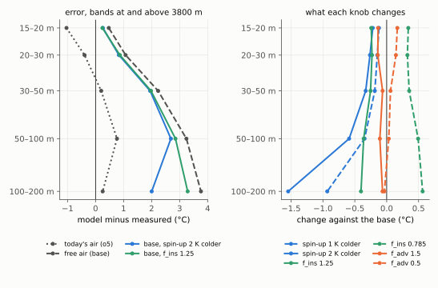
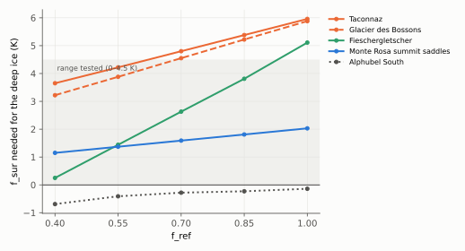

# 14. The right air, and what it reveals

> **In short.** Chapter 13 showed that ERA5's free air matches the mountain stations far better than the 2 m air the
> model used, and that the ice-temperature model gets worse with it.
>
> On 23 Oct Janosch turned the question around:
> - **Better input is kept**, and the model's new errors are read as compensations to find and fix.
> - **A standing rule** follows: input data are judged by their own observations, never by model skill.
> - **The free air becomes the base of the thermal model**, without any surface cooling.
> - **The fixes come from the parameter space first**, before new physics. The candidate for the deep error is the
>   past-climate offset of the spin-up.
>
> **The knob runs (27 Oct):** none of the three knobs removes the deep warmth of the high sites within plausible
> values.
> - The past-climate offset has the right shape but acts mainly below 100 m (−0.77 °C per K there, −0.1 to −0.3
>   above).
> - f_ins shifts every depth evenly; f_adv does almost nothing.
> - The warmth at 30–100 m is made during the run by a winter surface that is too warm: the model's snow surface is
>   the air itself, with no radiative cooling.
>
> **The surface offset f_sur (27 Oct)** works as intended, but does not fix the high sites (1 of 9, as before). Mont
> Blanc's high sites need 2–4 K more surface cooling than Monte Rosa's, and no single value fits both: the old massif
> split again, now measured in kelvin.
>
> *Status (27 Oct, afternoon): Janosch's decision on how to go on.*

## What we believed

- **An input is adopted when the model gets better with it.** The free-air test of chapter 13 was built that way: a
  rule against today's model (o4).
- **The 2 m air's errors were a known limitation** to be fixed together with a surface energy balance in later work.

## What changed: the standing rule

- **The rule (Janosch, 23 Oct):** input and forcing data are chosen by how well they match observations of the input
  itself (stations, radiosondes, gauges), never by whether they improve the model's results. If better input makes
  the model worse, the model needs fixing. This holds for every future forcing dataset.
- **Why it matters here.** The cold 2 m air made the model look right for the wrong reasons. Its winter cold stood in
  for:
  - the snow surface's own radiative cooling;
  - the colder past that the deep ice remembers;
  - f_ref pressed against its upper limit.

  With the right air these three show themselves (chapter 13):

| where (free air, no cooling, against the measurements) | error | likely cause |
|---|---|---|
| below 3800 m, every depth | as before (< 0.2 °C change) | — |
| above 3800 m, 15–20 m | +0.5 °C | the snow surface is not colder than the air |
| above 3800 m, 30–200 m (Mont Blanc sites, Fiescher) | +2.3 to +3.8 °C | the deep ice's colder past; advection tuned to the old air |
| f_ref | 0.40–0.70 instead of 0.85–1.0 | it no longer makes up for the cold air |

- **Gilbert's surface cooling stays out** (Janosch, 23 Oct): no empirical relations that add processes.

## Parameters before physics

**Janosch's question:** can the parameter space absorb these errors instead of new physics? It can, under two
conditions:
- **The parameter acts where the error is.** What matters is the pattern with depth.
- **The boreholes can tell it apart from the others.**

**What the existing parameters can do:**
- f_ref, f_ins and f_adv change the column with nearly the same depth pattern (correlation 0.9–0.98, measured in
  September; chapter 3). They act as one "warmer/colder" knob.
- That knob can absorb the even +0.5 °C near the surface, but not an error that grows with depth.

```
 depth      error with free air        one "warmer/colder" knob        past-climate offset
            (above 3800 m)             (f_ref, f_ins, f_adv)           (spin-up air colder)
 15–20 m    +0.5 °C   ■                 shifts  ■■■                     barely  ·
 30–50 m    +2.3      ■■■■              shifts  ■■■                     some    ■■
 50–100 m   +3.3      ■■■■■■            shifts  ■■■                     more    ■■■■
 100–200 m  +3.8      ■■■■■■■           shifts  ■■■                     most    ■■■■■■
```
*(expected shapes; the knob runs measure them)*

**The past-climate offset** is the spin-up's air shifted colder (`firnice_spinup_dT`):
- The deep, old ice feels it most; the top 20 m hardly.
- It stands for the colder climate before the run. The deep Mont Blanc holes record about 1.5 °C of warming since 1900
  (Gilbert & Vincent 2013).
- **It mirrors the flow model's spin-up** (Janosch). There, the 1961–90 mass balance and the deformation factor A are
  perturbed until each glacier matches its inventory volume and length. Here, the spin-up climate is made colder until
  the ice temperatures match.
- **One difference:** volume and length are known for every glacier, ice temperatures only at the 20 borehole sites.
  So the offset must be one value for the Alps, calibrated at the boreholes and carried to all glaciers, like f_ref.

**The guard against compensating again:**
- every parameter keeps a physically plausible range;
- a parameter at its bound is read as a missing process, not as a result;
- the values are reported as "effective".

## The runs

- **Five parts per band:** v1.0 uses five orientation parts (Janosch, 23 Oct), so the factors were rebuilt for the
  free air on five parts (orientation session, from the stored pixel factors: north faces slightly colder, south
  faces slightly warmer than with the 2 m air).
- **The base `fb1`:** free air, no cooling, f_ref at all 8 values (40 runs).
- **The knobs `fd2`** at f_ref 0.40, 0.55 and 0.70 (90 runs):
  - spin-up air 1 and 2 K colder;
  - f_adv 0.5 and 1.5;
  - f_ins 0.785 and 1.25.
- **The reading, fixed before the runs** (`scripts/icetemp_analysis/freeair/freeair_diag.py`, icetemp `b866c10`): a
  knob matches the deep error if both hold:
  - its depth pattern above 3800 m correlates with the base's error by depth at |r| ≥ 0.9;
  - it halves the 30–200 m error while 15–20 m stays within ±0.5 °C.
- The scorer's dry run reproduces the first free-air test (2.71 °C on left-out massifs, 3.28 above 3800 m).

## What the runs give

*All 130 runs finished on 23 Oct (no failure), merged and scored by 17:09 (`week3/freeair/score_fb1/`,
`week3/freeair/diag_fb1/`).*

**The new base (`fb1`):**
- **Overall:** 2.79 °C on left-out massifs, against 2.13 for today's air on five parts (o5); 3.39 above 3800 m; the
  zone 2.52.
- **f_ref:** the folds choose 0.40–0.70, off its upper limit.
- **Regime classes:** 61 / 9 / 2 bands right.



*Left: model minus measured at the bands at and above 3800 m. The free air (dashed) is close at 15–20 m and too warm
below; the colder spin-up (blue) helps mainly the deepest bin. Right: what each knob changes, against the base at the
same f_ref.*

| setting (bands at and above 3800 m) | error 15–20 m | error 30–200 m | left-out massifs | pattern vs error (r) |
|---|---|---|---|---|
| today's air (o5) | −1.04 | +0.42 | 2.19 | |
| **free air, the base** | **+0.47** | **+2.84** | **2.79** | |
| spin-up 1 K colder | +0.35 | +2.47 | 2.74 | −0.81 |
| spin-up 2 K colder | +0.26 | +2.23 | 2.67 | −0.81 |
| f_adv 0.5 / 1.5 | +0.66 / +0.33 | +2.86 / +2.76 | 2.77 / 2.80 | −0.98 / +0.75 |
| f_ins 0.785 / 1.25 | +0.80 / +0.25 | +3.06 / +2.50 | 2.75 / 2.78 | +0.91 / −0.91 |

*(f_ref chosen leaving one massif out among 0.40, 0.55 and 0.70)*

**By the reading fixed before the runs, no knob explains the deep warmth.** It needed the 30–200 m error halved
(≤ +1.42 °C). The best is the spin-up 2 K colder, from +2.84 to +2.23.

**What each knob does:**
- **The past-climate offset has the right shape but is too weak where most deep readings are.**
  - Per kelvin of colder spin-up: −0.77 °C at 100–200 m, but only −0.1 to −0.3 °C at 15–100 m.
  - Why: the 54 years of the run (1971–2025) re-set the column down to about 50 m (heat diffuses about 45 m in that
    time). So the warmth at 30–100 m is made during the run, not before it.
  - Per site (30–200 m): it helps Fieschergletscher clearly (+2.8 → +1.2 °C), but Bossons (+4.0 → +3.5) and Taconnaz
    (+4.8 → +4.6) only a little.
- **f_ins shifts every depth about evenly** (−0.25 to −0.40 °C at 1.25): it is the "warmer/colder" knob. Over the
  depth bins it correlates with the spin-up offset at 0.83, so the boreholes only partly tell the two apart.
- **f_adv hardly moves anything** (at most 0.17 °C).
- **Below 3800 m no knob moves anything** (less than 0.06 °C).

**What we infer (from these and the chapter 13 runs, not a separate test):**
- The deep warmth at the high Mont Blanc sites is made by the surface during the run. With the free air the winter
  surface is 4–5 K warmer, because the model's snow surface is the air temperature itself; a real snow surface
  radiates and is several kelvin colder in winter (3.4 K measured at Col du Dôme).
- f_ref makes up for it near the surface (0.40–0.70, less meltwater heat), so 15–20 m look right while 30–100 m carry
  the warm winters.
- The chapter 13 runs agree: the surface cooling of the skin variant (−3.4 K) cooled every depth by 1.1–1.5 °C, the
  strongest lever measured so far.
- **Within plausible values the parameters we have cannot replace the missing surface cooling.** The past-climate
  offset is worth keeping for the deepest ice (100–200 m) and for Fiescher.

## The surface offset f_sur (27 Oct)

**Why:** the knob runs left one candidate, the snow surface's own cooling. Janosch chose to try it as a calibrated
parameter instead of new physics: **f_sur**, the surface = min(0, air − f_sur), fitted together with f_ref, with f_ins
and f_adv fixed.

**Built and checked:**
- **GloGEM `61ada09`, `firnice_f_sur`:** the surface in every month and in the starting profile; off at 0.
- **Gate:** f_sur = 0 is byte-identical to the base. f_sur = 3 leaves the 69 mass-balance files identical and puts the
  surface exactly 3 K below the air.
- **Review at max effort:** the code is right, but the first reading pooled all high readings into one mean, where
  Mont Blanc and Monte Rosa cancel. Before any run the reading was changed:
  - judge each band at and above 3800 m within ±1.7 °C at 15–20 m and at 30–200 m, and count sites;
  - it passes if more high sites fit than with the base and at least half of them, and f_ref and f_sur stay off
    their grid edges in most folds;
  - f_ref 0.40 was added.

**The test** (tag `fs1`): f_sur 0 / 1.5 / 3.0 / 4.5 K × f_ref 0.40–1.00, five parts, 75 runs, all OK.

**By the reading, f_ref + f_sur does not fix the high sites:**
- **Sites:** still 1 of 9 high sites fits (Alphubel South), as with the base.
- **Overall:** the error on left-out massifs is 2.81 °C against 2.79.
- **The folds** split along the massifs. Predicting Monte Rosa, the other massifs (mostly Mont Blanc) choose f_sur 0 and
  f_ref 0.40. Predicting Mont Blanc, they choose f_sur 1.5 and f_ref 1.0.
- **In sample** the best pairs reach 2.31 °C (f_sur 1.5 with f_ref 0.85, or f_sur 3.0 with f_ref 1.0), against 2.41
  for the best base. The pairs that fit most sites fit at most 5 of 9 (f_sur 3.0, f_ref 0.70).



*The f_sur each high site needs for its deep readings to match, at each f_ref (interpolated; f_sur acts almost as an
even offset at cold sites). Mont Blanc's Taconnaz and Bossons need 2–4 K more than the Monte Rosa saddles at every
f_ref; Fieschergletscher crosses between them; Alphubel needs none.*

**What it shows:**
- **f_sur works as intended:** at the cold sites it cools every depth almost evenly (f_sur 3: about −3 °C).
- **It cannot close the gap between the massifs.** The Mont Blanc minus Monte Rosa difference of the deep error does
  not move with f_sur at all (2.21 °C at f_ref 0.40, whatever f_sur is); only f_ref changes it (2.2 at 0.40 to 3.9 at
  1.00).
- **The remaining problem is the massif split, not the air and not the surface.** It is the same split as since
  chapter 8 (f_ref 0.15–0.23 at Mont Blanc, 1.0 at Monte Rosa), now measured as a surface cooling: Mont Blanc's high
  sites need 2–4 K more than Monte Rosa's.

## What is still open

- Janosch's choice of the parameter space for the calibration (Step 3 of the plan).
- The calibration (Step 5 plan of 20 Oct) on the free air with that parameter space.
- The mass balance on the free air.

## Sources

- Plan: `plans/2026-10-23_freeair_base_plan.md`; decision log, 23 Oct.
- GloGEM `freeair-thermal` `d783f84` (no change for this chapter). icetemp `b866c10` (scorer, plan, decision log).
- Factors: `week3/orient_parts5_fa` (five parts, free air), hole parts `week3/orient_parts5`.

## Glossary

| term | meaning |
|---|---|
| free air | ERA5's pressure-level temperature read at the band's height |
| standing input rule | input data are judged by their own observations, never by model skill |
| f_ref | the share of meltwater that refreezes and heats |
| f_ins | the scaling of the snow and firn conductivity (insulation) |
| f_adv | the scaling of ice advection |
| past-climate offset | the spin-up's air shifted colder (`firnice_spinup_dT`) |
| depth pattern | how a parameter changes the modelled temperature at each depth |
| effective parameter | a parameter whose value also absorbs missing processes |
| fb1, fd2 | the new base; the knob runs |
| o4, o5 | today's air with three and five orientation parts |
| five parts | gentle, north, east, south and west shares of each band, each with its own melt factor |
| error on left-out massifs | each massif predicted with the f_ref chosen on the others |
