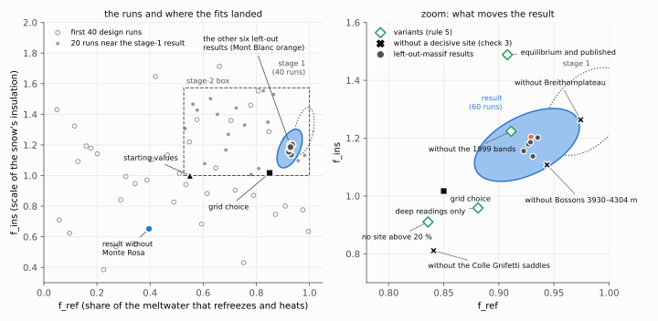
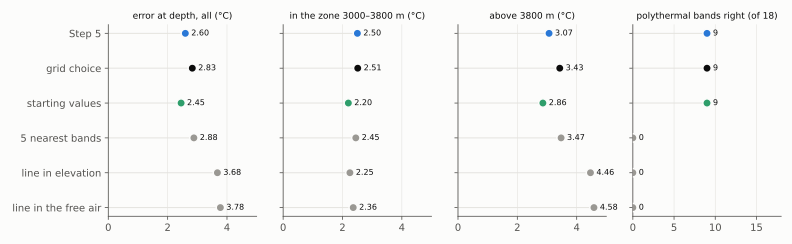
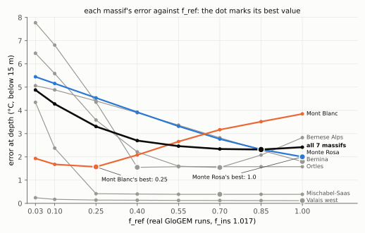
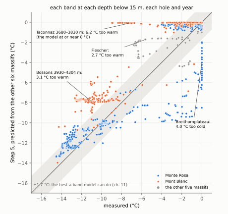
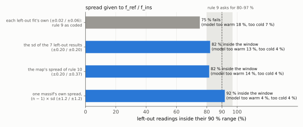

# 16. Step 5: the calibration, and why its own rule says no

> **In short.** On 27 Oct Janosch chose the physics for the calibration (option A, chapter 14):
> - the free air;
> - a snow surface 1.4 K colder than the air, fixed from the literature;
> - five orientation parts per band;
> - f_ref and f_ins calibrated.
>
> On 28 Oct he approved the rules that decide the result. They were committed before any fit (icetemp `3467851`).
>
> **The calibration ran overnight on 60 GloGEM design runs:** f_ref 0.93 ± 0.02 and f_ins 1.18 ± 0.06. The data tell
> the two apart, and the error model fits the readings.
>
> **On massifs it has not seen, it beats the grid choice** (2.60 against 2.83 °C) and equals it in the zone. But its
> 90 % ranges contain only 75 % of the readings, and the rule asks for 80–97 %. **So rule 9 does not adopt it.**
>
> **The cause is the massif split once more.**
> - Each calibration takes the value of whichever of Mont Blanc and Monte Rosa it contains: 0.40 without Monte Rosa,
>   0.92–0.94 otherwise.
> - Yet each one claims to know f_ref to ±0.03.
> - With the disagreement between the massifs added, the ranges become about right: 82 %, or 92 % with one massif's
>   own spread. This is a check made after the results were seen, reported only.
>
> **Against simple rules,** the model wins above 3800 m and is the only method that gets polythermal bands right. In
> the zone, a line in elevation does as well.
>
> *Status (29 Oct): two decisions for Janosch, on adoption and on the map's spread.*

## What we believed

- **The plan of 20 Oct (after the review panel):** a Bayesian calibration gives f_ref and f_ins together with an
  honest uncertainty, under three conditions:
  - the error model is right;
  - single sites are checked;
  - the result is tested on massifs it has not seen.
- **Adoption:** only if the result does at least about as well as the simple grid choice there.
- **From chapter 14 we knew** that the massif split sits in the boreholes themselves. Warm, meltwater-soaked bands
  and cold, dry ones lie side by side at the same height, and one f_ref cannot fit both. We therefore expected the
  left-out calibrations to disagree.
- **What we did not know** is whether the calibration's own uncertainty would admit that disagreement.

## How the calibration works

```
 GloGEM at 60 pairs     ──►  an emulator: a fast      ──►  every reading compared,   ──►  the best f_ref and f_ins,
 of f_ref and f_ins          statistical stand-in that      allowing for the misses        and how sure we are
 (each in 5 orientation      predicts any pair in           the error model expects        (the posterior)
 parts: 5 runs per pair)     between
```

**The error model** says how far the model may normally miss a reading, and which readings miss together. Its form,
C6b, was chosen by evidence (rule 1). The miss of a reading is the sum of parts:

| part | what it stands for | size at the result (sd) |
|---|---|---|
| band | shared by nearby depths of one band; fades over about 120 m of depth | 1.6 °C |
| hole | shared by all readings of one borehole | 1.2 °C |
| hole and year | one visit to one hole | 0.2 °C |
| site | shared by the holes of one site | 0.9 °C |
| single reading | its exact depth and month, top 15 m only | 0.6 °C |
| heavy tails | some sites miss much more than others (ν = 2.6; small ν = large differences) | — |

The sizes are estimated from the data, started at C6b and checked once at the first result. A second estimate gained
nothing (0.00 log-units), so they stayed.

## The rules, fixed before any fit

The rules plan (`plans/2026-10-27_step5_rules_plan.md`) fixed every choice that decides the result.

| rule | what it fixes, in short |
|---|---|
| 1 | the error model C6b, its sizes re-estimated once |
| 2 | sites by a written rule: holes within 1 km and 150 m, chained |
| 3 | three checks per site: do its misses fit the error model; is its offset unusual (a 1-in-300 chance); does leaving it out move the result by more than its uncertainty ("decisive") |
| 4 | can f_ref and f_ins be told apart; if not, f_ins is fixed at 1.0 |
| 5 | five variants beside the main fit, reported |
| 6 | very deep, very old ice left out at low-accumulation summits ("0.6 m w.e. per year or less") |
| 7 | withdrawn: readings above 0 °C measure air or water, not ice, and stay dropped |
| 8 | the benchmark: each massif predicted from the other six; Step 5 against the grid choice, the starting values and five simple rules |
| 9 | **adoption:** at worst 0.1 °C worse than the grid choice (with 90 % confidence) overall and in the zone, **and** 90 % ranges holding 80–97 % of the readings |
| 10 | the map's uncertainty for glaciers without boreholes: the larger of the calibration's own spread and the spread between the left-out results |

**Before the rules commit, an independent review** of the code (maximum effort) found four errors that would have
changed the result, and all four were fixed:
1. The resampling of whole sites split one glacier outline into its sites, so a resampled site counted as a glacier
   of its own.
2. The variant "only holes in equilibrium and published" dropped whole depths that a published hole shared with an
   unpublished one. It now leaves out single readings.
3. The left-out calibrations started from the main fit's error sizes, which had already seen the left-out massif.
   They now start from C6b.
4. Check 3 (decisive sites) was computed but never used. It now widens the map's uncertainty.

The whole chain then ran once on stand-in data (a code test) and passed. The scripts refuse to run on uncommitted
code, on runs at the wrong settings, on a missing prediction, or on a different set of design runs.

## The runs

| when | what | GloGEM runs |
|---|---|---|
| 27 Oct, until 18:05 | 40 design pairs spread over the whole range (`s5d00`–`39`) | 200 |
| 28 Oct, from 11:48 | the yardsticks: f_ref 0.03–1.00 at f_ins 1.017 (`s5g00`–`07`), the starting values (`s5s00`) | 45 |
| 28 Oct, about 15:45 | **the rules commit `3467851`** | — |
| 15:46–16:40 | stage 1: the fit on 40 runs, the left-out fits, the box for 20 more runs | — |
| 16:41–18:44 | 20 design pairs in the box (`s5d40`–`59`) | 100 |
| 18:45–20:48 | the fit on 60 runs, site checks, variants, left-out fits, a real run at each left-out result and at the main result (`s5f0`–`6`, `s5m00`), the benchmark | 40 |
| about 21:30 | the check of the ranges after the fact | — |

All 385 GloGEM runs were OK. Every step ran automatically on vierzack07 and 03, behind a guard that stopped if the
rules code changed.



*Left: the 60 design runs (open circles: the first 40; dots: the 20 in the stage-2 box), the stage-1 result (dotted,
90 % region) and the final result (blue). Six of the seven left-out results lie inside the final region; the one
without Monte Rosa lies far away. Right: a zoom showing what moves the result: the variants (green) and the result
without each decisive site (crosses).*

**What the figure shows:**
- **The 20 extra runs moved the result** from 0.98 / 1.29 (stage 1) to 0.93 / 1.18. So the emulator had too few runs
  near the answer (inferred).
- **Six left-out results agree closely** (f_ref 0.92–0.94, f_ins 1.14–1.20). The seventh, without Monte Rosa, gives
  f_ref 0.40 and f_ins 0.65.
- **f_ref is robust to every variant (0.84–0.93); f_ins is not (0.91–1.49).**

## What the calibration gives

- **f_ref 0.93 ± 0.02, f_ins 1.18 ± 0.06,** correlation +0.50. The data narrow f_ins to 0.18 of its starting
  spread, so rule 4 keeps both parameters.
- **The error model fits:** the misses average 1.15 expected misses (shallow 1.29, deep 1.07; 1 would be perfect).
- **The fit's health checks pass** (convergence, enough design runs near the result, the gap between the best point
  and the mean).
- **The emulator check fails** (reported only). With the emulator's own uncertainty, the result could move by about 1
  sd in f_ref and 2 sd in f_ins.
  - It does not matter for the benchmark, which uses real GloGEM runs at every left-out result.
  - There the emulator and GloGEM agree within 0.23 °C at every reading (massif errors 2.58 against 2.60 °C).

**The site checks (rule 3):**
- **Check 1:** every site's misses fit the error model, except Grenzgletscher at 2015 m (the tongue, 10 readings).
- **Check 2:** no site has an unusual offset.
- **Check 3:** three sites are decisive, because leaving any one out moves the result by more than its uncertainty:
  - Breithornplateau: f_ref +0.05, f_ins +0.09;
  - Bossons 3930–4304 m (the Dôme du Goûter and Col du Dôme holes): f_ins −0.07;
  - the Colle Gnifetti saddles (Grenzgletscher 3898–4485 m): f_ref −0.09, f_ins −0.37.

  They widen the map's f_ins uncertainty to ±0.37. They do not stop adoption.
- **The named check** (without the 1999 campaign's 14 shallow bands) moves f_ref −0.015 and f_ins +0.045. It is not
  decisive.

**The variants (rule 5):**

| variant | f_ref | f_ins |
|---|---|---|
| main | 0.93 | 1.18 |
| deep readings only | 0.88 | 0.96 |
| no site above 20 % of the information on f_ref | 0.84 | 0.91 |
| holes in equilibrium and published only | 0.91 | 1.49 |
| f_ins starting spread twice as wide | 0.93 | 1.18 |
| without the 1999 shallow bands | 0.91 | 1.22 |

## The test on unseen massifs

Each massif is predicted by a calibration that has not seen it, made on the other six (rule 8). The simple rules are
fitted on the same six.



*Error at depth below 15 m (each glacier outline counting equally) overall, in the zone and above 3800 m, and the
number of polythermal bands classed right. Blue: Step 5. Black: the grid choice. Green: the starting values (f_ref
0.55, f_ins 1.0). Grey: the simple rules.*

| method | bands in the right class (of 105) | polythermal bands right (of 18) | sites right (of 22) |
|---|---|---|---|
| Step 5 | 73 | 9 | 9 |
| grid choice | 72 | 9 | 8 |
| starting values | 75 | 9 | 10 |
| the 5 bands nearest in elevation | 76 | 0 | 12 |
| a line in elevation | 72 | 0 | 9 |
| a line in the free air | 72 | 0 | 9 |
| elevation thresholds | 74 | 0 | 11 |
| Suter's cold-firn limit | 60 | 0 | 6 |

- **Step 5 beats the grid choice** by 0.23 °C overall (90 % range: 0.42 better to 0.02 worse, resampling whole
  sites), and equals it in the zone (2.50 against 2.51).
- **The starting values do 0.14 °C better than Step 5,** but that is within the uncertainty (0.22 better to 0.58
  worse). They win at Mont Blanc and the Bernese Alps and lose at Bernina.
- **Above 3800 m the model clearly beats the simple rules** (2.9–3.4 against 3.5–4.6 °C).
- **In the zone a line in elevation beats Step 5** (2.25 against 2.50 °C) and matches the starting values, as in the
  quick check of 21 Oct (plan of 20 Oct).
- **No simple rule gets a single polythermal band right.** The 5-nearest rule gets the most bands right by calling
  almost everything cold.
- **The frozen beds are the same for every model version:**
  - 11 of the 14 measured frozen beds found, among them 11 of the 12 very cold ones;
  - neither of the 2 close to melting (Tête Rousse at 65 m, Corvatsch);
  - one temperate bed called frozen (Hohsaas at 21.5 m).

## Why each left-out massif gets the wrong value



*The error at depth of each massif for the eight grid values of f_ref (real GloGEM runs at f_ins 1.017); the dot marks
each massif's best value. Black: all seven massifs together.*

- **Mont Blanc wants f_ref 0.25; Monte Rosa wants 1.0.** Together, the seven massifs want about 0.85 (2.32 °C), but
  the curve is flat between 0.55 and 1.0 (2.32–2.46 °C).
- **Leaving one massif out hands it the other's answer.**
  - Without Mont Blanc, Monte Rosa decides the fit: f_ref 0.93, and Mont Blanc's error is 3.48 °C instead of the 1.57
    it could have.
  - Without Monte Rosa, Mont Blanc decides: f_ref 0.40, and Monte Rosa's error is 3.39 °C instead of 2.00.
- **The grid choice suffers most** (2.83 °C), because it jumps between grid values (1.0 without Mont Blanc, 0.55
  without Monte Rosa).



*Every reading below 15 m (1135 points: one per band, depth, hole and year), against Step 5's prediction from the
other six massifs. The grey band is ±1.7 °C, about the best a band model can do (chapter 11).*

**The misses belong to whole sites, not to single readings:**
- **Mont Blanc (orange), predicted with Monte Rosa's f_ref:**
  - the cold summit ice at Dôme du Goûter and Col du Dôme (measured −9 to −13 °C) comes out at about −8 °C: 3.1 °C
    too warm;
  - Taconnaz at 3680–3830 m (measured −1 to −9 °C) comes out at or near the melting point (0 to −4 °C): 6.2 °C too
    warm on average.
- **Monte Rosa (blue), predicted with Mont Blanc's f_ref:**
  - the warm bands measured near 0 °C come out 2–9 °C too cold: Breithornplateau (1991) and the 1999 bands of Lys and
    the Grenz saddles at 15–22 m;
  - the deep cold ice of the saddles (−12 to −14 °C) is predicted well even so.
- **These are the warm and cold bands of chapter 14.** No single f_ref fits both.

## Rule 9: not adopted

| check | needed | Step 5 | |
|---|---|---|---|
| error, all | at worst 0.1 °C worse than the grid choice (90 % confidence) | 0.03 °C *better* | passes |
| error, zone | the same | 0.004 °C better | passes |
| the 90 % ranges | hold 80–97 % of the readings | **75 %** | **fails** |

- **By the rule, version 1.0 keeps the grid choice with its spread:** f_ref 0.85 at f_ins 1.017. That is the best
  grid value on all seven massifs; 0.70 is nearly as good, 2.34 against 2.32 °C. Its spread between the seven
  left-out choices is 0.16.
- **The ranges are too narrow because each left-out calibration is too sure of itself.** It claims to know f_ref to
  ±0.02–0.04, yet the left-out results scatter by 0.20.
  - Its ±0.02 is the uncertainty if all massifs were alike.
  - They are not, and the error model cannot see that, because it describes misses around one f_ref.

**A check after the fact, not a rule** (`scripts/icetemp_analysis/step5/coverage_spread.py`): the same 90 % ranges
with the parameters spread as for the map.



*Share of the left-out readings inside their 90 % range when the left-out results carry four different spreads of
f_ref and f_ins. Shaded: the window rule 9 asks for (80–97 %); dashed: 90 %.*

- **Rule 10 already adds the spread between massifs to the map.** With it, the ranges become about right: 82 %.
- **Only one massif's own spread** gives ranges that hold about 90 % (92 %), missing equally often on the warm and the
  cold side (4 % each).
  - That spread is (n − 1) times the sd of the left-out results.
  - It says how far one massif's own best value lies from the overall result.
- **With the narrower spreads most misses are too warm** (13–18 %). Those are the cold Mont Blanc sites.

## What this means (inferred)

- **The calibration itself works.** The error model fits, the parameters are told apart, and it beats the grid
  choice on unseen massifs.
- **But f_ref is not a property of the Alps.** It differs between massifs (0.25 at Mont Blanc, 1.0 at Monte Rosa), and
  one value for all hides that.
  - For a glacier without boreholes, the honest uncertainty in f_ref is the spread between massifs (0.20, or 1.2 for
    one massif's own value), not the calibration's ±0.02.
- **Calibrating adds little skill over the starting values on unseen massifs** (within the uncertainty). What it adds
  is the error model and an honest uncertainty, which the probability map needs.
- **Where the model earns its place:** above 3800 m, and in the polythermal structure, which no simple rule can
  give. In the zone, a line in elevation is as good.
- **The split limits the map.** Until something in the model makes one high band wet and its neighbour dry (chapter
  14, follow-ups 1 and 2), the map's probabilities stay wide wherever f_ref matters, in the zone and on high warm
  bands.

## What we changed and why

- **The rules, the error model and the benchmark code:** icetemp `ab923b3` (sites by rule, deep old ice by measured
  accumulation, review fixes) and **`3467851` (the rules commit)**; the plan records it in `70d937e`.
  - New in the library: single readings can be left out of the fit (`calibrator.fit_exclude_points`), for the
    variant "equilibrium and published" (review finding 2), with a test against scipy.
- **The result and the check after the fact:** icetemp `2e8410b`. It adds `step5/coverage_spread.py`, which first
  reproduces the benchmark's 75 % before it writes anything, the result section of the rules plan, and two rows of
  the decision log.
- **GloGEM:** no change. The runs used the free-air worktree at `61ada09`.

## What is still open

1. **Decision A, adoption** (Janosch).
   - (a) Follow rule 9: version 1.0 takes the grid choice (f_ref 0.85, f_ins 1.017) with its spread.
   - (b) Adopt Step 5 against the rule, logged as a deviation like S and orientation.

   **Recommendation (a):** the rule was fixed to catch an over-confident calibration, and it did. The two values of
   f_ref lie close (0.85 against 0.93), well inside the map's spread of ±0.20, and the paper can say that the rule
   fixed in advance was followed.
2. **Decision B, rule 10's spread** for glaciers without boreholes (Janosch).
   - (a) One massif's own spread, (n − 1) × sd.
   - (b) The sd of the left-out results.

   **Recommendation (a):** it is the only spread whose ranges hold what they claim (92 %). Its cost: for an unseen
   massif, f_ref can then lie anywhere in 0.03–1.0, so the map's probabilities stay wide in the zone. That is what the
   data support.
3. **Step 5 will be redone on the free-air mass balance** (decision of 28 Oct, chapter 15), with the same rules
   committed again. Decisions A and B set how that run is read.
4. **The extra runs at the result** (step 4.3 of the plan):
   - without stretching the columns, as the map will run;
   - FRH and H;
   - the past-balance correction;
   - advection at half and 1.5 times;
   - a colder climate before 1942;
   - the measured ice thickness at the bed holes.
5. **The two follow-ups of chapter 14** on the cause of the split: the day-to-day temperature spread of each glacier's
   climate cell, and hourly energy-balance melt at warm and cold bands.
6. **The emulator check fails** (reported). With more design runs near the result it should pass. It matters only if
   the emulator is used where no real run checks it.

## Sources

- Plans: `plans/2026-10-20_step5_plan.md` (the approved plan, revised after the panel);
  `plans/2026-10-27_step5_rules_plan.md` (the rules, approved 28 Oct; result section of 28 Oct evening). Decision log,
  27–28 Oct.
- Scripts: `scripts/icetemp_analysis/step5/` (`step5_common.py`, `fit_step5.py`, `site_checks.py`, `variants.py`,
  `benchmark.py`, `stage2_design.py`, `coverage_spread.py`); config `config/step5_centraleurope_parts5.yaml`.
- Results: `data/bayescal/step5_parts5/`: `fit/` (fit.json, site_checks.csv, named_check.json, variants.json),
  `benchmark/` (folds.json, benchmark.json, benchmark_points.csv, frozen_bed_step5.csv, coverage_spread.json); stage 1
  in `fit40/`, `benchmark40/`.
- Runs: `s5d00`–`59` (design), `s5g00`–`07` and `s5s00` (yardsticks), `s5f0`–`6` and `s5m00` (at the results); logs
  in `week3/step5_main/` and `week3/logs/chain_step5_*.log`.
- icetemp `ab923b3`, `3467851`, `70d937e`, `2e8410b`; GloGEM free-air worktree `61ada09`.
- Figures: `figures/make_ch16.py`.

## Glossary

| term | meaning |
|---|---|
| f_ref, f_ins | share of the meltwater that refreezes and heats; scale of the snow's insulation |
| option A | the physics of the calibration: free air, f_sur 1.4 K fixed, five orientation parts, f_ref and f_ins calibrated |
| design runs | GloGEM runs at chosen pairs of f_ref and f_ins, from which the emulator learns |
| emulator | a fast statistical stand-in for GloGEM, trained on the design runs |
| error model (C6b) | how far the model may normally miss a reading, and which readings miss together |
| posterior | the calibrated values with their uncertainty |
| sd | standard deviation: the usual size of a spread |
| 90 % region / range | where the value (or a reading) should lie 9 times in 10 |
| coverage | how often the readings actually lie inside their 90 % ranges |
| site | holes within 1 km and 150 m of each other, chained |
| decisive site | a site whose removal moves the result by more than its uncertainty (check 3) |
| variant | the same calibration on a different choice of readings, reported beside the main one |
| left-out calibration, fold | one massif left out, everything calibrated on the other six, then the left-out massif predicted |
| grid choice | f_ref picked from eight fixed values by the same leave-one-massif-out procedure, f_ins 1.017 |
| starting values | f_ref 0.55, f_ins 1.0: the values before any calibration |
| error at depth | root-mean-square miss below 15 m, each glacier outline counting equally |
| zone | 3000–3800 m, the firn–no-firn transition |
| polythermal band | a band with both cold and temperate ice in its column |
| check after the fact | computed after the results were seen; reported, never used to decide |
| one massif's own spread | (n − 1) × the sd of the left-out results: about how far one massif's best value lies from the overall result |
| emulator check | whether the result stays put when the emulator's own uncertainty is included |
| massif split | Mont Blanc's boreholes want little meltwater heat, Monte Rosa's much; since chapter 8 |
